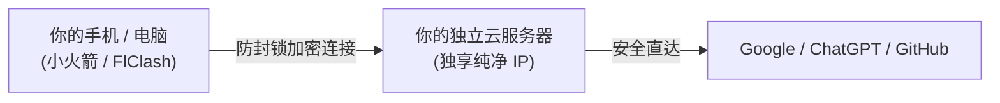

# 🚀 Evergreen · OwnLine (长青 · 个人专线)

> **帮小白轻松搭建安全、可控、便宜的专属 VPN 节点。**  
> 不用自己找教程，自备服务器 2 分钟全自动装好，一个私有网页多端同步。资产 100% 自有，独享原生纯净 IP，非合租、非机场，不卖流量，可选挂载美国家宽。

[](https://github.com/AdgaiWalker/VPN-OwnLine/releases/tag/v0.6.0)
[](LICENSE)
[](https://github.com/SagerNet/sing-box)
[](https://github.com/caddyserver/caddy)
[-success.svg)]()

---

## ⚡ 它是如何工作的？



* **安全（官方原版，零数据收集）**：只安装知名开源安全底座（[sing-box](https://github.com/SagerNet/sing-box) 与 [Caddy](https://github.com/caddyserver/caddy) 原版），绝无后门；不记录上网历史，密码与密钥物理不出机。
* **可控（资产自有，一个网页多端同步）**：服务器是你自己的，独享纯净 IP，哪怕本仓库关闭也永久可用；手机电脑扫码一键连通。
* **便宜（几块钱起步，不卖流量）**：自备海外云服务器（0 元至几块钱/月），不收月租、不卖流量，彻底告别商业机场按月按量割韭菜。

---

## 📋 准备清单与花费预估

在开始前，你只需准备以下原材料（费用由云厂商直接收取，丰俭由人）：

| 原材料类别 | 推荐方案 | 预估花费 | 说明与官方链接 |
| :--- | :--- | :--- | :--- |
| **1. 海外云服务器**<br>*(必选 · 购买时务必选香港/新加坡/硅谷等海外机房)* | **阿里云高校学生计划** | **0 元 或 9.9 元/月** | [阿里云「云工开物」](https://university.aliyun.com/)（高校学生与青年开发者专享算力补贴） |
| | **甲骨文云 Oracle** | **0 元 / 月** | [Oracle Always Free](https://www.oracle.com/cloud/free/)（官方永久免费额度，需外币信用卡） |
| | **RackNerd** | **约 7 元 / 月** | [RackNerd](https://www.racknerd.com/)（便宜实惠的海外年付促销小机器） |
| | **腾讯云轻量海外** | **约 24 元 / 月** | [腾讯云轻量应用服务器](https://cloud.tencent.com/product/lighthouse)（微信/支付宝直付，省心稳定推荐） |
| **2. 客户端上网软件**<br>*(必选 · 免费开源为主)* | **iPhone / iPad** | 免费通道 | [Shadowrocket (小火箭)](https://apps.apple.com/app/shadowrocket/id932747118)（控制台内提供免费美区通道，一键自动配好） |
| | **安卓 / Windows / Mac** | **完全免费** | [FlClash](https://github.com/chen08209/FlClash)（纯净开源，控制台提供免翻墙下载直链） |
| | **电脑专业版** | **完全免费** | [Clash Verge Rev](https://github.com/clash-verge-rev/clash-verge-rev)（适合喜欢规则分流的进阶用户） |
| **3. 真实美国家庭宽带**<br>*(可选 · 进阶防封号)* | **Webshare 静态住宅** | **+7 元 / 月** ($12/年) | [Webshare](https://www.webshare.io/)（挂载真实美国家宽，解决 ChatGPT 机房 IP 拒访） |

---

## 🚀 2 分钟极速装配

材料就绪后，选择以下任意一种方式完成部署：

### 方式 1：交给本地 AI Agent 全自动装配（⭐ 最推荐 · 小白首选）
不用打开云服务器黑框终端，不用学任何 Linux 命令。  
在 **Cursor / Claude Code / Antigravity / Windsurf** 等 AI 工具中，直接把下面这句话连同你的服务器信息发给 AI：
```text
克隆 https://github.com/AdgaiWalker/VPN-OwnLine.git，通过 SSH 连接我的服务器 [IP:端口:密码]，帮我全自动装配好，并把管理网址和初始账号密码发给我。
```
> AI 会自动帮你完成环境检测、安全加固与服务验证，装好后直接把管理后台链接和密码交还给你。

---

### 方式 2：自备服务器终端一行命令装配（工程师极客）
如果你熟悉终端，登录云服务器网页命令行（Ubuntu 22.04 / Debian 12），粘贴并回车：
```bash
curl -fsSL https://raw.githubusercontent.com/AdgaiWalker/VPN-OwnLine/main/deploy/bootstrap.sh | sudo bash
```
* **运行完毕后，屏幕直接打出你的专属管理后台网址与密码**：
  ```text
  专属管理地址: https://43.153.56.137:8443/
  面板账号:   admin
  初始密码:   xxxxxxxxxxxxxxxxxxxx
  ```

---

### 共同的下一步：登录后台，一键连接上网

用浏览器打开上述得到的管理网址（`https://服务器IP:8443/`），输入账号密码登录：

* **页面正上方会提供你的专属订阅链接和二维码**：
  ```text
  专属订阅链接: https://43.153.56.137:8443/s/c2763f350db2d011
  ```
  > **如何连通**：
  > * **手机（小火箭）**：点网页上的【一键连接本机】或手机扫码，App 自动唤醒并写入线路，轻按开关即通。
  > * **电脑（FlClash）**：点【复制订阅链接】，在软件里粘贴保存，就会自动刷出绿色可用线路，点连接即通。

> 💡 **避坑提示**：  
> 1. 第一次用 IP 网址打开时，浏览器提示“证书不安全”属于正常现象，点击「高级 ➔ 继续访问」即可。  
> 2. 如果网页一直转圈打不开，是因为云厂商默认关了端口，去云控制台把防火墙（安全组）的 **8443** 和 **443** 端口放行即可。

---

## 🧱 开源基石致敬

本项目建立在以下卓越的开源技术之上：
* [sing-box](https://github.com/SagerNet/sing-box) - 下一代通用代理核心引擎
* [Caddy](https://github.com/caddyserver/caddy) - 现代化自动证书管理与反向代理网关
* [Shadowrocket](https://apps.apple.com/app/shadowrocket/id932747118) / [FlClash](https://github.com/chen08209/FlClash) / [Clash Meta](https://github.com/MetaCubeX/mihomo) - 客户端标准生态

---

## ⚖️ 免责声明

本项目为开源私有网络管理与自动化部署工具，仅供个人合规网络管理与技术研究。使用者自备服务器并遵守当地法律法规。本项目不提供、不托管、不中转任何网络代理服务，不对任何使用者行为承担连带法律责任。
