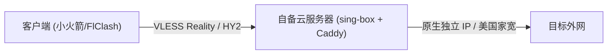

# 🚀 Evergreen · OwnLine (长青 · 个人专线)

> **“不用自己找教程，一台服务器 2 分钟全自动装配，一个私有地址多端同步。”**  
> 个人专属出海专线中枢。100% 资产自有，不卖流量，非商业机场，可选挂载美国家宽。

[](https://github.com/AdgaiWalker/VPN-OwnLine/releases/tag/v0.5.0)
[](LICENSE)
[](https://github.com/SagerNet/sing-box)
[](https://github.com/caddyserver/caddy)
[-success.svg)]()

---

## ⚡ 实现原理与拓扑



* **纯净底座**：直接校验拉取 [sing-box](https://github.com/SagerNet/sing-box) 与 [Caddy](https://github.com/caddyserver/caddy) 官方 Release 原生二进制，默认 Reality 伪装（抗 DPI），支持 Hysteria 2。
* **单机自治**：零遥测、零数据回传。哪怕本 GitHub 仓库被删除，你的独立服务器依然不受任何影响，永远独立运转。
* **凭据不出机**：管理密码 bcrypt 哈希存储，所有节点配置与私钥仅保存在你自己服务器的 `/opt/web-data`。

---

## 📋 准备清单与预估成本

在开始前，你只需准备以下原材料（费用由云厂商直接收取，丰俭由人）：

1. **一台海外云服务器 (必选)**：
   * 必须选择 **海外/境外地域**（如中国香港、新加坡、东京、硅谷等）：
   * **0 元 / 月** ➔ [甲骨文云 Oracle](https://www.oracle.com/cloud/free/)（Always Free 永久免费）
   * **约 7 元 / 月** ➔ [RackNerd](https://www.racknerd.com/)（年付促销 VPS）
   * **约 24 元 / 月** ➔ [腾讯云轻量](https://cloud.tencent.com/product/lighthouse)（微信 / 支付宝直付，省心推荐）
2. **一个客户端工具 (必选)**：
   * **iOS / iPadOS (推荐)**：[Shadowrocket (小火箭)](https://apps.apple.com/app/shadowrocket/id932747118)（控制台内嵌免外币美区账号通道，一键深链接写入）
   * **Mac / Windows / Android (推荐)**：[FlClash](https://github.com/chen08209/FlClash)（控制台提供免翻直链，一键导入）
   * **桌面进阶**：[Clash Verge Rev](https://github.com/clash-verge-rev/clash-verge-rev)（规则分流与策略组）
3. **真实美国家宽 (可选 · 进阶防拒访)**：
   * **+7 元 / 月** ➔ [Webshare](https://www.webshare.io/)（$12/年静态 ISP 原生住宅 IP，解锁 ChatGPT 与海外流媒体，消除数据中心 IP 标记）

---

## 🚀 极速起步与交付 URL 样例

装配全程约 2 分钟，按以下节点获取对应 URL：

### 节点 1：在服务器终端运行装配
登录你的服务器（Ubuntu 22.04 / Debian 12），粘贴并回车：
```bash
curl -fsSL https://raw.githubusercontent.com/AdgaiWalker/VPN-OwnLine/main/deploy/bootstrap.sh | sudo bash
```
* **此节点获得（终端回显）**：**专属管理控制台 URL** 与随机强密码。
  ```text
  专属管理地址: https://43.153.56.137:8443/
  面板账号:   admin
  初始密码:   xxxxxxxxxxxxxxxxxxxx
  ```
  > **正确标志**：用浏览器打开此 URL，能成功看到 OwnLine 黑色系管理控制台登录页。  
  > 💡 *提示 1：初次 IP 直连访问，浏览器提示“证书不安全”属正常现象，点击「高级 ➔ 继续前往」即可。*  
  > 💡 *提示 2：若网页打不开，请前往云厂商控制台的【防火墙 / 安全组】放行 **8443** 与 **443** 端口。*

### 节点 2：在浏览器后台获取客户端配置
在浏览器中输入上述密码登录管理控制台：
* **此节点获得（网页顶部）**：**专属订阅 URL** 与一键深链接。
  ```text
  订阅链接示例: https://43.153.56.137:8443/s/c2763f350db2d011
  ```
  > **正确标志**：
  > * **iOS（小火箭）**：点击控制台【一键连接本机】或扫码，App 自动唤醒并写入节点，轻按开关即通。
  > * **Mac / Win / 安卓（FlClash）**：点击【复制订阅链接】，在客户端内粘贴此 URL 保存，节点列表亮起绿色延迟。

---

### 备选：交给本地 AI Agent 全自动执行
在 **Cursor / Claude Code / Antigravity / Windsurf** 中，将此指令连同服务器信息发给 Agent：
```text
克隆 https://github.com/AdgaiWalker/VPN-OwnLine.git，通过 SSH 连接我的服务器 [IP:端口:密码/私钥]，完成全自动装配并返回管理地址与初始凭据。
```

---

## 🧱 开源基石致敬

本项目建立在以下卓越的开源技术之上：
* [sing-box](https://github.com/SagerNet/sing-box) - 下一代通用代理核心引擎
* [Caddy](https://github.com/caddyserver/caddy) - 现代化自动证书管理与反向代理网关
* [Shadowrocket](https://apps.apple.com/app/shadowrocket/id932747118) / [FlClash](https://github.com/chen08209/FlClash) / [Clash Meta](https://github.com/MetaCubeX/mihomo) - 客户端标准生态

---

## ⚖️ 免责声明

本项目为开源私有网络管理与自动化部署工具，仅供个人合规网络管理与技术研究。使用者自备服务器并遵守当地法律法规。本项目不提供、不托管、不中转任何网络代理服务，不对任何使用者行为承担连带法律责任。
