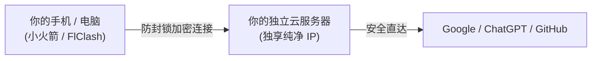

# 🚀 Evergreen · OwnLine (长青 · 个人专线)

> **帮小白轻松搭建安全、可控、便宜的专属 VPN 节点。**  
> 💡 **核心成本**：搭建普通节点每年仅需 **0 ~ 99 元**（服务器可完全白嫖），在此基础上只需再加 **85 元/年**（12 美元）挂载美国家宽 IP，即可升级为彻底防封的家庭住宅节点。  
> 资产 100% 自有，独享原生纯净 IP，非合租、非机场，不卖流量，2 分钟全自动装配，一个私有网页多端同步。

[](https://github.com/AdgaiWalker/VPN-OwnLine/releases/tag/v0.9.3)
[](LICENSE)
[](https://github.com/SagerNet/sing-box)
[](https://github.com/caddyserver/caddy)
[-success.svg)]()
[](docs/adr.md#adr-018)
[](docs/adr.md#adr-018)
[](docs/adr.md#adr-032)

---

## ⚡ 它是如何工作的？



* **安全（官方原版，零数据收集）**：只安装知名开源安全底座（[sing-box](https://github.com/SagerNet/sing-box) 与 [Caddy](https://github.com/caddyserver/caddy) 原版），绝无后门；不记录上网历史，密码与密钥物理不出机。
* **可控（资产自有，一个网页多端同步）**：服务器是你自己的，独享纯净 IP，哪怕本仓库关闭也永久可用；手机电脑扫码一键连通。
* **便宜（几块钱起步，不卖流量）**：自备海外云服务器（0 元至几块钱/月），不收月租、不卖流量，彻底告别商业机场按月按量割韭菜。

---

## 📋 准备清单与花费预估

> 💡 **核心成本区间**：搭建普通节点每年仅需 **0 ~ 99 元**（服务器可完全白嫖），在此基础上只需再加 **85 元/年**（12 美元）挂载美国家宽 IP，即可升级为彻底防封的家庭住宅节点。

在开始前，你只需准备以下原材料（丰俭由人）：

| 原材料类别 | 推荐方案 | 预估花费 | 说明与官方链接 |
| :--- | :--- | :--- | :--- |
| **1. 海外云服务器**<br>*(必选 · 强烈推荐**美西地区**如硅谷/洛杉矶，光缆直连且对 AI 支持最纯净)* | **甲骨文云 Oracle** | **0 元 / 月 (永久白嫖)** | [Oracle Always Free](https://www.oracle.com/cloud/free/)（官方永久免费额度，需外币信用卡） |
| | **阿里云高校计划** | **0 元 或 9.9 元/月** | [阿里云「云工开物」](https://university.aliyun.com/)（高校学生与青年开发者专享算力补贴） |
| | **大促特惠活动机** | **约 8 ~ 11 元/月** | 腾讯云 1024 程序员节等官方活动特惠机（实测 **99元/年 硅谷**、**138元/年 新加坡**）；日常优惠可常刷 **[LINUX DO 社区](https://linux.do/)** 关注神价爆料 |
| | **RackNerd** | **约 7 元 / 月** | [RackNerd](https://www.racknerd.com/)（便宜实惠的海外年付小主机） |
| **2. 客户端上网软件**<br>*(必选 · 免费开源)* | **安卓 / Windows / Mac** | **0 元 完全免费** | [FlClash](https://github.com/chen08209/FlClash)（纯净开源，控制台提供免翻下载直链） |
| | **电脑专业版** | **0 元 完全免费** | [Clash Verge Rev](https://github.com/clash-verge-rev/clash-verge-rev)（适合喜欢规则分流的高阶用户） |
| | **iPhone / iPad** | **免费通道** | [Shadowrocket (小火箭)](https://apps.apple.com/app/shadowrocket/id932747118)（控制台内提供免费美区通道，一键自动配好） |
| **3. 真实美国家庭宽带**<br>*(⭐ 唯一刚需付费项 · 彻底解决 AI 封号)* | **Webshare 静态住宅 (ISP)** | **约 $12 / 年 (+7元/月)** | [Webshare](https://www.webshare.io/)（**唯一必须付费项**，挂载真实美国家宽，彻底根除 ChatGPT/Claude 机房 IP 拒访与封号风险） |

---

## 2 分钟极速装配

材料就绪后，选型、端口、家宽、客户端与可选域名指南均已内嵌产品界面。普通用户直接使用下方「方式 1」图形安装器即可，全程无需打开终端：

### 方式 1：免 Python 独立安装包（零命令行 · 推荐小白）

直接前往 [v0.9.3 发布页](https://github.com/AdgaiWalker/VPN-OwnLine/releases/tag/v0.9.3) 下载对应电脑的独立安装包（内置全部运行依赖，无需安装 Python）：

- **Apple Silicon Mac（M1 / M2 / M3 / M4 芯片）**：点左上角苹果图标「关于本机 -> 芯片」，显示 Apple M 系列芯片即下载 `OwnLine-Setup-v0.9.3-macOS-arm64.zip`，解压后双击 **`OwnLine-Setup.app`**
- **Intel 芯片 Mac（旧款 Mac）**：若「关于本机」显示 Intel 处理器，下载 `OwnLine-Setup-v0.9.3-macOS-x64.zip`，解压后同样双击 **`OwnLine-Setup.app`**（免 Python 独立运行）
- **Windows 10 / 11**：下载并解压 `OwnLine-Setup-v0.9.3-Windows-x64.zip`，双击 **`OwnLine-Setup.exe`**
- **Linux / 源码备选**：下载源码包 `vpn-ownline-v0.9.3.zip`（需先安装 Python 3.10+）运行 `python3 ownline.py ui`，或展开下方改用「方式 3 一行命令」（`SHA256SUMS.txt` 仅供高阶校验，新手可忽略）

> 首次打开提示说明：因开源项目未采购商业签名证书，首次双击若被系统安全策略拦截属于正常现象：**macOS** 若提示“无法验证开发者”或建议“移至废纸篓”，先点取消，再打开「系统设置 -> 隐私与安全性」下拉点击「仍要打开」；**Windows** 在 Windows 安全警告弹窗（SmartScreen）点击「更多信息 -> 仍要运行」。

打开本机网页后支持「SSH 直连」（支持 `root` 或 Oracle / 腾讯云轻量 Ubuntu 默认 `ubuntu` 账号，自动提权；同一栏可填密码或粘贴完整私钥）与「腾讯云只读发现」（如需 API 读取请到腾讯云 CAM 控制台创建仅含轻量与 CVM 只读权限的子账号）。未买机器时可在页内展开「还没有服务器」；首次连接会弹窗核对服务器唯一指纹防篡改；安装完成后系统自动以你的服务器 IP 映射免费安全域名（`https://服务器IP短横线.sslip.io:8443/`）并自动申请浏览器信任证书，管理权限与密码 100% 留在本机与你自己的服务器，无任何第三方托管。复制保存初始密码后点击「关闭本地服务」即可清空内存凭据。

> 安全组端口要求：在云控制台防火墙 / 安全组（如甲骨文云为「VCN 安全列表入站规则」，腾讯云 / 阿里云为「防火墙规则」）放行 `SSH 端口（默认 22）`、`80/TCP`（自动申请 HTTPS 证书必需）、`8443/TCP`、`443/TCP`、`443/UDP`。仅支持空白 Ubuntu 22.04+ / Debian 12+ 服务器。

<a id="ai-assisted-setup"></a>

<details>
<summary>开发者 / AI 助手与命令行备选（方式 2 · 方式 3）</summary>

### 方式 2：本地 AI Agent + 本机安全凭据输入（开发者 / 全平台）

不用学 Linux 命令，也**不要把服务器密码、SSH 私钥、腾讯云 API 密钥或 Webshare 口令发进聊天框**。  
解压或克隆仓库后，在 **Cursor / Claude Code / Codex / Antigravity** 等具备本机终端权限的工具中，输入下面这段提示词（没买服务器可直接写“还没买服务器”；Windows 用户将 `python3` 换为 `py -3` 或 `python`，工具首次运行会自动按 `requirements.lock` 校验安装 `.venv`）：

```text
在 Evergreen · OwnLine 代码库根目录工作，完整规程见 skills/ownline-local/SKILL.md，选型清单见 web/src/data/onboarding.json：先运行 python3 ownline.py doctor --json；如我尚未购买服务器，先读 onboarding.json 为我对比方案与端口；需要 SSH、腾讯云 API、Webshare 或面板凭据时调用 python3 ownline.py vault request --slot <ssh|tencent_api|webshare_isp|panel_auth> 弹起本机安全输入卡由我本人填写，凭句柄执行 check -> install -> apply 完成装配与验真，切勿索取或输出任何明文凭据。
```

- 桌面系统会自动在浏览器打开仅监听 `127.0.0.1` 的单屏凭据输入卡；无桌面 SSH/终端环境自动回退为本机隐藏输入（`getpass`）。
- 密码与私钥仅存于本机临时内存句柄（`vh_...`），不落盘、不进诊断日志、不进 AI 对话上下文。

### 方式 3：自备服务器终端一行命令装配（极客备选）

登录云服务器终端（Ubuntu 22.04+ / Debian 12+），以 root 权限执行：
```bash
curl -fsSL https://raw.githubusercontent.com/AdgaiWalker/VPN-OwnLine/main/deploy/bootstrap.sh | sudo bash
```
* **运行完毕后，屏幕直接打出你的专属管理后台网址与初始密码**：
  ```text
  专属管理地址: https://服务器IP短横线.sslip.io:8443/
  面板账号:   admin
  初始密码:   xxxxxxxxxxxxxxxxxxxx
  ```

</details>

---

### 共同的下一步：登录后台，一键连接上网

用浏览器打开上述交付的专属 `https://...:8443/` 管理网址（系统已自动签发可信 HTTPS 证书，浏览器默认无警告），输入账号密码并按引导修改初始密码后即可进入面板；新增节点、查看配置一致性、核对云账单流量或绑定自有域名均可直接在网页内一键完成。

* **页面正上方会提供你的专属订阅链接和二维码**：
  ```text
  专属订阅链接: https://服务器域名:8443/s/xxxxxxxxxxxxxxxx
  ```
  > **如何连通**：
  > * **手机（小火箭）**：点网页上的【一键连接本机】或用小火箭内置相机扫码，轻按开关即通。
  > * **电脑（FlClash / Clash Verge）**：点【复制订阅链接】或一键导入，自动刷出可用线路，点连接即通。

> **排障提示**：如果管理网页转圈打不开或首次验收提示证书/端口未就绪，通常是因为云厂商默认拦截了入站端口，前往云控制台防火墙 / 安全组放行 **80/TCP、8443/TCP、443/TCP 与 443/UDP** 后重试即可。

---

## 🧱 开源基石致敬

安装、升级及节点控制的归属校验、失败恢复和兼容规则见 [可信交付方案与执行清单](docs/adr.md#adr-018)。旧节点的现有连接继续保留；无法确认服务归属时，在线修改会被拒绝，需要先核实归属。

本项目建立在以下卓越的开源技术之上：
* [sing-box](https://github.com/SagerNet/sing-box) - 下一代通用代理核心引擎
* [Caddy](https://github.com/caddyserver/caddy) - 现代化自动证书管理与反向代理网关
* [Shadowrocket](https://apps.apple.com/app/shadowrocket/id932747118) / [FlClash](https://github.com/chen08209/FlClash) / [Clash Meta](https://github.com/MetaCubeX/mihomo) - 客户端标准生态

---

## ⚖️ 免责声明

本项目为开源私有网络管理与自动化部署工具，仅供个人合规网络管理与技术研究。使用者自备服务器并遵守当地法律法规。本项目不提供、不托管、不中转任何网络代理服务，不对任何使用者行为承担连带法律责任。
