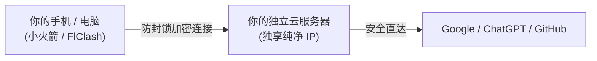

# 🚀 Evergreen · OwnLine (长青 · 个人专线)

> **帮小白轻松搭建安全、可控、便宜的专属 VPN 节点。**  
> 不用自己找教程，自备服务器 2 分钟全自动装好，一个私有网页多端同步。资产 100% 自有，独享原生纯净 IP，非合租、非机场，不卖流量，可选挂载美国家宽。

[](https://github.com/AdgaiWalker/VPN-OwnLine/releases/tag/v0.5.0)
[](LICENSE)
[](https://github.com/SagerNet/sing-box)
[](https://github.com/caddyserver/caddy)
[-success.svg)]()

---

## ⚡ 它是如何工作的？



* **安全（官方原版，零数据收集）**：只安装知名开源安全底座（[sing-box](https://github.com/SagerNet/sing-box) 与 [Caddy](https://github.com/caddyserver/caddy) 原版），绝无后门；不记录上网历史，密码与密钥物理不出机。
* **可控（资产自有，一个网页多端同步）**：服务器是你自己的，独享纯净 IP，哪怕本仓库关闭也永久可用；手机电脑扫码一键连通。
* **便宜（几块钱起步，不卖流量）**：自备海外云服务器（0 元至几块钱/月），不收月租、不卖流量，彻底告别商业机场按月按量割韭菜。

---

## 📋 准备清单与花费预估

在开始前，你只需准备以下两样东西（费用由云厂商直接收取，丰俭由人）：

1. **一台海外云服务器 (必选 · 几块钱起步)**：
   * 购买时请务必选择 **海外机房**（如中国香港、新加坡、东京、硅谷等，国内机房无法出海）：
   * **0 元 / 月** ➔ [甲骨文云 Oracle](https://www.oracle.com/cloud/free/)（官方永久免费额度）
   * **约 7 元 / 月** ➔ [RackNerd](https://www.racknerd.com/)（便宜实惠的年付小机器）
   * **约 24 元 / 月** ➔ [腾讯云轻量海外](https://cloud.tencent.com/product/lighthouse)（微信 / 支付宝直付，省心推荐）
2. **一个手机或电脑上网软件 (必选 · 免费开源为主)**：
   * **苹果手机 / iPad (最推荐)**：[Shadowrocket (小火箭)](https://apps.apple.com/app/shadowrocket/id932747118)（网页后台内提供免费获取通道，点一下自动配好）
   * **安卓 / Windows / Mac (最推荐)**：[FlClash](https://github.com/chen08209/FlClash)（免费开源，后台提供免翻下载直链）
   * **电脑专业版**：[Clash Verge Rev](https://github.com/clash-verge-rev/clash-verge-rev)（适合喜欢规则分流的进阶用户）
3. **真实美国家庭宽带 (可选 · 进阶防封号)**：
   * **+7 元 / 月** ➔ [Webshare](https://www.webshare.io/)（每年 12 美元，挂载真实美国家宽 IP，就像在美国拉了宽带，ChatGPT 绝不拒访）

---

## 🚀 2 分钟极速装配

只需要两步，零基础也能搞定：

### 第 1 步：在服务器上运行装配命令
买好服务器后，打开云控制台的网页命令行终端，复制这行命令粘贴进去并回车：
```bash
curl -fsSL https://raw.githubusercontent.com/AdgaiWalker/VPN-OwnLine/main/deploy/bootstrap.sh | sudo bash
```
* **运行完毕后，屏幕上会直接输出你的专属管理后台网址与密码**：
  ```text
  专属管理地址: https://43.153.56.137:8443/
  面板账号:   admin
  初始密码:   xxxxxxxxxxxxxxxxxxxx
  ```
  > **如何确认成功**：用电脑或手机浏览器打开这个网址，能看到自己的黑色管理后台登录界面。  
  > 💡 *新手提示 1：第一次用 IP 网址打开时，浏览器提示“证书不安全”属于正常现象，点击「高级 ➔ 继续访问」即可。*  
  > 💡 *新手提示 2：如果网页一直转圈打不开，是因为云厂商默认关了端口，去云控制台把防火墙（安全组）的 **8443** 和 **443** 端口放行即可。*

### 第 2 步：登录后台，一键连接
在浏览器输入上述密码登录你的专属管理后台：
* **页面正上方会提供你的专属订阅链接和二维码**：
  ```text
  专属订阅链接: https://43.153.56.137:8443/s/c2763f350db2d011
  ```
  > **如何连通**：
  > * **手机（小火箭）**：点网页上的【一键连接本机】或者用手机扫码，App 会自动唤醒并把线路加进去，轻按开关即可上网。
  > * **电脑（FlClash）**：点【复制订阅链接】，在软件里粘贴保存，就会自动刷出绿色可用线路，点连接即通。

---

### 懒人专属：直接发给本地 AI 帮你装
如果你使用 **Cursor / Claude Code / Antigravity / Windsurf** 等 AI 编程工具，直接把这句话连同服务器信息发给它：
```text
克隆 https://github.com/AdgaiWalker/VPN-OwnLine.git，通过 SSH 连接我的服务器 [IP:端口:密码]，帮我全自动装配好，并把管理网址和账号密码发给我。
```

---

## 🧱 开源基石致敬

本项目建立在以下卓越的开源技术之上：
* [sing-box](https://github.com/SagerNet/sing-box) - 下一代通用代理核心引擎
* [Caddy](https://github.com/caddyserver/caddy) - 现代化自动证书管理与反向代理网关
* [Shadowrocket](https://apps.apple.com/app/shadowrocket/id932747118) / [FlClash](https://github.com/chen08209/FlClash) / [Clash Meta](https://github.com/MetaCubeX/mihomo) - 客户端标准生态

---

## ⚖️ 免责声明

本项目为开源私有网络管理与自动化部署工具，仅供个人合规网络管理与技术研究。使用者自备服务器并遵守当地法律法规。本项目不提供、不托管、不中转任何网络代理服务，不对任何使用者行为承担连带法律责任。
