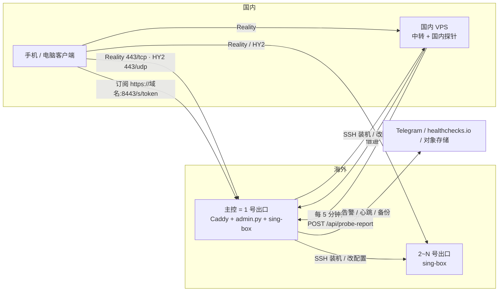
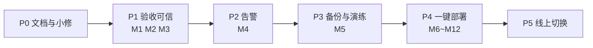

# 16 · 技术方案 v2：一个人稳定运维 + 买台服务器一键变梯子

| 项 | 内容 |
|---|---|
| 版本 | v2.0（草案，待确认） |
| 日期 | 2026-10-30 |
| 输入 | 15-GitHub调研-个人VPN、2026-10-30 需求对话、方案自审（3 个硬伤 + 5 个疏漏）、`运维/AGENTS.md` 七条规矩 |
| 取代 | `04-技术方案` v1.0 的 §1、§2（骨架与技术栈）。04 其余章节保留作历史 |
| 目标版本 | 仓库 `v0.2.0` |
| 原则 | **稳定性先于功能；能复用就不自研；一次只改一个变量；每一步都有可观测的验证和回滚办法** |

> ⚠️ **阶段归档（2026-10-31 审阅）**：本文档为 `v0.2.0` 版本阶段的过渡技术方案。
> 现行最终架构与全自动化装配实施基准已被 **[31-个人专属全自动化VPN装配中枢技术方案.md](31-个人专属全自动化VPN装配中枢技术方案.md)** 取代与升华。本文档仅保留作为系统从阶段性探索到全自动化演进的历史设计参考。

---

## 0. 需求（定稿）

| # | 需求 | 来源 |
|---|---|---|
| R1 | **一个人能稳定运维**：出了事有人告诉我，坏了能恢复，平时不用盯 | 用户原话「一个人稳定运维」 |
| R2 | **主打个人自用**：不做多用户、不计费、不卖 | 用户原话 |
| R3 | **买一台服务器 → 变成梯子**，人工操作尽量少、一键部署、轻量 | 用户原话（主场景） |
| R4 | **要网页版**：在网页上看状态、导入、加机器 | 用户原话 |
| R5 | 三种电脑都要有说法：海外 VPS（主）、国内电脑、海外家里电脑 | 用户原话 |
| R6 | 线上生产（硅谷 + 北京）先不动，新方案验证通过后再切换 | 用户「生产按你的建议」+ 规矩 7 |

### 0.1 三种电脑的定位

| 电脑 | 在本方案里的角色 | 支持方式 |
|---|---|---|
| **海外 VPS（主场景）** | 出口 / 主控 | 第 1 台：一条命令装好面板 + 本机节点；之后的：网页填 IP + 密码 |
| **国内 VPS** | 中转入口 **+ 国内探针** | 网页填 IP + 密码，自动判断「出不去」→ 借道海外（已有逻辑）。**新增：顺便承担「从国内视角探活」** |
| **海外家里电脑（NAT 后）** | 不进面板 | 文档指引：Tailscale exit node。有公网端口映射且是 Linux 时，按普通服务器添加 |
| 国内家里电脑 | 不能当出口 | 安装时检测并明确拒绝（已有逻辑） |

### 0.2 非目标

| 不做 | 理由 |
|---|---|
| 多用户、配额、到期时间 | R2 |
| 3x-ui / s-ui / Marzban / Sub-Store | 见 §1 决策记录 |
| 主控高可用（双主控） | 一个人维护不起；用「备份异地 + 30 分钟重建」代替 |
| Windows / macOS 当服务端 | addnode 只支持 Linux；家里电脑走 Tailscale |
| 除腾讯云外的云 API 自动化 | 防火墙改为「本机 ufw/firewalld + 打印控制台放行清单」 |
| NAT 穿透自研 | Tailscale 已经做完 |

---

## 1. 决策记录：面板用谁（按规矩 4 写）

| 阶段 | 判断 | 依据 |
|---|---|---|
| **原判断 X**（02，10-26） | 不碰 3x-ui | 安装脚本触发腾讯云主机安全告警；面向多用户 |
| **改判 X'**（15，10-29） | 默认用 3x-ui，不再自研面板 | 48.8k star、单二进制、内置订阅；自研胶水层故障多 |
| **证据 Y**（10-30 复核） | ① 3x-ui 每台机器各装一套，**没有**「填 IP 密码自动装 + 国内机自动借道」；② 我们的历史故障集中在 **subconverter / Caddyfile 正则改写 / 云 API**，不在面板本身；③ 我们的核心资产（真实出口验收、借道、drift）都长在自研代码上；④ 03a 起已定「不引入新运行时」 | `addnode.sh`、`14-陌生人演练`、`AGENTS.md` |
| **改为 Z** | **保留自研极简面板，砍掉故障最多的外部组件（subconverter、Caddyfile 改写）**；3x-ui 只当参考，不引入 | 本文 |

> 15 的结论「不要再自研面板」作废，改为「不要再自研**订阅转换和胶水层**」。

---

## 2. 目标架构

### 2.1 组件：从 4 个服务减到 2 个

| 组件 | 现在 | v2 | 说明 |
|---|---|---|---|
| sing-box | ✅ | ✅ | 协议内核，不变（1.14.4，锁版本 + SHA256） |
| Caddy | ✅ | ✅ | 只做 TLS + 反代 + 静态页；**不再被程序改写** |
| admin.py | ✅ | ✅ 扩展 | 新增：内置订阅、设置、探针回报 |
| subconverter-ng | ✅ | ❌ **删除** | 订阅由 admin.py 直接生成 |
| probe / usage / ipcheck 定时器 | ✅ | ✅ + alert、backup | usage-refresh 仅在配置了 tc.json 时启用 |

外部依赖（都不需要自己运维）：

| 依赖 | 用途 | 挂了会怎样 |
|---|---|---|
| Telegram Bot API | 告警推送 | 收不到告警，不影响上网 |
| healthchecks.io（免费档） | 「主控本身死了」的告警（死人开关） | 同上 |
| sslip.io | 没有域名时提供免费主机名，用来申请正式证书 | 证书续期失败；可随时改用自有域名 |
| 对象存储（Cloudflare R2 / Backblaze B2 免费档） | 异地备份 | 当天备份失败，有告警 |
| restic（单个静态二进制） | 加密增量备份 | — |

> restic 和 sing-box、Caddy 一样是单个二进制，不算违反「不引入新运行时」（那条针对的是 Node / 数据库 / Redis）。

### 2.2 拓扑



### 2.3 数据：只有一个目录

`/opt/web-data/`（700），全部原子写（tmp + fsync + rename）：

| 文件 | 内容 | 变化 |
|---|---|---|
| `nodes.json` | 节点列表 | 新增字段：`local`（是不是主控本机）、`machine`（同一台机器的 vless 与 hy2 两条共用一个值，删机器时一起删） |
| `settings.json` | **新增**：`domain`、`sub_token`、`panel_user`、功能开关 `sub_backend` | 订阅 token 从 Caddyfile 和 index.html 里搬到这里 |
| `secrets.json`（600） | **新增**：Telegram token / chat_id、healthchecks URL、探针 token、restic 密码与仓库地址 | 不进备份明文、不进日志 |
| `status.json` | 探活结果 | 改为按视角分：`{"overseas": {...}, "cn": {..., "ts": ...}}` |
| `known_hosts` | **新增**：所有 SSH 连接共用的主机指纹 | 统一 TOFU，见 M2 |

---

## 3. 模块设计

### 第一部分：验收可信（解决「假绿灯」）

#### M1 · verify 支持 Hysteria2

| 项 | 内容 |
|---|---|
| 问题 | `verify.run` 先查 TCP 再查 TLS，HY2 是 UDP，443/tcp 回应的是 Reality → 结果是假的；`probe.py` 直接跳过 HY2 |
| 改法 | `run()` 按 `type` 分发：`hysteria2` 跳过 TCP/TLS，直接 `proxy_exit_ip()`；`_client_cfg()` 新增 hysteria2 出站（password、obfs salamander、alpn h3、server_name） |
| 复用 | 起本地 socks、经节点取出口 IP 的逻辑原样复用 |
| 验证 | 单测：hy2 节点不调用 tcp_ok；真机：故意填错 HY2 密码 → 必须 `health=proxy` |
| 回滚 | 单文件 revert |

#### M2 · SSH 主机校验统一

| 项 | 内容 |
|---|---|
| 问题 | `addnode.sh` 用 TOFU（accept-new），`admin.py` 改配置/删节点和 `verify.py` 用的是 `StrictHostKeyChecking=no`：装机时防中间人，之后反而不防 |
| 改法 | 新增 `nodekit/ssh.py`：`base_cmd(user, host)` 统一返回 `-o UserKnownHostsFile=/opt/web-data/known_hosts -o StrictHostKeyChecking=accept-new`；三处全部改用它。`addnode.sh` 的 KH 指向同一个文件 |
| 迁移 | 首次上线前，把线上机器的指纹从 `/opt/sing-box/known_hosts` 合并过去 |
| 验证 | `grep -rn StrictHostKeyChecking=no server/` 为空；手动改一台的指纹 → 改配置必须失败并给出中文原因 |

#### M3 · 国内视角探活

| 项 | 内容 |
|---|---|
| 问题 | 探活从硅谷发起，**测不出被墙**（规矩 6） |
| 改法 | 新增 `server/probe_cn.py` + `probe-cn.timer`，装在国内中转机上（它本来就有 sing-box）：每 1 分钟对每条节点做 TCP 连通，每 10 分钟做一次真实代理取出口 IP（复用 verify 的 `proxy_exit_ip`）。结果 `POST https://域名:8443/api/probe-report`，`Authorization: Bearer <探针 token>` |
| 主控侧 | admin.py 校验 token，写入 `status.json.cn`；面板每条节点显示两个灯：**海外视角 / 国内视角** |
| 没有国内机器时 | 面板明确标注「仅海外视角，测不出被墙」，不显示国内灯 |
| 不做 | 不用这台 Mac 当探针（Shadowrocket TUN 开着时结果失真） |
| 验证 | 在某台出口机上临时 `iptables -A INPUT -s <北京IP> -j DROP` → 5 分钟内国内灯变红、海外灯仍绿；删掉规则后恢复 |

### 第二部分：出事有人告诉我

#### M4 · 告警

| 项 | 内容 |
|---|---|
| 新增 | `server/alert.py`（标准库 urllib），由 probe 写完 status 后调用 |
| 规则 | **只在状态变化时发**；连续 2 轮失败才算红（防抖）；恢复也发一条；每天 09:00 发一条日报（节点数、各自状态、近 24h 红灯次数） |
| 主控本身挂了 | 主控每 5 分钟 ping 一次 healthchecks.io，超过 15 分钟没 ping 由它发邮件/Telegram（死人开关），这一层不依赖主控 |
| 其他告警源 | 备份失败、证书剩余 < 14 天、磁盘 > 85%、国内探针超过 15 分钟没回报 |
| 配置 | 网页「维护 → 告警」填 Bot token 和 chat_id，带「发送测试消息」按钮 |
| 验证 | `systemctl stop sing-box`（在一台备用出口上）→ 2~3 分钟内手机收到；start 后收到恢复；拔掉主控网络 → 15 分钟内收到 healthchecks 告警 |

### 第三部分：坏了能恢复

#### M5 · 异地备份 + 重建演练

| 项 | 内容 |
|---|---|
| 问题 | 备份只在这台 Mac 上；`backup.sh` 曾静默失效两天；「30 分钟重建」从没演练过 |
| 改法 | 主控上 `backup.timer` 每天 04:00：`restic backup /opt/web-data /opt/sing-box/config.json /opt/sing-box/hy2.* /etc/caddy/Caddyfile`，推到 R2/B2；保留 7 天 + 4 周 + 6 个月；**失败走 M4 告警**。Mac 上的 `backup.sh` 保留作第二份 |
| 恢复 | `install.sh --restore`：装好依赖后从 restic 拉最新快照、还原、重启服务、跑一次 verify |
| 验证 | ① `restic snapshots` 能看到当天快照；② **演练**：开一台临时 VPS，`install.sh --restore`，计时 ≤30 分钟，客户端无需重新导入（同 token、同 UUID）即可连上（主控 IP 变了时，只需改 DNS / 重新导入一次，写进手册） |

### 第四部分：一键部署（功能，排在稳定性之后）

#### M6 · 内置订阅（删掉 subconverter）

| 项 | 内容 |
|---|---|
| 改法 | admin.py 新增 `GET /s/<token>` 与 `/s/<token>/clash`：按 User-Agent 分发——`clash / mihomo / stash / verge` → Clash YAML，其他（Shadowrocket、v2rayN）→ base64 后的 URI 列表。只输出 `in_subscription()` 为真的节点 |
| 复用 | `运维/生成客户端配置.py` 里的 `vless_uri / hy2_uri / clash_proxy`，搬进 `nodekit/subscriptions.py` 成为纯函数；运维脚本改为 import 它们（以后只有一份） |
| Clash 规则 | 不再依赖 subconverter 的 base.ini，改用 mihomo 内置 geosite/geoip：`GEOSITE,cn,DIRECT` → `GEOSITE,geolocation-!cn,代理` → `GEOIP,CN,DIRECT` → `MATCH,代理`；代理组 = url-test 自动选择 + 手动选择。**这比 subconverter 的规则集简单，属于有意降级**，够个人用 |
| 切换方式 | `settings.sub_backend = "builtin" \| "subconverter"`，默认 builtin；线上先保持 subconverter，对比两边输出的节点条数一致后再切 |
| 验证 | 单测：3 条节点 → base64 解码出 3 行、YAML 里有 3 个 proxies；真机：Shadowrocket 和 Clash Verge 各导入一次能连上 |

#### M7 · token 与设置搬出 Caddyfile

| 项 | 内容 |
|---|---|
| 问题 | 现在每次加删节点都用正则改写 Caddyfile 再 reload；换 token 要 sed 改 Caddyfile + index.html |
| 改法 | token 存 `settings.json`；`render()` 不再碰 Caddyfile；index.html 打开时 `GET /api/settings` 取订阅地址；`/api/rotate` 只改 settings 并重新生成二维码（`qrencode`）；`rotate.sh` 删除 |
| 验证 | 换 token → 旧地址 404、新地址返回正确条数；Caddyfile 的 mtime 不变 |

#### M8 · Caddy 收紧 + 免域名正式证书

| 项 | 内容 |
|---|---|
| 问题 | 现在 `:80 { import app }` 走明文 HTTP，Basic Auth 密码和订阅 token 都是明文；只有 IP 时只能用自签证书，客户端拉订阅常失败 |
| 改法 | Caddyfile 变成**静态模板**，安装时渲染一次：`:80` 只做 ACME 验证 + 跳转 https；站点 `https://<域名>:8443`。没有域名时用 `<ip 中点换横杠>.sslip.io`，Caddy 走 HTTP-01 自动申请 Let's Encrypt 证书（443/tcp 被 Reality 占着，所以必须放行 80） |
| 路由 | `/s/*` → admin（token 校验，不要 Basic Auth）；`/api/probe-report` → admin（Bearer 校验）；`/api/*` → Basic Auth + admin；其余 → Basic Auth + 静态页 |
| 有自有域名时 | `install.sh --domain v.example.com`，可继续接 Cloudflare（现有线上方式） |
| 验证 | `curl http://<ip>/` 只返回 308，拿不到页面；`curl https://<主机名>:8443/s/<token>` 证书链有效（不加 `-k`） |
| 待实测 | sslip.io 的 Let's Encrypt 频率限制、sslip.io 域名在国内能不能解析 |

#### M9 · install.sh 一键自举（第 1 台海外机器）

**人要做的：SSH 上去粘一条命令，最后扫一个码。**

```bash
curl -fsSL https://raw.githubusercontent.com/AdgaiWalker/ladder-web-panel/v0.2.0/deploy/bootstrap.sh | sudo bash
# 可选：--domain v.example.com   --restore
```

| 步 | 做什么 | 失败时 |
|---|---|---|
| 0 | 预检：root、systemd、apt、架构、磁盘；**能否直连国外**（不能 → 拒绝：「第一台必须在海外」） | 中文原因 + 退出码 |
| 1 | 装依赖：python3 curl openssl qrencode caddy | — |
| 2 | 下载 sing-box（锁版本 + SHA256） | 校验不过拒绝安装 |
| 3 | 代码 → `/opt/web`，数据 → `/opt/web-data` | — |
| 4 | 确定主机名：`--domain` 或 sslip.io | — |
| 5 | 生成本机节点：uuid、reality 密钥对、sid、hy2 密码、混淆密码、自签证书 → `exit_config(..., hy2=...)` → `sing-box check` → systemd | check 不过不写入 |
| 6 | 开 BBR（sysctl 持久化） | 内核不支持时跳过并提示 |
| 7 | 本机防火墙放行 80/tcp、443/tcp、443/udp、8443/tcp；**打印云控制台需要放行的 4 个端口** | — |
| 8 | 渲染 Caddyfile、写 settings / nodes（本机两条，`local: true`）、生成面板密码 | — |
| 9 | 启用定时器：probe、alert（未配置时静默）、backup（未配置时静默） | — |
| 10 | 自测：用公网 IP 跑 verify（Reality + HY2 各一次） | 端口不通 → 明确提示「去云控制台放行」 |
| 11 | 终端输出：面板地址、账号密码、订阅地址、**终端二维码**（`qrencode -t ansiutf8`） | — |

| 约束 | 做法 |
|---|---|
| **幂等**（LESSONS：重跑换凭据） | 已存在 settings / nodes / Caddyfile 时一律保留，不换 token、不换 UUID；只补缺的 |
| 本机识别 | 去掉 admin.py 里写死的 `198.51.100.12`，改为看 `node.local` |
| 卸载 | `install.sh --uninstall`：停服务、删 unit；`--purge` 才删数据 |
| 许可证 | 仓库保持 MIT；fscarmen/233boy 是 GPL-3.0，**只读思路不抄代码**（04 §3 结论不变） |

#### M10~M12 · 后续机器（网页填 IP + 密码）

每项单独一步、单独验证：

| # | 改动 | 验证 |
|---|---|---|
| M10 | `addnode.sh`：出口机额外生成 HY2 入站和自签证书，输出两条节点（同一个 `machine`）；中转机仍只有 Reality | 新加一台海外机 → 订阅多 2 条，两条 verify 都 ok |
| M11 | `addnode.sh`：出口机开 BBR | `sysctl net.ipv4.tcp_congestion_control` = bbr |
| M12 | 防火墙放行 UDP：本机 ufw/firewalld 加 `443/udp`；`providers.open_port(ip, port, proto="TCP")` 增加 proto 参数（补上「已知缺口」） | 腾讯云机器上 UDP 规则自动出现；HY2 verify ok |

删除节点时按 `machine` 一起删，避免留下只剩一半的机器。

---

## 4. 实施顺序



| 阶段 | 内容 | 估时 | 完成标志 |
|---|---|---|---|
| **P0** | ① 修 `运维/生成客户端配置.py` 读 `/opt/web/nodes.json` 的过期路径；② 15 补一段「已被 16 §1 修正」 | 0.5 小时 | 脚本跑出的条数 = 订阅条数 |
| **P1** | M1 → M2 → M3（按顺序，每个单独提交） | 1.5 天 | 三条验证全部看到红灯/绿灯切换 |
| **P2** | M4 | 0.5 天 | 手机收到「挂了 / 恢复 / 日报 / 主控失联」4 种消息 |
| **P3** | M5 + 重建演练 | 1 天 | restic 有快照；临时 VPS 恢复 ≤30 分钟 |
| **P4** | M6 → M7 → M8 → M9 → M10 → M11 → M12 | 3 天 | §6 陌生人演练通过 |
| **P5** | 硅谷线上切换：sub_backend 切 builtin → 观察 24h → 停 subconverter → 换静态 Caddyfile | 0.5 天 | 现有客户端不用重新导入；回滚步骤演练过一次 |

**P1~P3 在线上就能做**（不改协议、不改订阅），做完马上能用；P4 在新开的临时 VPS 上做，不碰线上。

---

## 5. 线上切换与回滚（P5）

| 步 | 动作 | 验证 | 回滚 |
|---|---|---|---|
| 1 | `bash 备份/backup.sh` + `restic backup` | 8/8 成功 + 有快照 | — |
| 2 | 部署 v0.2.0 代码，`sub_backend` 保持 `subconverter` | 订阅条数不变（3） | 换回旧代码 |
| 3 | 并行对比：新接口 `/s/<token>?backend=builtin` 和旧订阅解出来的节点集合一致 | 脚本 diff 为空 | — |
| 4 | 切 `sub_backend=builtin` | Shadowrocket / Clash 各刷新一次能连 | 改回 `subconverter` |
| 5 | 观察 24 小时（告警已在 P2 就位） | 无红灯 | 同上 |
| 6 | 停用并 disable subconverter；换成静态 Caddyfile（保留现有域名和 Cloudflare 方式） | `ss -ltnp` 里没有 25500；订阅正常 | 恢复备份的 Caddyfile + enable subconverter |

---

## 6. 验收标准

| # | 标准 | 怎么量 |
|---|---|---|
| A1 | 一台**全新海外 VPS** → Shadowrocket 能上网：**≤10 分钟，人工 ≤3 步**（粘命令、去云控制台放行端口、扫码） | 陌生人演练：干净机器、只看 README，计时 |
| A2 | 网页加第 2 台海外机：只填 IP + 密码，订阅自动多 2 条且 verify 都 ok | 实测 |
| A3 | 网页加国内机：自动变成中转 + 国内探针 | 实测，面板出现国内视角灯 |
| A4 | 任一节点挂了，**≤3 分钟**手机收到；主控挂了，**≤15 分钟**收到 | 人为制造故障 |
| A5 | 节点被墙（模拟），国内灯变红 | §M3 验证 |
| A6 | 主控重建 **≤30 分钟**，已导入的客户端不用改 | 演练一次（NFR-7 终于落地） |
| A7 | 运行组件：sing-box + Caddy + admin.py + 若干 timer；**没有 subconverter**；总内存 < 150 MB | `systemctl` / `ps` |
| A8 | 重跑 install.sh 不换 token、不换 UUID | 连续跑两次对比 |
| A9 | 离线单测全过（现有 122 项 + 新增） | `bash scripts/test.sh` |
| A10 | 仓库里没有 `StrictHostKeyChecking=no`，也没有写死的 IP | grep |

---

## 7. 风险

| 风险 | 影响 | 对策 |
|---|---|---|
| sslip.io 在国内解析不了或被干扰 | 订阅更新失败（已导入的节点不受影响） | 先实测；不行就推荐自有域名 + Cloudflare（现有方式），sslip.io 只当兜底 |
| Let's Encrypt 对 sslip.io 的频率限制 | 首次申请证书失败 | 实测；失败时退回 `tls internal`，并提示「客户端可能拉不了订阅」 |
| HY2 用自签证书 + `insecure=1` | 理论上可被中间人攻击 | 先保持现状；调研 `pinSHA256` 在 Shadowrocket / mihomo 里的支持情况，支持就换成证书指纹固定 |
| 内置 Clash 规则比 subconverter 简单 | 少数网站分流不准 | 有意降级；需要时再加 rule-providers |
| 国内探针本身挂了 | 国内视角缺失 | 超过 15 分钟没回报 → 告警 |
| 腾讯云主机安全把某个下载判成恶意 | 安装中断 | 只下官方 release + SHA256；不跑第三方一键脚本 |
| 主控仍是单点 | 主控挂了：面板、订阅、1 号出口一起挂 | 死人开关告警 + 30 分钟重建；有第 2 台出口时，已导入的客户端可以自动切换（url-test） |

---

## 8. 需要你确认的

1. **顺序**：P1~P3（稳定性）先做，P4（一键部署）后做——可以吗？
2. **告警渠道**：Telegram 可以吗？（需要你建一个 Bot，2 分钟的事）
3. **异地备份**：Cloudflare R2 还是 Backblaze B2？都有免费额度，都要注册账号
4. **P4 的测试机**：需要临时买一台海外按量计费的 VPS（几块钱，测完删），可以吗？
