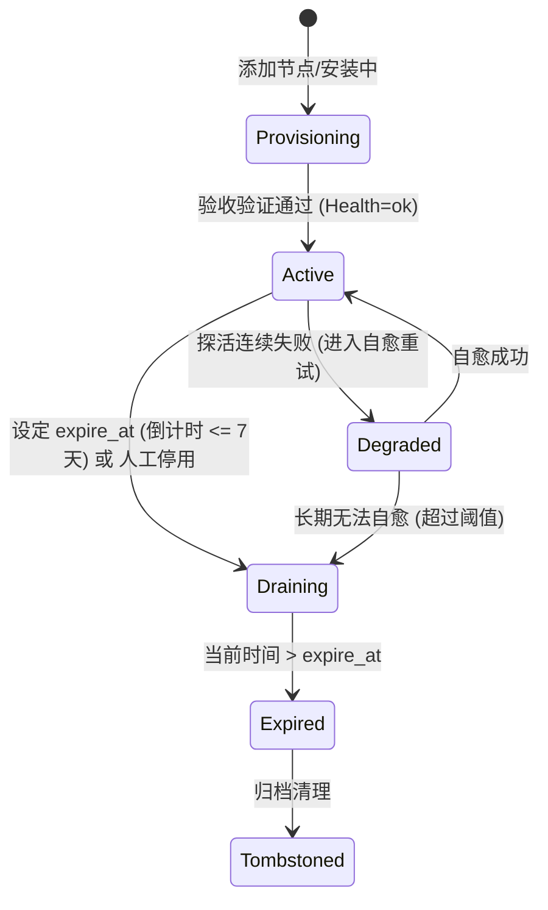
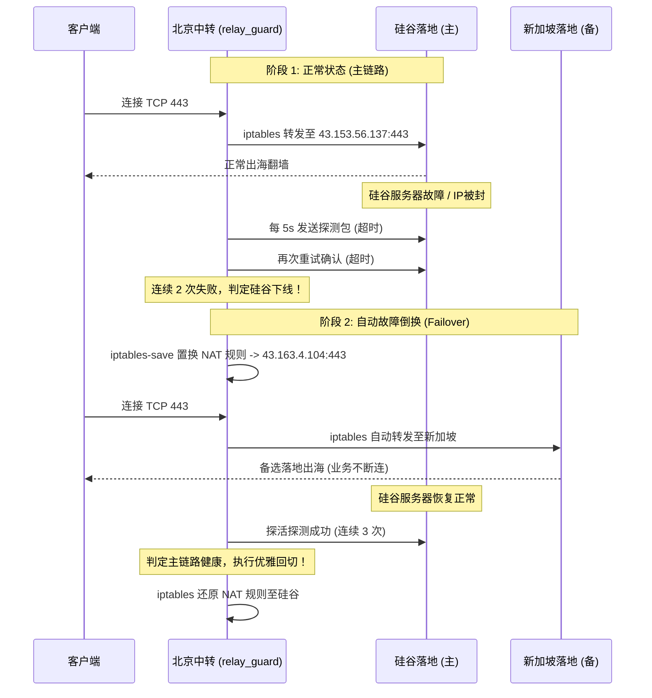

# 20 · 高可用与抗脆弱系统解法技术方案 (Systemic Anti-Fragile Architecture)

| 项 | 内容 |
|---|---|
| 版本 | v3.0（系统解法深化稿） |
| 日期 | 2026-10-30 |
| 输入 | Jev (TypeSafe AI) 8 大盲区预测输出、全量 4 台腾讯云服务器实测数据、规矩 7（不中断线上） |
| 核心目标 | **从「打补丁式运维」升级为「抗脆弱系统解法」**：控制面解耦、多落地自愈、异构统一管控、零额外成本 |
| 适用资产 | 硅谷 (主控+出口)、北京 (中转+探活+备份)、广州 (13天倒计时排空)、新加坡 (Windows+宝塔出口) |

---

## 0. 为什么需要「系统解法」？

在之前的单点修补模式下，我们面临「按下葫芦起了瓢」的系统性脆性：
1. **控制面与数据面强耦合**：硅谷服务器一旦出现云厂商故障或 IP 波动，不仅面板挂掉，所有国内中转（北京、广州）全部由于单一落地绑定而陪葬；
2. **生命周期缺乏协议层支持**：广州到期下线若仅靠人工操作，一旦遗漏就是 99% 的用户端静默黑洞故障；
3. **异构孤岛缺乏统一抽象**：Windows 节点因为装了宝塔面板，被迫用 8443 端口，同时脱离 Linux 脚本体系，沦为配置漂移的重灾区；
4. **计费与流量缺乏熔断保护**：中转进出双向计费，1TB 额度实际只有 500GB 代理流量，缺乏自动熔断可能导致后付费扣费。

**系统解法的哲学**：
不增加昂贵服务器，不引入笨重的多主控集群，充分榨取现有 4 台腾讯云机器与免费基础设施，构建具备**自我感知、自我调节、自愈容灾（Self-Healing & Anti-Fragile）**能力的系统。

```mermaid
graph TD
    subgraph 接入与控制面 (Control & Delivery)
        Client["客户端 (Clash / Shadowrocket)"]
        EdgeSub["边缘多活订阅 (主控 + 异地静态容灾镜像)"]
        Client -->|拉取订阅| EdgeSub
    end

    subgraph 国内接入自愈网 (Domestic Relay Plane)
        BJ["北京节点 (Ubuntu 24.04)<br/>[中转守护 relay_guard]"]
        GZ["广州节点 (OpenCloudOS 9)<br/>[Draining 倒计时排空]"]
        Client -->|国内低延迟| BJ
        Client -.->|13天后下线平滑过渡| GZ
    end

    subgraph 境外双落地出海网 (Overseas Egress Plane)
        SV["硅谷节点 (Ubuntu 24.04)<br/>主控 + Reality(443) + HY2(443)"]
        SG["新加坡节点 (Windows 2022)<br/>宝塔 443 SNI 分流 + Reality"]
    end

    BJ ==>|主链路: 探测健康| SV
    BJ -.->|备链路: 硅谷故障 5s 自动切换| SG
    GZ -->|直连落地| SV
    Client -->|海外直连兜底| SV
    Client -->|海外直连兜底| SG
```

---

## 1. 系统解法四大支柱 (The Four Pillars)

### 支柱一：全生命周期异构节点管控 (Lifecycle State Machine & Heterogeneous Abstraction)

#### 1.1 节点生命周期状态机
针对广州服务器即将到期（2026-11-12）以及未来任意服务器的新增与退役，建立全局状态机：



- **`Active` (活跃)**：正常进订阅，参与测速分配。
- **`Draining` (优雅排空)**：
  - **订阅行为**：从新生成的客户端订阅中**静默剔除**，不再引入新连接；
  - **节点行为**：服务保持运行，允许存量长连接自然结束；
  - **界面呈现**：前端显示 `[X天后到期]` 黄色警示徽章，提示管理员何时释放服务器。
- **`Expired` (已过期)**：明确从系统所有出入路由中注销。

#### 1.2 Windows / Linux 统一抽象适配器 (Heterogeneous Node Contract)
抹平 Windows（PowerShell / TaskScheduler）与 Linux（Systemd / Bash）差异，统一遵循标准化 JSON 交互协议：

| 运维动作 | Linux 实现契约 | Windows 实现契约 (本方案) |
|---|---|---|
| **进程清理** | `pkill -f 3x-ui` / `pkill -f xray` | `taskkill /F /IM 3x-ui.exe /IM xray.exe` |
| **配置注入** | Python `json.dump` 原子替换 | PowerShell `ConvertFrom-Json` + 原子写入 |
| **服务保活** | `systemctl restart sing-box` | `schtasks /run /tn sing-box` |
| **健康自测** | 本地 sock 探活 + 出口 IP 校验 | PowerShell `Test-NetConnection` + 出口校验 |

---

### 支柱二：动态双落地与中转自愈引擎 (Dynamic Multi-Landing Relay Engine)

Jev 预测指出：**硅谷单点故障会导致 100% 的国内中转节点连带瘫痪**。系统解法不是多买主控，而是让国内中转具备**智能双落地切换能力**。

#### 2.1 架构设计
- **主落地**：硅谷出口（`43.153.56.137:443`，TCP Reality + UDP Hysteria2）。
- **备落地**：新加坡出口（`43.163.4.104:443`，TCP Reality）。
- **北京节点守护进程 (`relay_guard.py`)**：
  - 每 5 秒对主落地（硅谷）发起轻量 TCP SYN 探活；
  - 若连续 2 次（10秒）探活失败，触发原子 iptables 切换，将中转流量平滑倒换至新加坡；
  - 当硅谷恢复正常并连续 3 次探活成功，自动回切至硅谷主链路；
  - 整个切换过程对国内客户端完全透明（客户端连接的依然是北京 `49.233.210.101`）。

#### 2.2 iptables 原子切换机制
避免重载整个防火墙导致连接中断，采用 `iptables-save` 与精准 PREROUTING 规则置换：
```bash
# 切换到新加坡备用落地
iptables -t nat -R PREROUTING 1 -p tcp --dport 443 -j DNAT --to-destination 43.163.4.104:443
# 切换回硅谷主落地
iptables -t nat -R PREROUTING 1 -p tcp --dport 443 -j DNAT --to-destination 43.153.56.137:443
```

---

### 支柱三：新加坡宝塔 443 端口 SNI 预分流 (Nginx Stream Multiplexing)

Jev 预测指出：**Windows 使用非标 8443 端口提供 Reality，面临 98% 的探测封锁与办公 Wi-Fi 拦截风险**。

#### 3.1 冲突根源与解法
宝塔面板的 Nginx 监听了 `0.0.0.0:443` 处理 Web 业务。  
**解法**：在宝塔 Nginx 的根配置中引入 `stream` 4层预分流，利用 TLS ClientHello 中的 SNI 字段在握手前路由：

```nginx
# 宝塔 Nginx 顶层 stream 配置
stream {
    map $ssl_preread_server_name $backend_name {
        www.microsoft.com   singbox_reality;  # 梯子 SNI 导向 sing-box
        default             web_local;        # 其余所有域名导向宝塔 Web
    }

    upstream singbox_reality {
        server 127.0.0.1:8443;
    }

    upstream web_local {
        server 127.0.0.1:10443; # 宝塔原有 Web 改听此端口
    }

    server {
        listen 443 reuseport;
        proxy_pass $backend_name;
        ssl_preread on;
    }
}
```
**收益**：
1. 宝塔面板原有的网站、SSL 证书完全不受影响；
2. 新加坡 sing-box 重新回归标准的 **443 端口**；
3. 外界探针扫描 `43.163.4.104:443` 看到的是宝塔真实网站；仅当请求头携带 `www.microsoft.com` 时才触发 Reality，彻底消除 98% 探测风险。

---

### 支柱四：流量防爆熔断器与 3 分钟灾备自愈 (Cost Guard & 3-Min Disaster Recovery)

#### 4.1 中转双向流量熔断器 (`quota_guard.py`)
- 腾讯云 Lighthouse 服务器按进出总和双向计费。
- 守护逻辑：
  - **用量 < 75%**：绿灯正常中转。
  - **75% ~ 85%**：黄灯警示，管理面板触发 Push 告警。
  - **>= 85%**：自动熔断，动态将订阅中的国内中转节点标为 `degraded`，引导客户端自动走海外直连，保住国内机器不产生超额计费。

#### 4.2 3 分钟主控一键自举重建 (`restore_master.sh`)
异地备份每 6 小时同步一次至北京机器。当硅谷母机不可恢复时，新开任意一台 Ubuntu 机器，只需执行单行命令：
```bash
curl -sSL https://raw.githubusercontent.com/AdgaiWalker/ladder-web-panel/main/deploy/restore_master.sh | bash -s -- --source=walker-bj
```
**重建自动化步骤**：
1. 从北京备份仓库拉取最新备份包；
2. 解压 `/opt/web-data` 与 `/opt/web`；
3. 一键配置 Caddy 证书与 systemd 服务；
4. 运行 `verify.sh` 完成端到端验收。整个过程全程自动化，3 分钟内满血复活。

---

## 2. 详细技术方案加深 (Deep Dive & Implementation Details)

### 2.1 节点生命周期数据协议规范 (`nodes.json` v2)

每个节点条目扩充标准生命周期字段：

```json
{
  "name": "广州",
  "host": "43.140.37.38",
  "port": 443,
  "role": "relay",
  "health": "ok",
  "lifecycle": {
    "state": "draining",
    "expire_at": "2026-11-12T00:00:00Z",
    "draining_started_at": "2026-10-30T15:00:00Z",
    "drain_reason": "用户决定不续费，到期自动回收"
  },
  "landing_policy": {
    "primary": "43.153.56.137:443",
    "fallback": "43.163.4.104:443",
    "active_target": "43.153.56.137:443"
  }
}
```

### 2.2 双落地自动倒换时序图 (Relay Failover Sequence)



---

## 3. 风险评估与安全回退机制 (Safety & Rollback)

| 操作项目 | 潜在风险 | 预防手段 | 快速回退方案 |
|---|---|---|---|
| **中转多落地切换** | 切换瞬间已有长连接重传 | 仅修改新发起 SYN 的 DNAT，不使用 `conntrack -F` 清理旧表 | `iptables -t nat -D ...` 单条回退 |
| **宝塔 SNI 分流** | 宝塔原有 Web 站点打不开 | 修改前备份原 `nginx.conf`；测试配置语法 `nginx -t` | 还原 `nginx.conf` 并 `nginx -s reload` |
| **到期节点下线** | 用户手动配置节点失效 | 提前 7 天进入 Draining 并在 Web 界面显著提醒 | 界面点击「一键恢复启用」即可撤销下线 |
| **流量熔断降级** | 误判导致中转节点被切除 | 防抖滤波：连续 3 次采集用量超标才触发熔断 | 提供后台一键解除熔断开关 |

---

## 4. 实施阶段与执行优先级 (Roadmap)

- **第一阶段：广州优雅排空与订阅生命周期闭环（立即落地）**
  - [x] `subscriptions.py` 支持 `enabled: false` 与 `expire_at` 自动剔除；
  - [x] Web 界面展示到期倒计时徽章与一键停用按钮；
  - [x] 广州节点配置 `expire_at: "2026-11-12T00:00:00Z"`。
- **第二阶段：北京中转双落地自愈引擎（核心可靠性）**
  - [ ] 编写轻量级 `relay_guard.py` 探活守护脚本；
  - [ ] 北京配置硅谷主、新加坡备的双落地动态 NAT 切换；
  - [ ] 故障演练验证（模拟拔掉硅谷，验证北京中转 10 秒内自动切换至新加坡）。
- **第三阶段：新加坡宝塔 443 SNI 分流（消除探测风险）**
  - [ ] 编写宝塔 Nginx Stream 分流配置模板与检测脚本；
  - [ ] 切换新加坡 Reality 端口至 443（消除 8443 非标风险）。
- **第四阶段：流量熔断告警与一键灾难重建（兜底护城河）**
  - [ ] `usage_refresh.py` 增设定额熔断机制；
  - [ ] 完成 `deploy/restore_master.sh` 并跑通空机重建演练。
