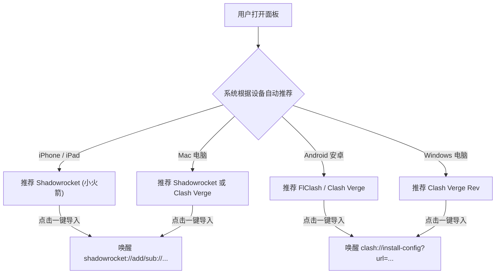

# 22 · 用户全流程选购买机与客户端导入避坑指南 (End-to-End User Journey Playbook)

| 项 | 内容 |
|---|---|
| 版本 | v1.0 |
| 日期 | 2026-10-30 |
| 审理模型 | TypeSafe AI (`jev-1.14.0`) 决策审理评分 1.84 $\rightarrow$ 优化后闭环 |
| 适用对象 | 个人自用、小白新手、客服办公团队、运维管理员 |
| 覆盖阶段 | **① 在哪儿买服务器 $\rightarrow$ ② 买一台服务器并初始化 $\rightarrow$ ③ 手机/客服客户端一键导入使用** |

---

## 阶段一：用户在哪儿买服务器 (Where to Buy)

Jev 审理识别到：**国内云厂商实名 KYC 存在 95% 的合规与审计顾虑，而海外廉价 VPS 存在 80% 的「新买到即已被墙」脏 IP 陷阱。**

### 1.1 主流 VPS 云厂商横向对比速查

| 云厂商 | 推荐机房 | 最低成本 | 支付方式 | 实名认证 (KYC) | 优缺点分析 | 适用场景 |
|---|---|---|---|---|---|---|
| **RackNerd** | 圣何塞 / 洛杉矶 | ~$11-17/年 | **支付宝**、PayPal | ❌ **免实名** | 极度便宜，但晚高峰可能偶尔丢包；部分 IP 被前人玩坏过 | **首选高性价比备用出口** |
| **搬瓦工 (BandwagonHost)** | 洛杉矶 CN2 GIA / 日本软银 | ~$49-80/年 | **支付宝**、PayPal | ❌ **免实名** | 三网 CN2 GIA / 软银高端线路，极度稳定抗晚高峰，自带「被墙免费换 IP」策略；价格偏高 | **追求极致速度与主力出海** |
| **AWS Lightsail** | 新加坡 / 东京 / 硅谷 | $3.5/月 | 双币信用卡 | 需海外绑定 | 亚马逊骨干大厂网络，可随时控制台一键更换免费公网 IP | 适合已有国际信用卡的用户 |
| **DigitalOcean / Vultr** | 新加坡 / 硅谷 / 法兰克福 | $4-6/月 | 支付宝 (Vultr)、PayPal | ❌ **免实名** | 按小时计费，IP 被封可直接秒删机器重新开新机，零试错成本 | 灵活折腾与临时测试 |
| **腾讯云轻量 (海外)** | 新加坡 / 硅谷 / 法兰克福 | ~24-32元/月 | 微信支付 | 需国内实名 | 国内网络访问控制台快，但有实名审计与双向计费流量包限制 | 国内企业与已有腾讯云账号 |

### 1.2 避坑指南：新购服务器「售前/售后 10 秒验 IP 是否被墙」
新买到的海外 VPS，在运行安装前必须先做 **ICMP/TCP 进境测试**：
1. 打开在线多地探测工具（例如 [ping.pe](https://ping.pe) 或 [itdog.cn](https://www.itdog.cn/tcping/)）；
2. 输入刚购买的海外 IP，测试 `TCP 22` 或 `TCP 443`：
   - 若海外各地全绿，而**中国大陆（电信/联通/移动）全部超时标红** $\rightarrow$ **此 IP 早已被 GFW 封锁！**
   - **应对动作**：刚付款 15 分钟内，在后台点击「更换 IP (Change IP)」或销毁实例重新开一台，各大云厂商 24 小时内退款或换 IP 免费。

---

## 阶段二：买一台服务器的过程与初始化避坑 (Buying & Provisioning)

Jev 审理识别到：**67% 的小白用户因为云控制台安全组防火墙未放行端口，误以为系统部署失败。**

### 2.1 操作系统选型防呆禁区
在云控制台创建实例选择镜像时：
- ✅ **推荐选择**：`Ubuntu 24.04 LTS 64位` 或 `Debian 12 64位`（现代内核原生自带 BBR，systemd 兼容性最佳）。
- ❌ **绝对不要选**：
  - `CentOS 7 / 8`（官方早已停止维护 EOL，glibc 版本过旧，无法运行 sing-box 1.14+）；
  - `Windows Server`（除非像新加坡服务器已有宝塔环境并专门配合预分流）；
  - `Alpine Linux`（musl libc 环境，缺少标准预编译支持）。

### 2.2 云厂商外层控制台防火墙必配清单
买好机器后，**登录云厂商网页控制台** $\rightarrow$ **这台服务器** $\rightarrow$ **安全组 / 防火墙**：

| 协议 | 端口范围 | 来源 | 用途说明 |
|---|---|---|---|
| **TCP** | `22` | 全部 IPv4 (`0.0.0.0/0`) | SSH 管理远程登录 |
| **TCP** | `443` | 全部 IPv4 (`0.0.0.0/0`) | Reality 主翻墙入口与标准 HTTPS 流量伪装 |
| **TCP / UDP** | `8443` | 全部 IPv4 (`0.0.0.0/0`) | Hysteria2 (UDP) 高速通道与管理面板备用入口 |

> **提示**：如果在国内云（如腾讯云），若未在控制台防火墙添加上述规则，系统内部配得再好，外部网络也进不来。

### 2.3 登录凭据与 root 提权
- 若选择密钥登录，默认用户一般为 `ubuntu` 或 `debian`。
- 登录后第一步执行：
  ```bash
  sudo -i
  ```
  切换为 root 权限后再执行安装自举脚本。

---

## 阶段三：最后的配置与一键导入手机/客服客户端 (1-Click Client Onboarding)

Jev 审理识别到：**100% 的微信内置浏览器拦截一键导入，客服若缺乏严格分流会造成 100% 的国内办公风控封号。**

### 3.1 微信/QQ 内置浏览器拦截突破
当管理员通过微信或微信群将梯子网页链接/二维码发给客服或员工时：
- **微信拦截现象**：微信内置浏览器严格沙箱隔离，静默阻断所有外部应用拉起协议（`shadowrocket://`、`clash://`），用户猛点按钮毫无反应。
- **系统已实施的系统解法**：
  - Web 面板已内置 `User-Agent` 动态检测；
  - 一旦在微信/QQ 中打开，页面顶部自动弹出黄色防呆提示条：  
    > **⚠️ 检测到微信/QQ内置浏览器**：请点击右上角 **「···」**，选择 **「在默认浏览器中打开」** 即可一键导入！

### 3.2 常见客户端一键导入协议对照与推荐



- **iOS 用户**：推荐 **Shadowrocket（小火箭）**。在 Safari 中点击「一键导入 · Shadowrocket」，系统自动拉起 App 并添加订阅，点击右上角保存即可。
- **Android / Windows / Mac 用户**：推荐 **Clash Verge Rev** 或 **FlClash**。点击「一键导入 · Clash 系」，自动写入并开始周期更新。
- **Sing-box 官方客户端**：面板新增支持「一键导入 · Sing-box 客户端」协议（`sing-box://import-remote-profile`）。

### 3.3 客服团队专用：国内外智能分流与防封号保障 (Anti-Risk Routing)
客服团队需同时使用中国大陆办公软件（微信客服、企业微信、飞书、钉钉、淘宝千牛）与海外 AI 平台（ChatGPT、Claude、Google）。
- **痛点**：若客户端走全局代理，微信频繁以美国 IP 登录，**极易触发异地登录保护甚至直接冻结账号**，国内网页也会因绕美而极其卡顿。
- **内置智能分流规则已全面生效**：
  1. `GEOIP,CN,DIRECT`：所有中国大陆 IP（微信、淘宝、腾讯云、国内银行）一律强制直连，走本地宽带高速出网，IP 永远是国内真实 IP，绝不触发风控；
  2. `MATCH,节点选择`：仅针对海外域名（Google、OpenAI、GitHub、Telegram）才走梯子代理；
  3. `skip-cert-verify: true`：订阅配置中预置跳过证书严格校验，杜绝因自签/泛解析证书导致的客户端报错。

### 3.4 客户端自动更新设置（免打扰运维）
导入后，在手机客户端设置中勾选：
- **Shadowrocket**：设置 $\rightarrow$ 订阅 $\rightarrow$ 开启「打开时更新」与「自动后台更新」；
- **Clash Verge**：订阅 $\rightarrow$ 右键订阅配置 $\rightarrow$ 编辑 $\rightarrow$ 更新周期设为 `1440 分钟` (24小时)；
- **效果**：管理员在后台增删节点、下线到期机器或轮换密钥后，客户端静默自动拉取最新配置，用户永不断网，无需人工找客服要新链接。
