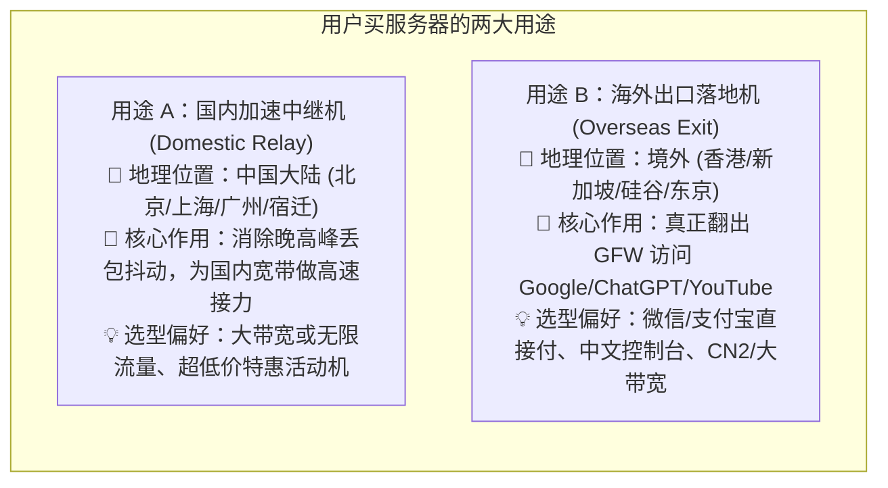
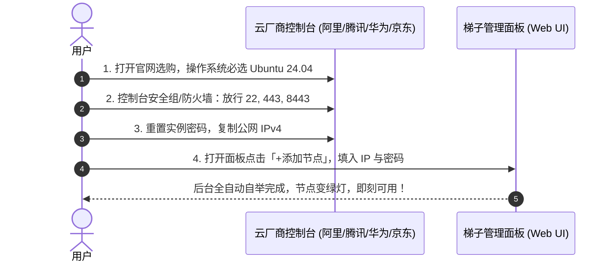

# 24 · 国内四大云厂商（阿里/腾讯/华为/京东）购机与节点接入实操 SOP

| 项 | 内容 |
|---|---|
| 版本 | v1.0 |
| 日期 | 2026-10-30 |
| 覆盖厂商 | **阿里云、腾讯云、华为云、京东云** |
| 核心目标 | **理清用户买来干什么、去哪家买、怎么配置，最后把公网 IP 填到面板全自动接入** |

---

## 一、用户去买服务器，究竟是去干什么？（明确两类核心定位）

在梯子系统中，一台云服务器主要承担两种角色，购买前必须先明确**这台机器的使命**：



- **用途 A：做国内中继机 (Domestic Relay)**：
  - **为什么需要**：晚高峰家里宽带（电信/移动/联通）直连美国 VPS 经常丢包 30%、极度卡顿；国内服务器利用顶级的 BGP 骨干网，国内访问延迟仅 10~30ms，中转出海又极稳定。
  - **怎么买最划算**：选国内地域，**优先选不限流量或自带大流量包的特惠机**（例如阿里云 99 元/年不限流量 ECS，或腾讯云 50 元/年轻量）。
- **用途 B：做海外出口机 (Overseas Exit)**：
  - **为什么需要在国内厂商买**：不想折腾外币信用卡和英文界面，国内大厂的境外轻量机支持微信/支付宝直接扫码付款，线路优良。
  - **怎么买最划算**：直接在各大厂商的海外轻量专区购买（如腾讯云硅谷/新加坡 24-34元/月）。

---

## 二、四大厂商横向对比与选购推荐

| 云厂商 | 推荐产品线 | 官方选购入口 | 推荐场景与规格 | 价格参考 | 关键优势与注意事项 |
|---|---|---|---|---|---|
| **阿里云** | **云服务器 ECS (经济型 e)** / 轻量应用服务器 | [aliyun.com/minisite/goods](https://www.aliyun.com/minisite/goods) | **国内中继首选**<br>2核2G 3M固定带宽 | **99元/年**<br>(新老用户同享) | 👑 **不限流量**！做中继再也不怕双向流量包跑爆，续费同价。 |
| **腾讯云** | **轻量应用服务器 (Lighthouse)** | [cloud.tencent.com/product/lighthouse](https://cloud.tencent.com/product/lighthouse) | **海外出口 / 国内中继皆可**<br>国内: 2核2G 4M<br>境外: 硅谷/新加坡 30M | 国内: ~68元/年<br>境外: 24~34元/月 | 控制台体验极佳；境外机提供微信支付；流量包出入双向计费需关注水位。 |
| **华为云** | **云耀云服务器 L 实例 (HECS-L)** | [huaweicloud.com/product/hecs-light.html](https://www.huaweicloud.com/product/hecs-light.html) | **政企级高稳定中继**<br>国内: 贵阳/北京/上海 2核2G | ~38-68元/年 | 华为网络骨干稳定性高，适合客服团队白天全天候挂机。 |
| **京东云** | **轻量云主机 (Light Host)** | [jdcloud.com/cn/products/light-cloud-host](https://www.jdcloud.com/cn/products/light-cloud-host) | **超低成本备用中继**<br>国内: 华北-北京 / 华东-宿迁 | ~38-50元/年 | 性价比极高，活动力度大，适合低成本中转备用。 |

---

## 三、用户完整实操流程（四大厂商通用 4 步走）

无论是哪家云厂商，从下单到最终在面板变绿灯，标准 SOP 只有 **4 个标准化步骤**：



### 第一步：打开网址并选购（参数防坑指南）

1. **登录控制台进入购买页**：
   - 阿里云：进入「云服务器 ECS 算力补贴」或「轻量应用服务器」；
   - 腾讯云：进入「轻量应用服务器」产品页；
   - 华为云：进入「云耀云服务器 L 实例」；
   - 京东云：进入「轻量云主机」。
2. **选择地域**：
   - 如果是做**国内中继**：选择离自己最近或全国骨干网城市（推荐：**北京、上海、广州、宿迁、成都**）；
   - 如果是做**海外出口**：选择 **中国香港、新加坡、美国硅谷、日本东京**。
3. **⚠️ 操作系统选择（防呆必看）**：
   - ✅ **唯一推荐**：**`Ubuntu 24.04 LTS 64位`**（或者 `Ubuntu 22.04 LTS`）。
   - ❌ **绝对不要选**：CentOS 7/8（官方淘汰EOL，无法运行现代sing-box）、Windows Server（异构配置繁琐）、宝塔/WordPress预装镜像。

---

### 第二步：云控制台放行安全组/防火墙（核心防坑）

> **为什么必须做**：云厂商在服务器外层有一道独立的安全组防火墙。如果不放行，内部装得再好，外部网络也连不上！

买好机器后，在云厂商控制台找到刚买的机器，进入 **「安全组」** 或 **「防火墙」**，添加如下规则：

| 协议类型 | 端口范围 | 来源地址 (CIDR) | 策略 | 用途说明 |
|---|---|---|---|---|
| **TCP** | `22` | `0.0.0.0/0` (全部) | 允许/放行 | SSH 远程部署与自举连接 |
| **TCP** | `443` | `0.0.0.0/0` (全部) | 允许/放行 | Reality 核心翻墙通道与 HTTPS 伪装 |
| **TCP / UDP** | `8443` | `0.0.0.0/0` (全部) | 允许/放行 | Hysteria2 高速 UDP 通道与面板备用 |

- **阿里云快捷操作**：进入实例详情 $\rightarrow$ 本实例安全组 $\rightarrow$ 配置规则 $\rightarrow$ 快捷添加。
- **腾讯云快捷操作**：轻量服务器详情 $\rightarrow$ 防火墙 $\rightarrow$ 添加规则 $\rightarrow$ 应用类型选「全部端口放通」或手动添加上述端口。
- **华为云快捷操作**：安全组 $\rightarrow$ 配置规则 $\rightarrow$ 入方向规则 $\rightarrow$ 添加规则。
- **京东云快捷操作**：轻量主机详情 $\rightarrow$ 防火墙 $\rightarrow$ 添加规则。

---

### 第三步：重置 root 密码并复制公网 IP

1. **重置登录密码**：
   - 在实例列表右侧点击 **「更多」** $\rightarrow$ **「密码/密钥」** $\rightarrow$ **「重置密码」**；
   - 设置一个较强的密码（例如 `MyPassword2026!`）；
   - **注意**：
     - 阿里云/华为云/京东云：默认用户名为 **`root`**；
     - 腾讯云轻量：默认用户名为 **`ubuntu`**（勾选支持 root 或直接使用 ubuntu + sudo 提权）。
   - 点击保存后，若提示重启，确认重启服务器生效。
2. **复制公网 IP**：
   - 在实例详情页中，找到 **公网 IP**（例如 `49.233.210.101`），点击一键复制。

---

### 第四步：把公网 IP 填到梯子面板，一键自动接入

现在回到我们的梯子管理面板：

1. 打开梯子控制台（`https://v.goodloop.si:8443`），登录管理账号；
2. 页面右上角点击 **「+ 添加节点」** 按钮，弹出向导窗口：
   - **节点名称**：自定义（例如：`阿里云-北京中继` 或 `腾讯云-硅谷出口`）；
   - **服务器 IP**：粘贴刚复制的 **公网 IP**；
   - **SSH 端口**：保持默认 `22`；
   - **登录用户**：腾讯云填 `ubuntu`，阿里/华为/京东填 `root`；
   - **认证方式**：选「密码」，填入刚才重置的实例密码；
   - **节点角色**：
     - 如果买的是**国内服务器**（北京/广州/宿迁等），选 **「国内中继」**；
     - 如果买的是**海外服务器**（硅谷/新加坡/香港等），选 **「海外出口」**。
3. 点击 **「开始部署」**！

```
🚀 后台全自动流水线开始运行（用户无需敲任何命令）：
[1/5] SSH 连通性测试与公钥自动置换 (TOFU 安全校验)
[2/5] 探测 Linux 发行版与内核版本，自动开启 Google BBR 拥塞控制
[3/5] 部署最新版 sing-box 内核与 systemd 开机自启守护
[4/5] 自动配置 Reality / Hysteria2 协议并配置内层 iptables 转发
[5/5] 执行端到端双视角健康探活，自动注册进集群与订阅
✅ 部署完成！节点卡片点亮绿灯，手机/电脑刷新订阅即可立刻使用！
```

---

## 四、四大厂商选购场景决策速查表（给小白的极简建议）

| 用户场景 | 推荐去哪家买？ | 推荐产品与地域 | 为什么这么选？ |
|---|---|---|---|
| **想要一个便宜的国内中继，怕流量超标** | **首选 阿里云** | 经济型 e 实例（北京/上海） | 99元/年包年，**不限流量**，绝不会因刷视频产生超额账单。 |
| **想要用微信支付直接买一台海外出口机** | **首选 腾讯云** | 轻量海外（硅谷 / 新加坡） | 中文界面，微信一键支付，自带 30Mbps 带宽与 1TB 流量包。 |
| **公司客服团队白天需要极高稳定性中转** | **首选 华为云** | 云耀 L 实例（北京 / 贵阳） | 华为网络政企骨干专线，防丢包抖动能力强。 |
| **纯粹个人备用，越便宜越好** | **首选 京东云** | 轻量云主机（华北-北京 / 华东-宿迁） | 新人特惠 38~50 元一年，适合低成本保活中转。 |
