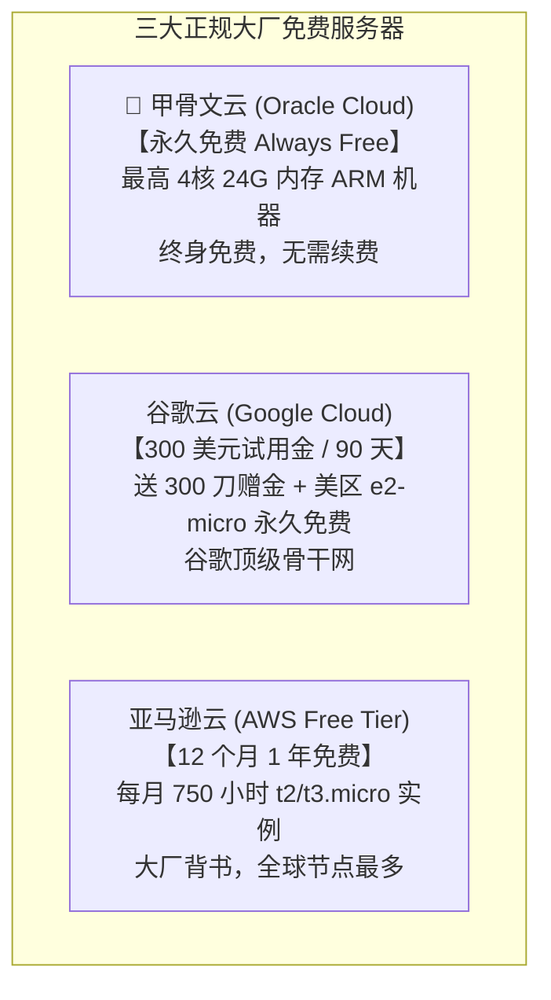
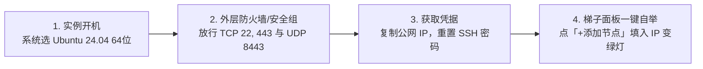

# 25 · 海外主流与免费白嫖云服务器选购接入全景 (Overseas VPS & Free Tier Playbook)

| 项 | 内容 |
|---|---|
| 版本 | v1.0 |
| 日期 | 2026-10-30 |
| 准入原则 | **坚决排除闲鱼/淘宝等杂牌二手黑机；只接入正规主流大厂与高信誉平台** |
| 覆盖类别 | **① 概念澄清 (Cloudflare/闲鱼) $\rightarrow$ ② 大厂免费白嫖神机 $\rightarrow$ ③ 国人常用海外高口碑 VPS $\rightarrow$ ④ 统一面板接入** |

---

## 一、明确底线与概念澄清

### 1.1 为什么坚决拒绝「闲鱼/淘宝杂牌二手服务器」？
在闲鱼或淘宝上常有几块钱、十几块钱的杂牌 VPS，**系统坚决不推荐也不应接入**，原因有四：
1. **NAT 共享端口陷阱**：几十上百人共享一个公网 IP，只分给你 10 个内网端口，根本开不了标准的 443/8443 端口；
2. **黑卡被封与跑路风险**：卖家多是用盗刷信用卡（黑卡）或开虚拟小号批量开机，1~2 周内就会被母机厂商直接封停封号，钱机两空；
3. **脏 IP 黑洞**：这些机器流转无数手，IP 早已被 GFW、Google、OpenAI 彻底拉入黑名单，买来也是残疾机；
4. **账号随时被找回**：原号主随时一个工单重置密码，存在严重的隐私和中间人抓包风险。

### 1.2 搞清楚：Cloudflare 到底是干什么的？
- **结论**：**Cloudflare (CF) 根本不是卖服务器的！**
- **它卖什么**：它全球最大的 CDN、DNS 托管、DDoS 防护和边缘无服务器计算（Workers/Pages），以及零信任网络（WARP/Zero Trust）。
- **圈子里常说的「白嫖 Cloudflare 节点」是什么**：很多 GitHub 项目利用 Cloudflare Workers 的免费额度配合反向代理或 WARP 组网，伪装成免费梯子。但这种节点**没有独立的 Linux 环境和 root 权限**，且 IP 属于广播公共 IP，被 ChatGPT、Google 严格风控，**不可作为企业或稳定自建的核心出口服务器**。

---

## 二、GitHub 与技术圈公认：大厂「免费白嫖」服务器指南

海外确实有几家正规国际巨头提供了真正的**永久免费 (Always Free)** 或**长期试用**云服务器。只要有条件注册，都是顶级优质出口：

### 2.1 👑 甲骨文云 (Oracle Cloud / OCI) —— 圈内公认的「白嫖之王」
- **官网入口**：`https://www.oracle.com/cloud/free/`
- **免费规格 (Always Free)**：
  - **ARM 实例**：最高可免费创建 **4核 24GB 内存、200GB 固态硬盘**（可以开成 1 台 4核24G，或拆成 2~4 台 1核6G）；
  - **AMD 实例**：2 台 1核 1GB 内存的 AMD 小机器；
  - **每月提供 10TB 免费出网流量**，完全用不完！
- **机房推荐**：推荐选择 **新加坡、日本东京/大阪、韩国首尔、美西圣何塞/凤凰城**。
- **避坑与门槛**：
  - **注册严格看脸**：必须准备一张真实全币种/双币单标信用卡（Visa/Mastercard），注册时扣 1 美元预授权后返还；对 IP 地址和账单地址审查严格；
  - **开机缺货**：热门亚太机房的 ARM 经常被抢空，可在 GitHub 搜索 `oci-cli` 脚本挂机自动刷机；
  - **开机后接入**：开好 Ubuntu 24.04 实例并分配公网 IP，在甲骨文控制台的「虚拟云网络 VCN $\rightarrow$ 安全列表」中添加入站规则放行 `22, 443, 8443`，即可直接填入我们面板一键点亮！

### 2.2 谷歌云 (Google Cloud / GCP) —— 300 美元赠金豪华体验
- **官网入口**：`https://cloud.google.com/free`
- **免费规则**：
  - 新账号绑定双币信用卡后，赠送 **300 美元试用余额**，有效期 90 天（3个月）；
  - 另外提供美区（俄勒冈/爱荷华等）永久免费的 `e2-micro` 微型实例（每月仅 1GB 出境流量，超额按标准计费）。
- **用途定位**：适合用 300 刀试用金在香港、新加坡或台湾机房开高规格机器，体验 3 个月谷歌顶级骨干直连网络。

### 2.3 亚马逊云 (AWS Free Tier) —— 1 年免费套餐
- **官网入口**：`https://aws.amazon.com/free/`
- **免费规则**：
  - 新注册账号提供 **12 个月（1年）免费体验**；
  - 每月免费提供 **750 小时** 的 `t2.micro` 或 `t3.micro` Linux 虚拟机（刚好够 1 台机器 24 小时不断开运行一整年）；
  - AWS Lightsail 轻量云也经常提供新用户前 3 个月免费试用。
- **⚠️ 避坑警示（防惊悚账单）**：
  - AWS 每月仅包含 15GB 免费出网流量，超额流量费用极贵（\$0.09/GB）；用来做主力出海看 4K 视频极易超标，**建议设置账单预算告警**（或在信用卡控制台锁死月额度）。

---

## 三、国人最常用：海外正规高口碑高性价比 VPS

如果不想折腾免费账号的苛刻信用卡审核，以下 4 家是国内技术圈口碑最好、支持支付宝、免实名的正规服务商：

| VPS 厂商 | 官网入口 | 最低价格 | 支付方式 | 线路与网络质量 | 核心优势与推荐场景 |
|---|---|---|---|---|---|
| **搬瓦工** (BandwagonHost) | [bandwagonhost.com](https://bandwagonhost.com) | ~$49-80/年 | **支付宝** PayPal | 👑 **三网顶级 CN2 GIA / 软银** 晚高峰 0 丢包，极速低延迟 | **追求极致速度的首选** 带「IP被封一键换新」策略，适合不差钱的专业团队。 |
| **RackNerd** | [racknerd.com](https://racknerd.com) | **~$11-17/年** (白菜价) | **支付宝** PayPal | 美西洛杉矶/圣何塞直连 普通骨干网，晚高峰轻微抖动 | **性价比之王 / 传家宝** 年付几十块钱，免实名 KYC，做备用机或刷视频极具性价比。 |
| **腾讯云海外轻量** | [cloud.tencent.com](https://cloud.tencent.com) | ~24-34元/月 | **微信支付** | 香港/新加坡/硅谷大厂 BGP 30Mbps 带宽，1024GB 流量 | **最省心的主流大厂** 微信直接扫码买，中文控制台，免外币卡，网络优秀。 |
| **阿里云海外轻量** | [aliyun.com](https://aliyun.com) | ~24-34元/月 | **支付宝** | 香港/新加坡大厂优质回国优化 30Mbps 峰值 | **香港优质网络标杆** 适合需要稳定亚太 IP 的电商或出海业务。 |

---

## 四、海外云服务器标准化配置与一键接入流程

无论是甲骨文免费机、谷歌云、AWS 还是 RackNerd/搬瓦工，买好（或开好）之后，接入我们系统的步骤是**完全一致的**：

1. **镜像选型**：创建实例时，统一选择 **`Ubuntu 24.04 LTS`**（或 `Debian 12`）。
2. **云防火墙开放**：在后台安全组（Security Lists / Firewall）放行入方向：
   - `TCP 22`（管理部署）
   - `TCP 443`（Reality 核心出口通道）
   - `TCP/UDP 8443`（Hysteria2 抗丢包通道）
3. **获取登录凭据**：
   - 搬瓦工 / RackNerd：开机后邮件会直接发送 root 初始密码与公网 IP；
   - 甲骨文 / AWS / 谷歌云：默认使用密钥登录，可登录后执行 `sudo passwd root` 设定密码并修改 `/etc/ssh/sshd_config` 允许密码登录，或者在添加节点时直接使用私钥认证。
4. **面板一键接入**：
   - 打开梯子管理面板 `https://v.goodloop.si:8443` $\rightarrow$ 点击 **「+ 添加节点」**；
   - 填入公网 IP，角色选择 **「海外出口」**；
   - 点击 **「开始部署」**，系统自动完成依赖安装、BBR 加速配置与协议下发，1 分钟内点亮可用！
