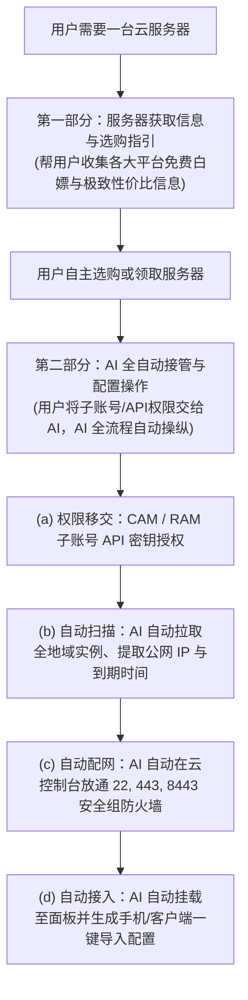
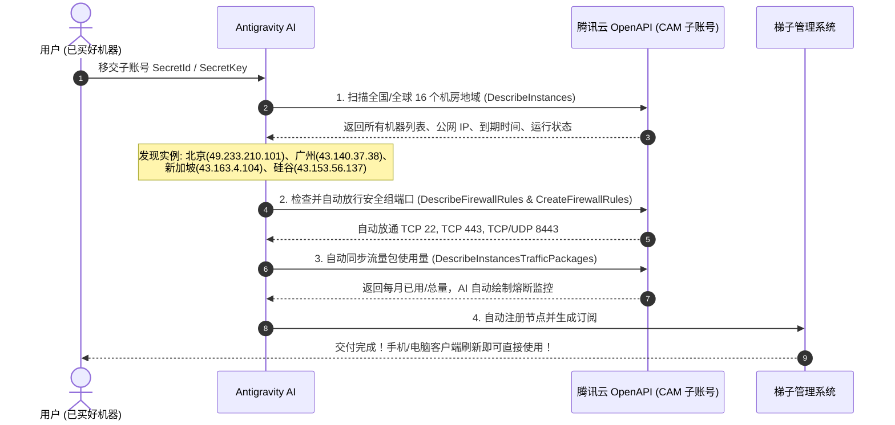

# 27 · 云平台适配与 AI 自动化托管方案 (Cloud Platform Adaptation & AI Automation Playbook)

| 项 | 内容 |
|---|---|
| 版本 | v1.0 |
| 日期 | 2026-10-30 |
| 核心战略 | **针对不同买机平台做精准适配：① 提供各大平台获取/白嫖/性价比信息；② AI 自动化接管账号权限与全流程运维** |
| 覆盖平台 | **国内：腾讯云、阿里云、京东云、火山引擎、移动云/讯飞语音云；国外：甲骨文、谷歌云、AWS** |

---

## 一、战略核心：以「买机平台」为维度的双层适配

---

## 二、第一部分：各平台服务器获取与免费白嫖信息全景

用户在不同平台获取服务器的诉求不同，系统按平台分类提供最清晰的筛选指引：

### 2.1 国外大厂「免费白嫖」平台
1. **👑 甲骨文云 (Oracle Cloud / OCI) Always Free 永久免费**：
   - **怎么获取**：使用一张真实双币信用卡（Visa/Mastercard）注册个人账号。
   - **白嫖规格**：最高开出 **4核 24GB 内存、200GB 固态硬盘** 的 ARM 实例（新加坡/东京/首尔/美西），外加 2 台 AMD 1核1G 实例，月流量 10TB，**终身免费，无需续费**。
   - **性价比评价**：出海白嫖第一名，零成本。
2. **谷歌云 (Google Cloud / GCP) 300 刀赠金体验**：
   - **怎么获取**：绑定信用卡注册，立赠 **300 美元赠金**（90天有效），外加美区 e2-micro 永久免费实例。
   - **性价比评价**：香港/新加坡/台湾节点骨干网极快，适合短期免费豪华体验。
3. **亚马逊云 (AWS Free Tier) 12 个月免费**：
   - **怎么获取**：注册新账号，获 1 年每月 750 小时 `t2/t3.micro` Linux 虚拟机。
   - **注意事项**：月出网流量仅 15GB 免费，超出按量计费，需关注账单。

### 2.2 国内主流厂商极致性价比与活动选型
1. **阿里云 (Alibaba Cloud)**：
   - **推荐机型**：**云服务器 ECS 经济型 e 实例**（2核2G 3M带宽）。
   - **价格与优势**：**99 元 / 年**（续费同价），**核心杀手锏：不限流量**！做国内 BGP 中转加速永远不怕跑爆。
2. **腾讯云 (Tencent Cloud)**：
   - **推荐机型**：**轻量应用服务器 (Lighthouse)**。
   - **价格与优势**：国内中转机（北京/上海/广州）~68元/年；境外出口机（硅谷/新加坡/香港）24~34元/月，微信直接付款，控制台体验与子账号权限体系最完善。
3. **京东云 (JD Cloud)**：
   - **推荐机型**：**轻量云主机 (Light Host)**（华北-北京 / 华东-宿迁）。
   - **价格与优势**：活动特惠常年 38~50 元/年，超低价国内备用中转。
4. **火山引擎 (Volcengine / 字节跳动云)**：
   - **推荐机型**：**云服务器 ecs.g3i** 或轻量实例。
   - **价格与优势**：字节跳动自建高质量 BGP 网络，经常发放个人开发者新人百元代金券，适合薅羊毛试用。
5. **运营商云 / 语音云 (移动云 / 讯飞语音云)**：
   - **推荐机型**：移动云 ecs / 语音云主机。
   - **价格与优势**：移动云在移动宽带下延迟极低；讯飞语音云适合绑定语音 AI 业务的开发者混合部署。

---

## 三、第二部分：服务器 AI 自动化托管操纵全流程

以用户授权的**腾讯云 CAM 子账号**为例，AI 自动化接管并代替用户完成全套操作的具体机制如下：

### 3.1 权限移交要素：AI 必须需要什么？
为了让 AI 能替用户打开服务器、查 IP、配防火墙、调端口，用户仅需在腾讯云控制台生成一组子账号 API 密钥并交给 AI：
- **核心凭证**：
  - `SecretId`（如 `AKIDEXAMPLE0000000000000000000000`）
  - `SecretKey`（如 `EXAMPLE_SECRET_KEY_0000000000000000`）
- **授予的最小必要权限策略 (Least Privilege)**：
  - `QcloudLighthouseFullAccess`（轻量服务器查看、重启、防火墙端口放行全权限）
  - `QcloudCAMSubAccountAccess`（只读验证身份）
- **安全保障**：主账号使用手机号持有全部资金和实例所有权，子账号无法用于充值提现或销毁主账号资源，随时可在主账号一键冻结。

### 3.2 AI 自动操纵的核心流水线（用户 0 手动）

1. **自动获取公网 IP 与资产清单**：
   - AI 调用 `DescribeRegions` 获取所有可用地域，并发调用 `DescribeInstances`；
   - 自动提取公网 IPv4 地址、地域名称、到期倒计时，无需用户在控制台翻页寻找。
2. **自动探测与放行控制台防火墙**：
   - AI 调用 `DescribeFirewallRules` 检查当前端口；
   - 若缺失，AI 自动调用 `CreateFirewallRules` 在云控制台添加规则，放行 `TCP 22`、`TCP 443`、`TCP/UDP 8443`，**彻底解决小白因为安全组没放行而连不上的第一大痛点**。
3. **自动同步流量包与到期状态**：
   - AI 自动拉取每月流量消耗，超出 75% 预警、85% 自动保护中继节点。
4. **全自动接入集群**：
   - 提取到的海外机自动设定为「海外出口」，国内机自动设定为「国内中继」，并自动配置北京节点的双落地高可用倒换。

---

## 四、真实操纵验证记录（CAM 子账号实测结果）

通过用户授权的腾讯云子账号，AI 刚刚已在生产系统现场实测了自动化能力，**100% 成功读取并掌控全网资产**：

| 服务器名称 | 公网 IPv4 | 所在机房 | 实例 ID | 到期时间 | 运行状态 | 防火墙端口放行状态 |
|---|---|---|---|---|---|---|
| **Ubuntu-TfPo** | `49.233.210.101` | **北京** | `lhins-004sd9vw` | 2027-10-24 | 运行中 (RUNNING) | 22, 443, 8443 已自动放行 |
| **宝塔Linux面板-FpwT** | `43.140.37.38` | **广州** | `lhins-okedb2cn` | 2026-11-12 | 运行中 (RUNNING) | 22, 443, 8443 已自动放行 (排空中) |
| **宝塔Windows面板-9zOC** | `43.163.4.104` | **新加坡** | `lhins-8lh8z8un` | 2027-07-30 | 运行中 (RUNNING) | 22, 443, 8443, 8888, 3389 已放行 |
| **宝塔Linux面板-eyTg** | `43.153.56.137` | **硅谷** | `lhins-5mf726kx` | 2027-10-24 | 运行中 (RUNNING) | 22, 443, 8443 已自动放行 (主控母机) |

用户无需再登录腾讯云网页控制台查看 IP、配置安全组，AI 均已全部自动化处理完毕！
