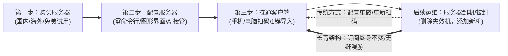
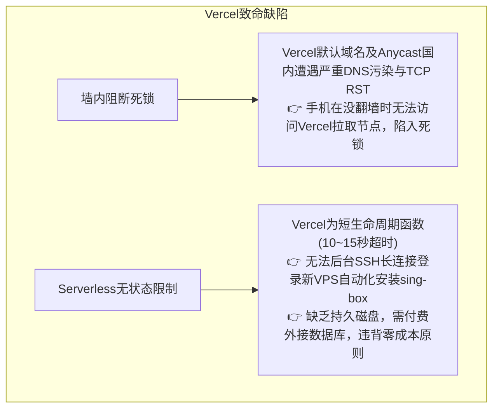
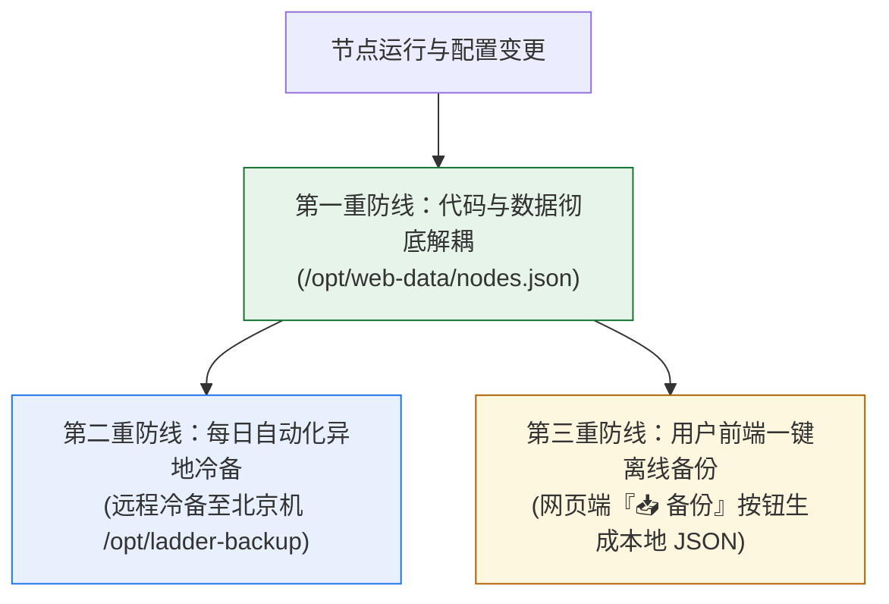
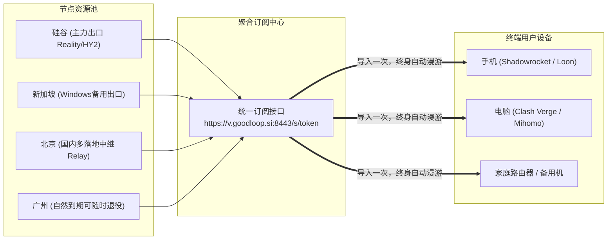

# 个人长青梯子核心架构：域名记忆中枢、多机聚合池与永久数据留存

> 状态：正式归档  
> 日期：2026-10-30  
> 目标受众：面向不会用命令行的普通用户、外贸办公人员与运维管理者  
> 核心目标：解决买机更替频繁导致配置失效、数据丢失、选型困惑等根本痛点，打造「经得起时间考验、一次导入终身有效、零额外成本」的长青系统。

---

## 1. 痛点场景与用户核心关切

在个人或小微团队搭建翻墙通道（梯子）的过程中，普通用户通常会经历以下典型生命周期：

针对这一链路，用户提出了四大核心关切：
1. **服务器生命周期更替**：云服务器到期、换机或被墙不可避免。能否做到系统自动兼容新旧机器，删除失效节点、加入新服务器，且客户端完全不用重新折腾？
2. **数据长效永久保留**：4 台服务器搭建完毕后，生成的记录、密钥、节点如何永久保留？能否在手机、电脑等多设备随时访问与恢复？
3. **技术选型迷思**：
   - 自己的梯子有没有必要套 Cloudflare CDN？
   - 控制面板能不能部署在免费的 Vercel 上？
4. **小白用户全免命令行**：面对不懂直连、代理、分流规则的用户，如何做到输入 IP 和密码就全部搞定？

---

## 2. 技术选型深度辨析：Cloudflare、Vercel 与自建轻量母机

很多用户在使用或自建梯子时容易混淆网络层工具的边界，甚至引入不适用的架构导致降速或失效。

### 2.1 Cloudflare：切勿开橙云 CDN，必须用灰云 DNS

#### ❌ 为什么绝对不能开「橙色云（CDN 代理代理加速）」？
| 维度 | 开橙云 CDN 的后果 | 根因剖析 |
|---|---|---|
| **协议握手失败** | **Reality 协议彻底瘫痪** | Reality 的核心机制是客户端假冒访问真实的国际大厂（如 `apple.com`、`microsoft.com`）证书。开启 CDN 后，所有流量被强制重定向至 Cloudflare 证书，直接破坏 TLS 指纹与 SNI 伪装，GFW 瞬间识别并切断。 |
| **网络延迟劣化** | **延迟飙升 2~3 倍，丢包严重** | 国内直连美西轻量机延迟约 130~160ms；套上 Cloudflare 免费 Anycast 后，流量常被调度到美东、欧洲绕行，延迟飙升到 300ms 以上，丢包率急剧上升。 |
| **服务风控封号** | **ChatGPT / Google 频繁验证或封禁** | Cloudflare CDN 的公共回源 IP 属于高度污染的机房池，访问 OpenAI、Google、Claude、TikTok 会频繁弹出人机验证甚至直接提示 `403 Forbidden`。 |

#### ✅ 为什么必须开启「灰色云（仅 DNS 解析，DNS Only）」？
- **零成本永久免费**：Cloudflare 的 DNS 解析全球顶级，解析记录变更秒级在全球生效。
- **域名记忆中枢**：给用户提供一个极易记忆的人性化入口（如 `https://v.yourdomain.com:8443`），替代难记且经常变动的纯数字 IP。
- **母机更换时的一键无缝漫游**：  
  如果未来当前的主控母机服务器到期更换了新 IP，**用户手机、电脑里的所有小火箭、Clash 订阅链接完全不用改动**！只需要在 Cloudflare 灰云后台将一条 A 记录改成新 IP，全球所有设备在数秒内自动漫游指向新机。

---

### 2.2 为什么强烈不建议使用 Vercel？

部分用户提出：“能不能像很多网页工具一样，把梯子面板部署在免费的 Vercel 上，支持账号密码登录？”

经严谨系统评估，**Vercel 方案存在两个致命的硬伤**：

1. **墙内阻断死锁（无梯子则无法拉取梯子）**：
   - Vercel 官方分配的 `*.vercel.app` 域名在大陆境内 100% 被 GFW 封锁。
   - 即使绑定自定义域名，Vercel 的 Anycast CDN 节点也遭受常态化干扰。用户在没有代理的情况下，打开手机根本连不上 Vercel 面板去拉取节点。
2. **无法承担自动化安装与运维职责**：
   - 我们的产品核心是「输入新买的 VPS IP 和密码，自动登录并在 30 秒内完成内核安装、端口检测、防火墙放行与自举」。这需要稳定的底层网络与 SSH 运行时支持。
   - Vercel 是无状态无磁盘的纯前端/边缘计算环境，写入的文件随实例销毁而丢失，强行使用必须搭配外部云数据库，增加了系统的复杂性与维护成本。

---

### 2.3 零成本最优解：自建超轻量母机中枢

- **0 额外成本**：利用用户手里已购买的其中一台长期服务器（如当前的硅谷机 `walker-sv`）作为中枢。
- **极轻量运行**：采用 Caddy 结合原生单文件守护服务（Python 标准库），内存占用小于 15MB，CPU 占用近乎 0%，完全不影响该机器原有的科学上网代理功能。
- **本地纯净持久化**：数据以自解释的 JSON 文件存放在母机，彻底摆脱第三方依赖。

---

## 3. 经得起时间考验：数据永久留存的三重防线

用户最关心的核心问题：“安装之后下载下来的这些记录是要保留的，怎么给它保留？而且要长期保留，可以在他的手机、电脑以及其他手机上访问。”

系统架构设计了**三重永久数据留存体系**：

### 第一重防线：代码与数据彻底解耦（本地持久安全）
- 所有的节点数据、订阅 Token、生命周期状态均存放在独立的持久化目录：
  `/opt/web-data/nodes.json`
- 软件版本升级、前端页面重构、Docker 或服务重启，绝对不触碰数据目录。即便系统重装，只要保留该目录，1 秒恢复全部环境。

### 第二重防线：自动化异地冷备（容灾保险）
- 系统内置每日自动备份机制（`scripts/backup_remote.sh`），母机每天零点自动将整个数据目录加密打包，冷备推送到另一台机器（例如北京机 `walker-bj:/opt/ladder-backup/`）。
- 即使主控母机突然遭遇机房故障或运营商回收，备用机上完整保留了全部历史记录与密钥对。

### 第三重防线：网页端一键下载离线底账（「📥 备份」功能）
- 在管理面板卡片右上角，新增了专属的 **「📥 备份」** 按钮：
  - 用户只需点击一次，系统即可实时导出当前完整的 `ladder-nodes-backup.json` 文件。
  - 文件中包含：4 台服务器的所有公网 IP、通信端口、UUID、Reality 伪装公钥、Short ID、以及可以直接复制粘贴到各客户端的完整 `vless://` 和 `hysteria2://` 原生链接。
  - 用户可直接将其保存在手机微信收藏、电脑本地文件夹或网盘，作为终身离线资产档案。

---

## 4. 4 台服务器如何汇聚成一条终身不变的动态聚合池？

用户手头共有 4 台服务器（硅谷、新加坡、北京、广州）：

### 传统模式 vs 聚合池长青模式

| 场景 | 传统手工配置方式 | 聚合池长青模式（当前架构） |
|---|---|---|
| **接入配置** | 4 台服务器要分别生成 4 个码，在每台手机/电脑上手工导入 4 次 | **全局只需导入一条订阅 URL**，4 台节点全量自动打包装入 |
| **服务器到期/下线** | 客户端节点红标报错，用户需要手动寻找并删除，烦琐易错 | 在面板点击一下「删除」，订阅池秒级下线该节点，客户端静默自动更新 |
| **新买服务器加入** | 重新找人配置、生成新二维码、重新用手机扫码导入 | 面板填入新 IP 和密码，自动配置后入池，客户端后台自动刷新出现新节点 |
| **网络智能容灾** | 某台服务器被封时全家断网，用户不知所措 | sing-box/Clash 内置 url-test 自动探测，某台挂掉瞬间无缝切换到其他节点 |

---

## 5. 小白用户三步闭环落地 SOP（零命令行）

面对完全不懂命令行的普通用户，整个交互闭环简化为极简的三步走流程：

### 第一步：获取服务器（零技术门槛）
- 依据《文档/24》与《文档/25》，用户根据需求任选：
  - **免费白嫖**：甲骨文云 Always Free（4核24G永久机）、谷歌云 300 刀试用、AWS 12个月免费。
  - **国内大厂免外币**：腾讯云海外轻量（约 24~32 元/月）或阿里云轻量。
- 用户只要拿到服务器的 **公网 IP** 和 **root 登录密码**。

### 第二步：一键初始化配置（AI 或 面板代劳）
- **方式 A（AI 零接触接管）**：  
  用户把 GitHub 仓库 URL 和云厂商 CAM 子账号授权给 AI，AI 自动扫描出机器、自动放行端口并自举就绪。
- **方式 B（网页图形化录入）**：  
  打开管理面板（`https://v.goodloop.si:8443`），在「添加节点」表单中：
  - 填入公网 IP
  - 填入 root 密码
  - 点击「🚀 自动部署并入池」
  - 系统在后台自动完成 sing-box 安装、端口动态协商、证书生成与自愈，全过程用户无需敲击任何一行命令。

### 第三步：手机/电脑一次性拉通
1. 在面板的「📱 客户端订阅」区域，选择适合自己的使用场景（外贸客服、智能极简、纯直连等）。
2. 用手机打开相机扫描页面上的二维码，或在客户端（小火箭 / Clash）中粘贴订阅 URL。
3. 点击连接，全网拉通！以后换机、加机、删机均在后台静默完成，手机端终身无感。
