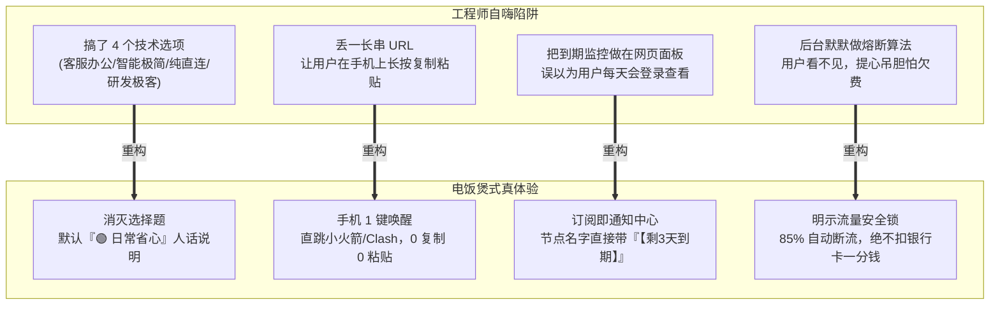
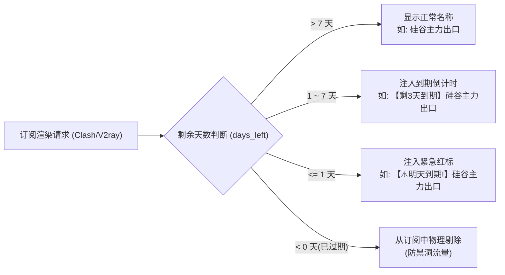
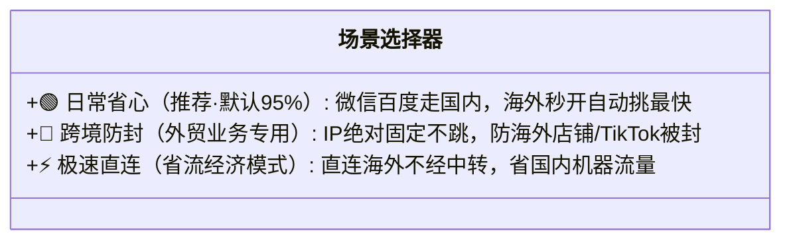

# 从工程师自嗨到电饭煲神器：极简用户体验重塑与交互重构 PRD

> 状态：正式归档（产品需求规格说明书）  
> 日期：2026-10-30  
> 责任人：产品经理（PM）  
> 核心受众：全流程无命令行认知的普通个人、外贸人员、科研办公者  
> 核心隐喻：**“把工具做成电饭煲，不要做成飞机驾驶舱”**——插电、加米、按「煮饭」，水烧干前自动断电，绝不让用户调节气阀。

---

## 1. 真实用户视角的当头棒喝

在过去的多轮技术演进中，工程团队先后攻克了多落地中转自愈、动态端口冲突协商、CAM 子账号扫码上云、离网单测等复杂架构。但当站在一位没有任何 Linux 基础、真金白银买了服务器的**真实普通用户**面前时，系统暴露出了一系列典型的“工程师自嗨式反人性断点”：



### 真实用户直击要害的 5 大诉求：
1. **别让我做选择题**：技术分类让人发懵，用户只想“国内正常开、国外极速翻”，默认给最省心的即可。
2. **手机端必须「一键直达」**：手机复制长链接容易断、小火箭手动配置易出错，必须支持点击直接唤醒客户端 App 自动装入。
3. **千万别让我欠费倒贴钱**：轻量云超量按 GB 扣费极贵，用户最怕一觉醒来卡被扣爆。必须在界面明示“物理熔断，绝不欠费”。
4. **服务器快到期了在客户端告诉我**：用户几个月不登一次网页面板，断网才知到期太反人性。必须把到期倒计时做进日常每天看的手机节点名称里。
5. **母机挂了要像“恢复 iPhone”一样简单**：哪怕主控机器失联，只要把备份文件往新机器网页一拖，节点全量满血复活。

---

## 2. 核心功能重构需求规格说明（PRD）

---

### 2.1 需求一：订阅即通知中心（节点名动态植入到期报警）

#### 痛点场景
用户买了 1~4 台轻量云服务器，租期半年或一年。用户不会定期登录云控制台，也不会天天看梯子网页后台。当某台机器即将到期被销毁时，用户在不知情的情况下遭遇断网或中转失效。

#### 产品解决方案
**把手机客户端（Shadowrocket / Clash）的节点列表，直接改造成无感通知中心。**  
通过服务端订阅生成引擎（`server/nodekit/subscriptions.py`），根据节点生命周期数据动态修饰输出的节点名称：



#### 规则规格定义
| 节点剩余天数 | 原始名称 | 客户端最终显示名称 | 订阅行为 |
|---|---|---|---|
| `days_left > 7` 或未设置 | `硅谷主力出口` | `硅谷主力出口` | 正常进订阅 |
| `1 < days_left <= 7` | `硅谷主力出口` | `【剩3天到期】硅谷主力出口` | 正常进订阅，醒目警示 |
| `0 <= days_left <= 1` | `硅谷主力出口` | `【⚠️明天到期!】硅谷主力出口` | 正常进订阅，最高危警示 |
| `days_left < 0`（已超期） | `硅谷主力出口` | `【已过期】硅谷主力出口` | 自动剔除，防止客户端死连 |

* **用户体验收益**：用户只要在手机上打开小火箭或连接科学上网，一眼就能看到倒计时，从容续费或换新机。

---

### 2.2 需求二：手机端一键唤醒 URL Scheme（消灭复制粘贴）

#### 痛点场景
用户在手机 Safari/Chrome 打开管理面板，需要：选中文本框 $\rightarrow$ 点击复制 $\rightarrow$ 切换回手机桌面 $\rightarrow$ 找到 Shadowrocket 打开 $\rightarrow$ 点击右上角加号 $\rightarrow$ 选类型 Subscribe $\rightarrow$ 粘贴 URL $\rightarrow$ 点击保存。步骤多达 8 步，误触率极高。

#### 产品解决方案
在面板「📱 客户端订阅」区域增加**平台自适应的一键直达按钮**，利用主流客户端的私有 URL Scheme，实现 1 次点击自动唤醒并装载订阅：

```html
<!-- 小火箭一键唤醒协议规范 -->
shadowrocket://add/sub://<base64_url>?title=我的长青梯子

<!-- Clash / Verge / Mihomo 唤醒协议规范 -->
clash://install-config?url=<url_encoded_sub_url>&name=我的长青梯子

<!-- Sing-box 官方客户端唤醒协议规范 -->
sing-box://import-remote-profile?url=<url_encoded_sub_url>#我的长青梯子
```

#### 界面交互逻辑
1. 页面自动通过 `navigator.userAgent` 探测当前访问设备：
   - 若为 **iOS / iPadOS**：首推 **「📱 一键导入小火箭 (Shadowrocket)」**，次推 Sing-box。
   - 若为 **Android / Windows / macOS**：首推 **「⚡ 一键导入 Clash / Verge」**。
2. 用户点击按钮：
   - 浏览器直接弹出系统级确认：*“在‘Shadowrocket’中打开？”*
   - 用户轻触「打开」，小火箭即刻完成配置拉取与节点列表加载，耗时 $< 2$ 秒！
3. 降级容错：
   - 仍保留「📋 复制链接」按钮与「📷 二维码弹窗」，满足电脑看网页、手机扫码等场景。

---

### 2.3 需求三：场景选择器“大白话”人话重塑

#### 痛点场景
界面提供「客服办公、智能极简、纯直连、研发极客」，用户不懂背后的路由规则（如 IP 是否锁死、走不走国内中继），产生严重的选择恐惧症。

#### 产品解决方案
彻底废除技术黑话，重塑为基于用户真实意图的 3 档大白话选择器，**并默认选中第 1 项**：



* **UI 展现原则**：
  - 默认加载即为 `🟢 日常省心`，**用户无需做任何操作**，直接点击导入即可获得最优配置。
  - 每一个选项下方配一行 12px 浅灰色的人话解释，禁止出现“中继、落地、SNI、Reality”等任何技术字眼。

---

### 2.4 需求四：流量防爆安全锁与定心丸可视化

#### 痛点场景
用户购买腾讯云/阿里云按量计费或包含固定月流量包的轻量云（如 1000G/月）。用户极度恐惧超标后银行卡被扣费。

#### 产品解决方案
把已实现的 `quota_guard.py` 水位熔断机制从“幕后隐形守护”转变为“台前定心丸”：
1. **视觉定心丸**：
   - 在卡片醒目区域展示防爆护盾徽章：  
     `🛡️ 流量安全锁：已激活 (自动监控各节点用量，达 85% 自动熔断断流，绝不扣费倒贴)`
2. **熔断保护行为**：
   - 当探测到某台机器月度流量达到 85% 水位时，该节点自动转入 `draining / circuit_broken` 状态，停止路由流量。
   - 手机客户端自动平滑切换走其他 3 台节点，保证用户核心网络可用，同时确保云厂商账单为 0。

---

### 2.5 需求五：一键上传恢复（iPhone 换机式灾备）

#### 痛点场景
母机硅谷服故障或重装后，用户手里虽然有先前点击「📥 备份」下载的 `ladder-nodes-backup.json`，但不会敲命令将其写入服务器。

#### 产品解决方案
1. **导出端（已上线验证）**：
   - 点击面板「📥 备份」，瞬间下载 `ladder-nodes-backup.json`，里面包含节点元数据及开箱即用的 `vless://` / `hysteria2://` 原生直连链接（失联时的急救底牌）。
2. **导入端（本次上线）**：
   - 面板卡片增加 **「📤 恢复」** 按钮。
   - 用户点击后弹出文件选择框，选择本地的备份 `.json` 文件上传。
   - 后端 `POST /api/restore` 接收并原子替换 `/opt/web-data/nodes.json`，1 秒原地满血复活所有历史节点。

---

## 3. 技术落地分解与验收门禁

| 模块 | 改动文件 | 技术实现要点 | 验收门禁 |
|---|---|---|---|
| **订阅通知中心** | `server/nodekit/subscriptions.py` | 提取 `lifecycle.get_days_until_expiration`，根据天数在 `node_uri()` 与 Clash 名称前加 `【剩X天到期】` | 单测覆盖 `>7天`、`3天`、`1天`、`已过期` 场景；真机 curl 订阅验证节点名 |
| **手机一键唤醒** | `web/index.html` | 新增 `openClientApp(scheme)` 函数，提供小火箭、Clash、Sing-box 的 Scheme 组装 | 手机点击能够正常唤醒本地 App；微信内提示右上角跳浏览器 |
| **大白话重塑** | `web/index.html` | 简化场景选择器为 3 个卡片：日常省心、跨境防封、极速直连；默认选中日常省心 | 页面无生涩技术黑话，文案通俗易懂 |
| **备份一键恢复** | `server/admin.py` + `web/index.html` | 新增 `POST /api/restore` 接口，校验备份格式合法后安全写入 `nodes.json` | 导出备份后清空或改名，点击恢复后节点数 100% 完整复原 |

---

## 4. 产品经理发布判准（Definition of Done）

1. **零门槛测试**：找一个完全不懂 Linux 的普通人，在手机 Safari 上打开页面，能够在 **10 秒内** 完成日常省心节点的一键导入并顺利翻墙。
2. **安全感测试**：到期预警在手机小火箭里清晰可见，流量安全锁明确展示，用户无财务顾虑。
3. **单测与线上验收**：全部 13 套单测 100% 通过，生产验收脚本 `./scripts/verify.sh` 20 项验收 100% 通过。
