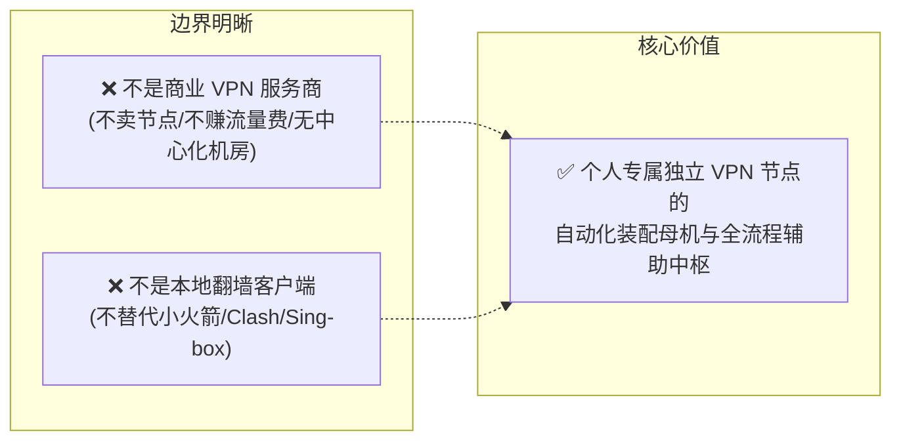

# 30 · 产品定位与全流程辅助装配白皮书

> 状态：正式归档（产品定位纲领性文档）  
> 日期：2026-10-30  
> 核心定义者：真实用户与产品团队共同提炼  
> 适用对象：不会命令行的普通用户、外贸跨境人员、科研学术者

---

## 1. 终极产品定位：它到底是什么？

用三句话即可讲透本产品的本质定位：



1. **它不是 VPN 本身**：我们不经营商业翻墙业务，不售卖共享机场节点，不收集任何用户流量。你的流量只在你自己购买的服务器与你的手机/电脑之间点对点流通，拥有 100% 的隐私与物理隔离。
2. **它不是本地运行的客户端**：它不是用来替代手机上的小火箭（Shadowrocket）、电脑上的 Clash Verge 或 Sing-box 的软件。手机/电脑依然使用这些成熟顶级的客户端来开启代理。
3. **它的真正身份**：**「用来帮助你搭建属于自己的独立 VPN 节点的自动化母机与全流程辅助中枢」**。它把原本只有高阶工程师才能完成的“选机、编译、防火墙规则、伪装证书、路由分流、动态容灾”等一系列高门槛脏活累活，彻底封装成一个任何人都能操作的“家用电饭煲”。

---

## 2. 全流程三大环节图谱（The 3-Step Journey）

整个系统的价值流，完整贯穿于用户从零到拉通的**三大闭环环节**：

```mermaid
flowchart TD
    subgraph 环节一：选择自己的服务器
        S1["国内外主流选型指引<br/>· 国内免外币大厂 (腾讯轻量 / 阿里99元)<br/>· 海外正规白嫖 (甲骨文永久 / 谷歌300刀 / AWS)"]
        S2["售前辅助避坑教学<br/>· 10秒测IP是否被墙 · 坚决排除二手黑机"]
    end

    subgraph 环节二：把服务器变成一个 VPN 节点
        S3["图形化/AI极简录入<br/>· 输入公网 IP + 密码，或授权 CAM 子账号"]
        S4["自动化装配与抗脆弱守护<br/>· 30秒装配 sing-box + Reality / HY2 伪装<br/>· 动态端口避让 (化解 Windows 宝塔 443 冲突)<br/>· 流量安全锁 (达 85% 自动熔断保平安，绝不扣费)"]
    end

    subgraph 环节三：将节点配置导出到客户端中
        S5["手机端 1 键唤醒<br/>· 浏览器直跳小火箭/Clash，消灭复制粘贴"]
        S6["多机聚合与长青通知中心<br/>· 4 台机器聚合成 1 条永久订阅<br/>· 快到期小火箭动态带【剩3天到期】"]
        S7["iPhone式灾备底牌<br/>· 1键导出JSON底账 · 1键拖拽满血恢复"]
    end

    S1 --> S2 --> S3 --> S4 --> S5 --> S6 --> S7
```

---

### 环节一：选择自己的服务器（辅助决策与选购/白嫖）

* **痛点**：普通人不知道去哪里买机器，怕买到被 GFW 封锁的脏 IP，怕淘宝闲鱼二手黑卡封停，怕国外网站全英文且必须用 VISA 信用卡。
* **产品提供**：
  * **选购与白嫖知识库**（详见 [文档/24](file:///Users/happy/Desktop/梯子/文档/24-国内四大云厂商购机与节点接入实操SOP.md) 与 [文档/25](file:///Users/happy/Desktop/梯子/文档/25-海外主流与免费白嫖服务器选购接入全景.md)）：
    * **正规免费白嫖**：甲骨文云 Always Free（4核24G 永久免费神机）、谷歌云 300 刀试用、AWS 12个月免费。
    * **国内大厂免外币**：腾讯云海外轻量（微信支付宝付、约 24~32 元/月）、阿里云轻量、阿里云 99 元/年不限流量 ECS。
  * **避坑底线**：明确排除闲鱼/淘宝 NAT 共享小鸡与黑卡机，保障个人资金与账号绝对安全。

---

### 环节二：把服务器变成一个 VPN 节点（自动化装配与自愈守护）

* **痛点**：普通用户不会敲命令行，不懂 SSH，看到 Linux 黑框就害怕；如果云服务器上原本装了宝塔或建了网站，端口被占用就会报错瘫痪。
* **产品提供**：
  * **零命令行装配**：在网页面板中输入新买机器的 IP 和 root 密码，点击「🚀 自动部署」，系统后台在 30 秒内自动登录、安装内核、下发 Reality / Hysteria2 协议。
  * **动态端口自愈**（详见 [文档/26](file:///Users/happy/Desktop/梯子/文档/26-动态端口函数架构与异构系统难题化解方案.md)）：纯函数自动检测，遇宝塔或 443 占用自动从 8443 / 20443 避让，与原有网站共存。
  * **流量防爆安全锁**：实时监控各节点月度流量包，达到 **85%** 自动物理断流熔断，宁可断流也绝不让云厂商产生任何按量超额扣费。

---

### 环节三：将节点导出到小火箭、Clash 等客户端（无缝拉通与终身漫游）

* **痛点**：配置复杂、长链接容易断、微信拦截、换手机或服务器到期后全家断网需重新扫码。
* **产品提供**：
  * **手机一键直达**：手机 Safari 浏览器中点击「📱 一键导入小火箭」或「⚡ 一键导入 Clash」，秒级唤醒本地 App，全量节点自动装入，命名为清晰易懂的 **「我的长青梯子」**。
  * **场景大白话分流**：默认启用 **「🟢 日常省心」**，微信淘宝国内直连不耗流量，Google/YouTube/ChatGPT 极速秒开并自动优选延迟最低节点。
  * **订阅即通知中心**：服务器到期前 7 天，手机小火箭的节点名称自动变成 **`【剩3天到期】硅谷`**，随时随地打开手机即见提醒，告别突发性断网。
  * **iPhone 换机式灾备**：支持一键导出包含全部 IP、密钥与原生直连链接的 `ladder-nodes-backup.json`；换新母机时网页拖拽上传文件，1 秒原地满血复原全部节点。

---

## 3. 全套辅助教学与避坑保障体系

除了自动化的代码实现外，本系统还提供完备的“保姆级辅助教学”矩阵：

| 教学模块 | 解决的实际问题 | 对应核心文档 |
|---|---|---|
| **购机接入 SOP** | 手把手教小白在阿里云/腾讯云下单、开安全组、拷 IP | [24-国内四大云厂商购机SOP](file:///Users/happy/Desktop/梯子/文档/24-国内四大云厂商购机与节点接入实操SOP.md) |
| **海外与免费全景** | 海外主流机型性价比对比、免外币指南与白嫖路径 | [25-海外主流与免费白嫖全景](file:///Users/happy/Desktop/梯子/文档/25-海外主流与免费白嫖服务器选购接入全景.md) |
| **全流程防坑手册** | 售前测被墙、微信拦截跳出、自签证书白名单避坑 | [22-选购买机与客户端导入避坑指南](file:///Users/happy/Desktop/梯子/文档/22-用户全流程选购买机与客户端导入避坑指南.md) |
| **长青架构与留存** | 澄清 Cloudflare 灰云 DNS 价值与否定 Vercel 死锁原因 | [28-个人长青梯子核心架构](file:///Users/happy/Desktop/梯子/文档/28-个人长青梯子核心架构：域名记忆中枢、多机聚合池与永久数据留存.md) |
| **电饭煲交互 PRD** | 彻底消灭选择题、一键直达与到期报警产品规范 | [29-极简用户体验重塑PRD](file:///Users/happy/Desktop/梯子/文档/29-从工程师自嗨到电饭煲神器：极简用户体验重塑与交互重构PRD.md) |

---

## 4. 总结：做数字化时代的水电工工具箱

> **“买一台自己的服务器，用电饭煲一样简单的工具，让它变成只属于你和家人的纯净通道。”**

我们不做庞大臃肿的企业级 SaaS，不搞云里雾里的黑客炫技。我们只做一件踏踏实实的小事：**让每一个不懂技术的普通人，都能在 3 步之内，拥有一个安全、不封号、不欠费、经得起时间考验的个人梯子。**
