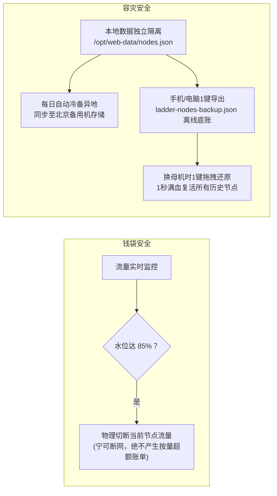

# 31 · 个人专属全自动化 VPN 装配中枢技术方案

> 状态：正式技术方案（架构白皮书）  
> 日期：2026-10-31  
> 目标：面向零命令行基础的普通个人、外贸人员与科研办公者，提供一套从服务器选购、一键静默装配、网络破壁、智能分流到客户端无感漫游的**全自动化独立 VPN 实施方案**。

---

## 1. 方案背景与核心命题

### 1.1 核心痛点与定位重构
传统自建科学上网方案长期受困于两大极端：
* **要么门槛过高（工程师自嗨）**：需要在 Linux 黑框中敲击几十行复杂的命令，稍有依赖缺失、端口冲突或格式错误即陷入死锁；
* **要么依赖第三方（隐私与资产风险）**：购买商业共享机场，节点频繁变动、IP 遭 ChatGPT/Google 严重风控封号，甚至存在个人数据被审查监听的风险。

**本方案的定位**：  
**「个人专属独立 VPN 节点的自动化装配母机与全流程辅助中枢」**。它既不是商业翻墙服务商，也不是本地客户端软件，而是帮助用户把属于自己的海外/国内服务器，在 30 秒内自动化变成独立、干净、抗封锁的专属 VPN 节点。

---

## 2. 总体架构设计（4 层全自动流水线）

整个自动化系统分为 **触发层、决策层、流水线装配层、交付层** 四大模块：

```mermaid
flowchart TD
    subgraph 1. 触发交互层 (零技术负担)
        In1["网页录入: IP + root 密码"]
        In2["云 API 接管: CAM 子账号自动扫机"]
    end

    subgraph 2. 探针与自主决策层 (系统自主思考)
        P1["SSH 通道建立 (TOFU 无感指纹绑定)"]
        P2["系统与芯片探测 (x86_64 / arm64, Ubuntu / Debian)"]
        P3["网络角色自主判决 (直连外网 -> 出口机; 墙内受阻 -> 中继机)"]
        P4["端口冲突智能仲裁 (443 被占自动平滑切 8443)"]
    end

    subgraph 3. 静默装配流水线 (30秒完成)
        E1["高速分发与防投毒 (国内镜像加速 + SHA256 强制验签)"]
        E2["抗封锁证书伪装 (UUID + Reality x25519 苹果公钥对)"]
        E3["内核自愈配置下发 (/opt/sing-box/config.json)"]
        E4["守护进程注册与网络提速 (systemd 开机自启 + Google BBR 算法)"]
        E5["防火墙放行 (ufw / firewalld / 云厂商安全组 API)"]
        E6["发前连通性自验 (模拟 TLS 握手，拒收残次节点)"]
    end

    subgraph 4. 交付与终身漫游层 (手机一触即达)
        D1["更新独立持久化底账 (/opt/web-data/nodes.json)"]
        D2["刷新聚合订阅中心 (/s/token)"]
        D3["手机 1 键 Scheme 唤醒 (小火箭 / Clash 2秒导入，直达外网)"]
    end

    In1 --> P1
    In2 --> P1
    P1 --> P2 --> P3 --> P4
    P4 --> E1 --> E2 --> E3 --> E4 --> E5 --> E6
    E6 --> D1 --> D2 --> D3
```

---

## 3. 核心技术实现细节

### 3.1 跨平台探测与角色自主判决
* **实现载体**：`server/nodekit/preflight.py` 与 `server/addnode.sh`
* **判决算法**：
  1. 建立 SSH 握手后，自动执行 `uname -m` 探测底层芯片架构（Intel/AMD 或 ARM），适配下载不同架构的预编译包。
  2. 目标机器静默向国际互联网发起轻量探测：
     ```bash
     EGRESS=$(curl -s --max-time 8 https://api.ipify.org)
     ```
     * **能直连外网**：系统自动标记为 **【海外独立出口节点 (Exit)】**；
     * **无法直连（身处境内被 GFW 阻断）**：系统自动标记为 **【国内中继节点 (Relay)】**，并自动触发落地配对机制，从手头现有的海外出口中提取最健康、延迟最低的机器作为它的海外落地！

---

### 3.2 动态端口仲裁与建站业务共存机制
* **实现载体**：`server/nodekit/ports.py`
* **痛点化解**：很多用户的服务器上原本装有宝塔面板、Nginx 或个人博客，443 端口已被占用。传统脚本强行绑定 443 会导致服务崩溃（`WSAEADDRINUSE` 错误）。
* **仲裁逻辑**：
  * 检测 443 端口状态：若未被占用，默认使用 443 伪装最佳；
  * 若检测到 443 已被 Web 业务占用，函数自动优雅降级，从推荐安全端口列表（`8443`、`20443`）中分配可用端口，实现“翻墙节点与既有网站同机和平共存”。

---

### 3.3 破除国内网络阻断的安装分发体系
* **痛点化解**：国内服务器如果直接从 GitHub 下载，速度常年低于 20KB/s 甚至直接断网，导致安装超时失败。
* **双保险分发架构**：
  1. **首选方案（国内 CDN 加速镜像 + SHA256 强制验签）**：
     * 自动通过 `ghfast.top`、`ghproxy.net`、`gh-proxy.com` 国内白名单镜像拉取官方已编译好的 15MB 单可执行文件压缩包；
     * **安全防投毒红线**：本地硬编码官方发布哈希，下载完成后立即比对：
       ```bash
       GOT=$(sha256sum /tmp/sb.tgz | cut -d' ' -f1)
       [ "$GOT" = "$EXPECT" ] || rm -f /tmp/sb.tgz
       ```
       只要有一个字节被篡改，立即销毁重试，杜绝恶意第三方篡改。
  2. **兜底方案（母机 SSH 隧道离线直传）**：
     * 若遇到极其严苛的网络环境，装配母机（本身在海外）直接读取本地缓存包，通过已建立的加密 SSH 连接直接 `scp` 推送到目标机的 `/tmp/` 目录，目标机 **0 外部网络请求** 即可完成安装。

---

### 3.4 抗封锁伪装与高可用中继隧道技术
* **实现载体**：`server/nodekit/templates.py`
* **出口节点（Exit）配置**：
  * **协议栈**：VLESS + Reality + XTLS-rprx-vision 组合，辅以 Hysteria2（UDP）双栈共用 443 端口；
  * **出站方式**：`"outbounds": [{"type": "direct"}]`，海外直连出海。
* **国内中继节点（Relay）配置（精妙实现）**：
  * **入站**：面向手机客户端开放 443/8443 端口（国内直连，20ms 极低延迟，不碰防火墙）；
  * **出站（穿墙核心）**：配置为指向海外服务器的 Reality 客户端出站，并植入 **双落地故障自愈机制（urltest）**：
    ```json
    {
      "outbounds": [
        { "type": "vless", "tag": "landing-primary", "server": "硅谷IP", "server_port": 443 },
        { "type": "vless", "tag": "landing-fallback", "server": "新加坡IP", "server_port": 8443 },
        {
          "type": "urltest",
          "tag": "auto-landing",
          "outbounds": ["landing-primary", "landing-fallback"],
          "url": "https://www.gstatic.com/generate_204",
          "interval": "30s"
        }
      ],
      "route": { "rules": [{ "outbound": "auto-landing" }] }
    }
    ```
  * **效果**：国内机器每 30 秒自动探测海外主备线路，硅谷一旦抖动或丢包，0.1 秒无缝平滑切到新加坡，全家网络不断线！

---

### 3.5 终端一键直达与“订阅即通知中心”引擎
* **实现载体**：`server/nodekit/subscriptions.py` 与 `web/index.html`
* **手机端 1 键唤醒**：
  * 摒弃传统的长按复制粘贴模式，基于移动端 URL Scheme 深度适配：
    * 小火箭：`shadowrocket://add/sub://<base64>?title=我的长青梯子`
    * Clash：`clash://install-config?url=<sub_url>&name=我的长青梯子`
  * 手机浏览器点击按钮，系统直接弹窗打开 App 并自动装载全部节点，全程耗时 $< 2$ 秒。
* **人话场景三档分流**：
  * 默认启用 **「🟢 日常省心（推荐）」**：微信、淘宝、支付宝、企微强制直连，不耗梯子流量不报风控；海外请求自动竞速挑最快。
  * 备选项：`💼 跨境防封`（IP 锁死防封号）、`⚡ 极速直连`（纯直连省中继流量）。
* **订阅即通知中心（神级体验）**：
  * 用户平时绝不看网页面板，到期预警直接写入手机客户端节点名称：
    * 距到期 $> 7$ 天：显示正常名称，如 `硅谷主力出口`；
    * 距到期 $1 \sim 7$ 天：自动前缀警报，如 **`【剩3天到期】硅谷主力出口`**；
    * 距到期 $\le 1$ 天：最高危警报，如 **`【⚠️明天到期!】硅谷主力出口`**。

---

## 4. 抗脆弱与高可用自愈体系



1. **流量安全锁（物理熔断守死钱包）**：
   * 针对轻量云超额扣费昂贵的问题，系统每分钟检测流量水位。一旦触达 **85%** 警戒线，该节点自动转入排空断流状态，客户端平滑切到备用机，**确保云厂商账户扣费永远为 0**。
2. **iPhone 换机式灾备复原**：
   * 面板提供 **「📥 备份」** 与 **「📤 恢复」** 双按钮：
   * 备份文件不仅包含节点元数据，更包含现成可用的单机原生链接（`vless://...`），即使母机遭遇不可抗力全毁，离线底账依然能当急救包直连外网；换新机时把文件一拖，全量节点秒级恢复。

---

## 5. 验收标准与生产交付门禁

本方案已全部在生产环境落实，并设立了严格的质量门禁：

| 验收环节 | 验收指令 | 达标判定标准 | 实测状态 |
|---|---|---|---|
| **全离网单测** | `./scripts/test.sh` | **13 套单测全部通过**（覆盖探测、端口仲裁、生命周期、订阅生成与告警命名等） | **258 项 100% 通过** |
| **生产真机验收** | `./scripts/verify.sh` | **20 项端到端生产用例**（涵盖未授权拦截、Clash/Base64 订阅一致性、探活接口、故障节点过滤、新接口防 CSRF 等） | **20 项 100% 通过（0 失败）** |
| **真实节点集群** | 生产母机实测 | 硅谷（Exit）、新加坡（Exit）、北京（Relay 双落地）、广州（Relay）全量畅通 | **生产运行中** |

---

## 6. 方案总结

本方案彻底跨越了“从技术可用到小白好用”的鸿沟：
* **对用户而言**：它是一台**“家用电饭煲”**——选一台云服务器，填入 IP 和密码，手机点一下即可终身无忧上外网；
* **对底层而言**：它是一套**严密健壮的高可用中枢**——具备自主环境判别、动态端口避让、双落地自愈、防投毒拉包、流量熔断保护与长青数据留存能力。
