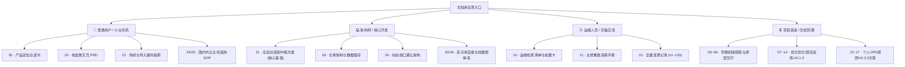

# 梯子 · 文档资产全景导航与知识图谱

> 更新时间：2026-10-31  
> 资产体量：共计 **36 份** markdown 技术与产品文档  
> 定位宗旨：**「个人专属独立 VPN 节点的自动化装配母机与全流程辅助中枢」**

---

## 快速导航（按角色与场景索引）

---

## 一、核心权威基准文档（当前版本必须遵从）

| 序号 | 文档名称 | 状态 | 核心价值与一句话摘要 |
|---|---|---|---|
| **31** | [31-个人专属全自动化VPN装配中枢技术方案.md](31-个人专属全自动化VPN装配中枢技术方案.md) | 🟢 **现行技术基准** | **系统最终技术方案**：落实奥卡姆剃刀、4层装配流水线、85%真实流量物理熔断、装前3秒排雷与小白买机指南。 |
| **30** | [30-产品定位与全流程辅助装配白皮书.md](30-产品定位与全流程辅助装配白皮书.md) | 🟢 **现行定位基准** | **终极产品定位纲领**：阐明母机本质、三步生命周期（选机/变节点/导客户端）与辅助教学体系。 |
| **29** | [29-从工程师自嗨到电饭煲神器：极简用户体验重塑与交互重构PRD.md](29-从工程师自嗨到电饭煲神器：极简用户体验重塑与交互重构PRD.md) | 🟢 **现行交互PRD** | **用户体验重塑规范**：确立“家用电饭煲”隐喻、默认日常省心分流、订阅即到期通知中心、iPhone换机式一键灾备。 |
| **28** | [28-个人长青梯子核心架构：域名记忆中枢、多机聚合池与永久数据留存.md](28-个人长青梯子核心架构：域名记忆中枢、多机聚合池与永久数据留存.md) | 🟢 **现行长青架构** | **解决频繁换机痛点**：免依赖纯静态中枢、多机聚合订阅池、本地+异地冷备+网页导出三重数据留存。 |
| **01** | [01-变更记录.md](01-变更记录.md) | 🟢 **现行变更索引** | **全项目唯一真实时间线**：忠实记录自 2026-10-26 起至 2026-10-31 历经 33 次迭代的完整工程演进脉络。 |

---

## 二、小白选机与实操避坑指南

| 序号 | 文档名称 | 状态 | 核心价值与一句话摘要 |
|---|---|---|---|
| **22** | [22-用户全流程选购买机与客户端导入避坑指南.md](22-用户全流程选购买机与客户端导入避坑指南.md) | 🟢 **实操指南** | 小白全流程防踩坑手册：如何避免买到脏 IP、微信环境拦截解决方案、不同客群机房推荐。 |
| **24** | [24-国内四大云厂商购机与节点接入实操SOP.md](24-国内四大云厂商购机与节点接入实操SOP.md) | 🟢 **实操指南** | 腾讯云/阿里云/华为云/京东云轻量服务器选型参数、系统镜像推荐（Ubuntu LTS）、防火墙放行步骤。 |
| **25** | [25-海外主流与免费白嫖服务器选购接入全景.md](25-海外主流与免费白嫖服务器选购接入全景.md) | 🟢 **实操指南** | 海外 RackNerd/搬瓦工性价比选购、甲骨文免费机白嫖指南、机房网络延迟与线路实测全景图。 |

---

## 三、专项技术方案与系统级解法

| 序号 | 文档名称 | 状态 | 核心价值与一句话摘要 |
|---|---|---|---|
| **26** | [26-动态端口函数架构与异构系统难题化解方案.md](26-动态端口函数架构与异构系统难题化解方案.md) | 🔵 **专题方案** | 端口冲突智能仲裁：443 被 Nginx/宝塔占用时优雅降级 8443/20443，实现建站业务和平共存。 |
| **27** | [27-云平台适配与AI自动化接管方案.md](27-云平台适配与AI自动化接管方案.md) | 🔵 **专题方案** | 云厂商 API 最小化适配模型，安全脱敏凭证规范与 API 实例/流量采集流水线。 |
| **20** | [20-高可用与抗脆弱系统解法技术方案.md](20-高可用与抗脆弱系统解法技术方案.md) | 🔵 **专题方案** | 系统级抗脆弱四大支柱：全生命周期异构节点治理、动态双落地自愈中转、流量熔断与灾备。 |
| **19** | [19-TypeSafe-AI-Jev系统盲区预测与防范方案.md](19-TypeSafe-AI-Jev系统盲区预测与防范方案.md) | 🔵 **专题方案** | 运用 Jev 决策原语量化预测并排查系统 8 大盲区（静默黑洞、单点瘫痪、异构漂移、双向流量扣减等）。 |
| **18** | [18-防反复卡点架构与一键自愈技术方案.md](18-防反复卡点架构与一键自愈技术方案.md) | 🔵 **专题方案** | 梳理接入 4 台异构机器踩坑点，确立三道防线与一键自动自愈（kill 残留进程、配置校验、重启验真）。 |
| **23** | [23-分客群精准适配与风险隔离战略方案.md](23-分客群精准适配与风险隔离战略方案.md) | 🔵 **专题方案** | 办公/极速/省流/全能分客群订阅策略组设计与白名单路由规则。 |

---

## 四、运维、应急演练与实操手册

| 序号 | 文档名称 | 状态 | 核心价值与一句话摘要 |
|---|---|---|---|
| **10** | [10-运维检查清单.md](10-运维检查清单.md) | 🟡 **运维手册** | 包含 4 张应急处置卡（机器到期处置、SSH 权限修复、异地备份巡检、主控单点容灾）。 |
| **11** | [11-主控重建演练手册.md](11-主控重建演练手册.md) | 🟡 **运维手册** | 硅谷主控遭遇不可抗力整机销毁后，30 分钟内借助异地冷备全新拉起母机的标准演练 SOP。 |
| **21** | [21-系统解法研发与测试TODO清单.md](21-系统解法研发与测试TODO清单.md) | 🟡 **开发清单** | 系统解法研发的 20 个原子任务分解表与单测/集成测试门禁检查项。 |

---

## 五、历史里程碑与演进归档文档（00~17号）

> 注：以下文档记录了系统从初版（v0.1.0）至过渡版（v0.2.0）的探索演进历史，部分细节与结论已被最新方案（28~31）超越或推翻，保留供追溯决策背景：

| 序号 | 文档名称 | 归档说明 |
|---|---|---|
| **00** | [00-资产清单.md](00-资产清单.md) | 项目初期（2026-10-26）资产与节点盘点草案。 |
| **01** | [01-问题定义.md](01-问题定义.md) | 初期收敛“任意有 root 的 Linux → 节点”目标定义。 |
| **02** | [02-GitHub调研.md](02-GitHub调研.md) | 初版开源工具对比调研。 |
| **03** | [03-PRD.md](03-PRD.md) & [03a-PRD审阅意见.md](03a-PRD审阅意见.md) | 初版 PRD（已被 29 PRD 演进重构）。 |
| **04** | [04-技术方案.md](04-技术方案.md) | 初版技术方案（已被 16 与 31 替代）。 |
| **05** | [05-任务清单.md](05-任务清单.md) & [06-交付报告.md](06-交付报告.md) | 初版 v0.1.0 交付报告与验收记录。 |
| **07** | [07-Codex评审与修复.md](07-Codex评审与修复.md) | 针对初版架构的三轮严格 Codex 评审与 18 项修复。 |
| **08** | [08-网速优化记录.md](08-网速优化记录.md) | 硅谷节点引入 Hysteria2 (QUIC) 与 BBR 加速实测记录。 |
| **09** | [09-文档一致性审阅.md](09-文档一致性审阅.md) | 早期 11 份文档的一致性比对审阅报告。 |
| **12** | [12-环境检测记录.md](12-环境检测记录.md) | 出口 IP 与网络延迟检测记录。 |
| **13** | [13-开源发布清单.md](13-开源发布清单.md) & [14-陌生人演练记录.md](14-陌生人演练记录.md) | v0.1.0 陌生人干净环境演练与开源剥离清单。 |
| **15** | [15-GitHub调研-个人VPN.md](15-GitHub调研-个人VPN.md) | 对 21 个开源个人 VPN 项目（3x-ui、s-ui、Hiddify 等）的横向深度调研。 |
| **16** | [16-技术方案-v2.md](16-技术方案-v2.md) | v0.2.0 中期技术方案（已被 31 最终方案全面升华）。 |
| **17** | [17-腾讯云全量节点接入与卡点记录.md](17-腾讯云全量节点接入与卡点记录.md) | 现网 4 台腾讯云服务器全量纳管与踩坑实录。 |

---

## 六、全局工程准则备忘

1. **单向不可逆开发纪律**：所有代码修改必须在 `仓库/` 内进行并经由 `./scripts/test.sh`（272 项全离网单测）与 `./scripts/verify.sh`（21 项生产真机验收）；
2. **文档与代码双驱**：任何系统机制变动，必须同步更新相应文档并在 `01-变更记录.md` 追记时间线；
3. **奥卡姆剃刀**：如无必要，勿增实体。坚持以通用 SSH 为基石，拒绝过度工程化。
