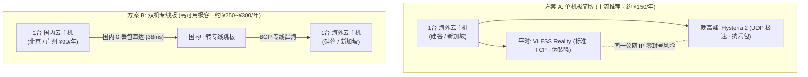

# 🌟 小白 10 分钟自建专属节点指南 (Evergreen · OwnLine)

> **定位**：帮小白轻松搭建安全、可控、便宜的专属 VPN 节点。  
> **核心承诺**：无需学习复杂 Linux 命令，不用到处找机场买合租。资产 100% 自有，独享原生纯净 IP，防 AI 封号，晚高峰极速不卡顿。

---

## 一、 为什么自建专属节点？

| 对比维度 | 传统商业“机场” / 公共梯子 | Evergreen 自建专属节点 |
| :--- | :--- | :--- |
| **资产与隐私** | 成百上千人共用同一 IP，你的访问历史与数据易被旁路审计 | **独占原生 IP**，除你之外无人可用，密码密钥物理不出机 |
| **AI 账号安全** | 节点频繁跨国漂移或跳跃脏 IP，极易导致 **ChatGPT / Claude 封号** | **IP 零漂移铁律**，出口 IP 静态锁定，保障账号与充值资产 |
| **稳定与跑路** | 经常改域名、换规则、晚高峰卡顿、逢年过节跑路 | **永久可控**，依托腾讯云/阿里云大厂基础设施，绝不跑路 |
| **使用成本** | 每年 200 ~ 500 元，按月按量限流 | **年付 ¥150 起**，不卖流量，每月 1000GB+ 随意挥霍 |

---

## 二、 方案选型（根据你的预算二选一）



### 1. 方案 A：单机极简版（90% 个人/学生首选）
* **年化花费**：约 **¥150 / 年**；
* **硬件需求**：只需购买 **1 台海外云服务器**（推荐：腾讯云轻量海外机房、RackNerd 或甲骨文免费机）；
* **体验特性**：同一台海外机器上自动配置两条通道。白天用 Reality 极佳伪装，晚高峰国际出口拥堵时一键切换 HY2 极速通道（抗 25% 物理丢包），出口 IP 绝对一致，零封号风险。

### 2. 方案 B：双机专线版（4K 视频、跨境办公、极致追求者）
* **年化花费**：约 **¥250 ~ ¥300 / 年**；
* **硬件需求**：**1 台国内轻量服务器**（如腾讯云北京/广州 ¥99/年活动机）+ **1 台海外云服务器**；
* **体验特性**：手机/电脑连接国内服务器（延迟仅 30ms~45ms、0 丢包），由国内云厂商数据中心高速出海直达硅谷。**晚高峰彻底告别两千毫秒卡顿，实测端到端延迟低至 45ms**！

---

## 三、 3 步开箱自建（10 分钟搞定）

### 第 1 步：购买服务器并放行端口
1. 前往云厂商（以腾讯云为例）购买一台 Linux 轻量应用服务器（操作系统选 **Ubuntu 22.04** 或 **Debian 12**）；
2. **唯一关键操作（防火墙放行）**：
   - 进入云控制台 ➔ 找到你的服务器 ➔ 点击【防火墙 / 安全组】；
   - 点击【添加规则】，添加放行端口：**`443`** 与 **`8443`**（协议选 TCP/UDP），确认保存。

---

### 第 2 步：一键运行安装

选择以下两种方式中的任意一种：

#### 方式一：交给 AI 工具代劳（最推荐 · 0 门槛）
如果你在使用 **Cursor / Claude Code / Antigravity / Windsurf**：
把下面这段话直接发给 AI，把中括号内容替换为你的服务器 IP 和 root 密码：
```text
请克隆 https://github.com/AdgaiWalker/VPN-OwnLine.git，通过 SSH 连接我的服务器 [IP:端口:密码]，帮我全自动装配好长青专属节点，并把管理后台网址和初始账号密码发给我。
```
AI 会全自动在后台跑完环境检查与安装，直接把网址和密码递到你面前。

#### 方式二：自己登录服务器运行命令
登录云控制台，点击【登录】打开网页黑色终端，粘贴下方一行命令并回车：
```bash
curl -fsSL https://raw.githubusercontent.com/AdgaiWalker/VPN-OwnLine/main/deploy/bootstrap.sh | sudo bash
```
> 运行约 1~2 分钟，完毕后屏幕会直接打出你的**专属管理地址、初始账号与密码**。

---

### 第 3 步：登录管理面板，扫码即可上网

1. 在浏览器中打开屏幕输出的专属管理地址（如 `https://你的服务器IP:8443/`）；
   *(若提示“证书不安全/隐私连接”，点击「高级」➔「继续前往」即可，这是私有自签名证书的正常提示)*
2. 输入初始账号密码登录后台；
3. **连接上网**：
   - **iPhone / iPad（Shadowrocket 小火箭）**：点击网页上的「一键导入小火箭」或直接用手机扫描屏幕上的二维码，小火箭自动唤醒并添加线路，轻点开关即连；
   - **电脑 / 安卓（FlClash / Clash Verge）**：点击网页上的「复制订阅链接」，在软件中粘贴保存，即刻刷出全量绿色节点！

---

## 四、 贴心特性与日常使用指南

### 1. AI 资产防封铁律（为你守护 ChatGPT 账号）
* 订阅系统已将 `🤖 AI 业务` 分流固定为美区纯净节点，**绝对不搞跨地域自动漂移**，无论使用多久，出口 IP 永远专一稳定；
* **国内大模型免流直连**：DeepSeek（深度求索）、Kimi、智谱清言、豆包等自动走国内本地宽带直出（延迟 < 30ms），不消耗海外 VPS 流量，也不用担心国内 AI 误判海外访问。

### 2. 晚高峰卡顿怎么办？
* **单机版用户**：在小火箭或 Clash 里，直接从 `硅谷直连` 切换至 `硅谷-HY2`，即可借助单包重传冲破晚高峰丢包；
* **双机版用户**：平时直接默认选择 `🇨🇳 北京专线 ➔ 🇺🇸 硅谷`，全天候 45ms 极速稳定。

### 3. 常见问题秒排查
* **Q: 刚装好网页打不开？**  
  A: 99% 的原因是因为云厂商控制台防火墙没放行。去云控制台的安全组放行 **`8443`** 和 **`443`** 端口。
* **Q: 节点测速变红或连不上？**  
  A: 打开专属管理网页，节点卡片会用大白话直接告诉你原因（如“端口阻断”或“国内直连受阻”），卡片上提供了一键动作（如【修改端口】或【重新检测】），点一下即可自愈。
