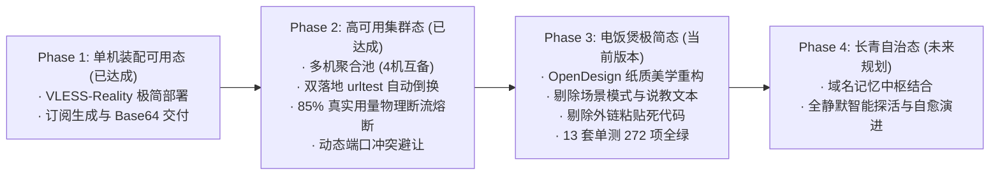

# 02 · 产品规划与定位白皮书

> 状态：**现行生效（产品战略与路线图基准）**  
> 适用版本：全生命周期通用纲领  
> 核心定义者：真实用户需求与核心研发团队共同提炼  
> 核心受众：无技术背景的普通个人、跨境电商团队、外贸业务人员、科研学术者

---

## 1. 终极产品定位：它到底是什么？

用三句话讲透本系统的本质定位与业务边界：

```mermaid
flowchart LR
    subgraph 明确边界 (我们不是什么)
        N1["❌ 不是商业 VPN / 机场服务商<br/>(不卖节点 / 不赚流量费 / 零中继劫持)"]
        N2["❌ 不是本地翻墙客户端<br/>(不替代 Shadowrocket / Clash / Sing-box)"]
    end

    subgraph 核心价值 (我们到底是什么)
        CORE["✅ 个人专属独立 VPN 节点的<br/>自动化装配母机与全流程辅助中枢"]
    end

    N1 -.-> CORE
    N2 -.-> CORE
```

1. **它不是商业 VPN / 机场**：
   * 我们不经营任何商业翻墙代理业务，不售卖共享机场节点，绝不收集、中转或监听任何用户网络数据。
   * 用户的所有网络流量，**100% 仅在用户自己购买的云服务器与个人手机/电脑之间点对点流通**，实现完全的物理隔离、纯净独享 IP、防封号与数据隐私保障。
2. **它不是本地运行的客户端**：
   * 它不是用来替代 iOS 上的小火箭（Shadowrocket）、电脑上的 Clash Verge Rev 或 Sing-box 的本地应用。
   * 终端用户依然使用这些全球成熟、顶级的原生客户端来开启代理通道。
3. **它的真正身份**：
   * **「用来帮助你把属于自己的云服务器，自动化变成独立 VPN 节点的母机与全流程辅助中枢」**。
   - 它把原本只有高阶运维工程师才能完成的“选机避坑、镜像拉取、依赖编译、防火墙规则、伪装证书、路由分流、动态容灾与防超额熔断”等一系列脏活累活，彻底封装为开箱即用的“家用电饭煲”。

---

## 2. 全生命周期三大闭环环节（The 3-Step Journey）

系统的核心业务价值流，完整贯穿于用户从零到拉通的**三大闭环环节**：

```mermaid
flowchart TD
    subgraph 环节一：选择与选购自己的服务器 (辅助决策)
        S1["国内外主流选型指引<br/>· 国内免外币大厂 (腾讯轻量 24~32元/月 · 阿里99元)<br/>· 海外正规白嫖神机 (甲骨文永久免费 · 谷歌300刀 · AWS)"]
        S2["售前辅助避坑教学<br/>· 测 IP 纯净度 · 坚决排除闲鱼二手黑卡机"]
    end

    subgraph 环节二：把服务器变成专属节点 (静默装配母机)
        S3["图形化极简录入<br/>· CAM 自动发现云主机 或 手工填入 IP + root 密码"]
        S4["30秒静默自动化装配<br/>· 探测环境 + 国内镜像加速 + SHA256 防投毒<br/>· Reality / Hysteria2 伪装证书下发 + Google BBR 提速"]
        S5["系统级抗脆弱守护<br/>· 动态端口避让 (建站与翻墙共存)<br/>· 85% 水位真机物理断流熔断 (绝不超额扣费)"]
    end

    subgraph 环节三：导出到客户端终身漫游 (无缝交付)
        S6["手机端 1 键唤醒<br/>· 浏览器直跳小火箭/Clash，消灭复杂复制粘贴"]
        S7["长青订阅与通知中心<br/>· 多机聚合池 4 合 1 终身漫游<br/>· 到期前7天节点名自动带【剩3天到期】"]
        S8["iPhone 换机式灾备<br/>· 1键导出离线底账 · 1键拖拽满血恢复"]
    end

    S1 --> S2 --> S3 --> S4 --> S5 --> S6 --> S7 --> S8
```

---

### 环节一：选择与选购自己的服务器（辅助决策与选购/白嫖）
* **用户痛点**：普通人不知道去哪里买机器，怕买到被 GFW 封锁的脏 IP，怕淘宝闲鱼二手黑卡封停，怕国外网站全英文且必须绑定境外 VISA 信用卡。
* **产品提供**：
  * **国内大厂免外币方案**：首推腾讯云海外轻量（支持微信/支付宝直接结算，香港/新加坡/东京/硅谷约 24~32 元/月，配置 1核2G 1000G月流量），其次推荐阿里云 99 元/年 ECS。
  * **海外正规免费白嫖全景**：甲骨文云 Always Free（4核24G ARM 永久免费神机）、谷歌云 300 刀试用、AWS 12 个月免费体验。
  * **避坑底线**：明确排除闲鱼/淘宝 NAT 共享小鸡与黑卡机，保障个人资金与账号绝对安全。

---

### 环节二：把服务器变成专属 VPN 节点（自动化装配与自愈守护）
* **用户痛点**：普通用户不会敲命令行，看到 Linux 黑框就畏难；云服务器上若装有宝塔面板或建了网站，端口冲突便直接瘫痪；最怕流量超标产生天价账单。
* **产品提供**：
  * **零命令行装配**：在网页面板中选择机器或填入 IP，输入 root 密码，点击「开始安装」，系统后台在 30 秒内静默完成环境探测、依赖拉取、配置下发与服务启动。
  * **动态端口自愈**：遇 443 端口被宝塔或 Web 业务占用时，算法自动从 8443 / 20443 避让，实现建站业务与翻墙同机和平共存。
  * **流量防爆安全锁**：真实监测腾讯云 Lighthouse 等月度流量包，达 **85% 水位自动执行真机物理断流（`systemctl stop sing-box`）并在订阅层同步剔除**，宁可断流也绝不让云厂商产生超额账单。

---

### 环节三：将节点导出到客户端（无缝交付与终身漫游）
* **用户痛点**：配置繁琐、长链接复制易截断、微信内置浏览器拦截、换设备或服务器到期后全家断网。
* **产品提供**：
  * **手机一键直达**：在手机 Safari 浏览器中点击「📱 导入小火箭」或「⚡ 导入 Clash」，秒级唤醒本地 App 自动装入配置。
  * **订阅即通知中心**：服务器到期前 7 天，手机客户端中的节点名称自动前缀 **`【剩3天到期】`**，日常使用即可看到提醒，从容续费。
  * **iPhone 换机式灾备**：一键导出包含节点元数据与单机原生链接的 `ladder-nodes-backup.json`；母机损坏重建时，网页拖拽上传文件，1 秒原地满血复原全部节点。

---

## 3. 奥卡姆剃刀与产品边界（六大不为清单）

为杜绝工程师自嗨与过度工程化，本系统坚守**六大不为原则**：

| 不建内容 | 坚决不做的原因 | 正确的解法 |
|---|---|---|
| **不建第三方节点粘贴** | 没有对方机器的 SSH 控制权，无法验真、无法做 85% 熔断、无法动态换密钥与排障。这是客户端与机场的职责，不是装配母机的职责。 | 坚决砍掉，专注纯自建云主机的装配与管理。 |
| **不建多云 SDK 庞大矩阵** | 引入 AWS、GCP、Azure、阿里各家 SDK 会让母机膨胀几十倍，依赖冲突频发。 | 以标准 SSH（IP + root 密码）作为跨云通识底座；云 API 仅收敛于已接入的腾讯云轻量。 |
| **不建 Windows 节点自动化** | 科学上网服务器 99.9% 基于 Linux 运行，没必要引入庞大的 WinRM/PowerShell 负担。 | 专注 Linux LTS（Ubuntu / Debian / CentOS）。 |
| **不建商业订阅防刷限流** | 这是个人专属独立母机，32 位高熵 Token 在数学上不可能被穷举，无需做高并发限流。 | 保持纯静态轻量服务。 |
| **不建云端自动换 IP 编排** | 独立节点被封是极低频事件，在云控制台手工点一次换 IP 仅需 10 秒，自动化收益小于维护负债。 | 保留手工换 IP 指引。 |
| **不建客户端排障向导套娃** | 小火箭与 Clash 自带成熟的连通性测速与排障日志，无需重复造轮子。 | 依托客户端原生日志，母机仅输出状态真值。 |

---

## 4. 产品演进路线图（Roadmap）



* **Phase 1（单机装配可用态 · 已达成）**：实现核心 Reality 协议、基础 Web 面板与订阅生成。
* **Phase 2（高可用集群态 · 已达成）**：实现多节点管理、国内中转双落地故障自动倒换、85% 水位真机物理断流、动态端口冲突自动协商。
* **Phase 3（电饭煲极简态 · 当前版本）**：全量落地 OpenDesign 设计语言；践行奥卡姆剃刀彻底移除场景选择器与说教说明；拔除第三方链接粘贴死代码；单测与生产验收 100% 达标。
* **Phase 4（长青自治态 · 长期演进）**：结合 Cloudflare 域名记忆中枢，实现母机迁移时客户端完全零感知的终身自治漫游。
