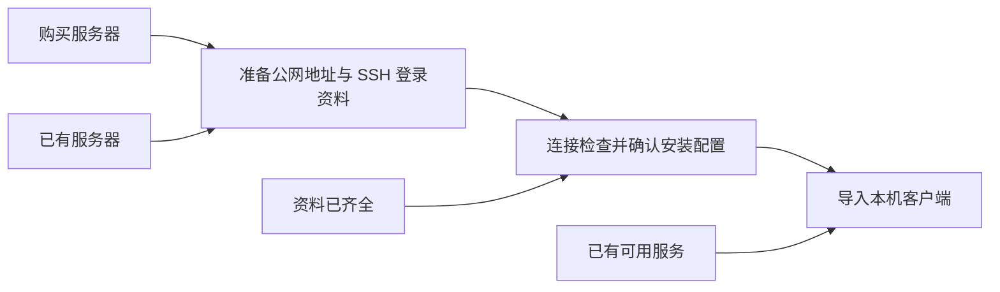
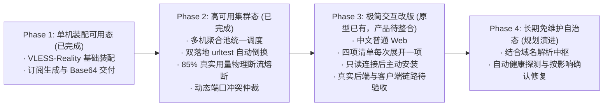

# 02 · VPN-OwnLine · 长青 (Evergreen OwnLine) 产品规划与定位白皮书

> Status / 状态：**Active / 现行生效（产品战略与路线图基准）**  
> Project / 开源项目：**VPN-OwnLine（个人专线）**  
> Brand / 项目品牌：**Evergreen (长青)**  
> Slogan / 理念：*Turn your own Linux server into a private, dedicated cross-border line.*（默认 SSH 接入，下方可选腾讯云 Lighthouse 授权；其他云原生能力按实际适配扩展）<br>
> Version / 适用版本：全生命周期通用纲领  
> Team / 责任团队：系统架构与产品团队  
> Audience / 核心受众：无技术背景的普通个人、跨境电商团队、外贸业务人员、科研学术者

> **2026-11-06 现行交互边界（v1.8）**：首次由用户在自己的云控制台终端或通过 Mac 原生零依赖自举脚本 `setup-mac.sh` 执行安装，公共介绍页不接收 SSH 凭据；AI 可选。日常首页、共用流量阈值、添加节点全闭环与用户自持备份以[交互规格 v1.8](../设计/客户端Web交互设计规格说明书.md)为准。文内较早的公共图形安装设想不作为当前上线要求。

---

## 1. 终极产品定位与业务边界

系统核心业务边界由以下基本原则确立：

```mermaid
flowchart LR
    subgraph 明确边界 (我们不是什么)
        N1["❌ 不是商业代理服务商<br/>(不售卖节点 / 不收取流量费 / 零中继审计)"]
        N2["❌ 不是本地翻墙客户端<br/>(不替代 Shadowrocket / Clash)"]
    end

    subgraph 核心价值 (我们到底是什么)
        CORE["✅ 长青 · 个人专属专线 (VPN-OwnLine)<br/>自动化装配母机与全流程辅助中枢"]
    end

    N1 -.-> CORE
    N2 -.-> CORE
```

1. **非商业代理属性**：
   * 不经营商业翻墙服务，不售卖共享节点，不收集或转发用户流量。
   * 用户流量 100% 仅在用户自购的云服务器与个人终端之间端到端直连，保障纯净独享 IP、防关联风控与数据隐私。
2. **非本地客户端属性**：
   * 不替代 iOS Shadowrocket（小火箭）、macOS/Windows Clash Verge Rev 或 FlClash 等成熟原生客户端（注：sing-box 仅作为云端服务端内核运行，客户端不采用 sing-box）。
   * 终端用户持续使用成熟客户端建立系统级代理。
3. **系统真实定位**：
   * **「协助用户将个人所属云服务器，自动化装配为专属独立专线 (VPN-OwnLine) 的自动化母机与全流程辅助中枢」**。
   * 将选机规避风控、镜像拉取、依赖编译、防火墙规则、伪装证书、路由分流、动态容灾与防超额熔断等运维操作，封装为单页面傻瓜化流水线。
4. **接入优先级与原生适配范围**：
   * **默认 SSH**：所有厂商先准备公网地址、用户名（默认 root）和密码/私钥；添加服务器直接展示 SSH 表单，下方才提供可选腾讯云授权，不要求先接入云账号。
   * **可选 Lighthouse 原生云能力**：已有腾讯云 provider 提供实例发现、支持的防火墙操作与真实流量包数据。其他厂商及 CVM 仍走通用 SSH，不具备相应原生云用量保护。
   * **实现边界**：支持的系统、端口、权限及各路径的只读连接 等能力以[交互规格 v1.6](../设计/客户端Web交互设计规格说明书.md)为准；其他云原生 API 后续按需扩展，不提前承诺。

* **CVM 支持边界**：符合系统要求的 CVM 可通过通用 SSH 方式接入；当前未实现 CVM 原生实例发现、安全组和流量用量 API，不能视为与 Lighthouse 同等自动化。

---

## 2. 以用户下一步组织四阶段旅程

核心是让用户用上自己的专线。新手优先图形引导，熟悉者一条命令，AI 按需使用。每次只突出当前任务；已知完成的准备可跳过，服务已就绪直接导入，异常优先恢复，不强迫重新购买或重装。



首次用轻量设置清单提示四阶段，只有当前项展开，完成依据与设备边界按专项规格。清单可收起，正常首屏仍以导入为主；不新增待办管理器。四阶段是连续任务，不是四个常驻面板；以[交互规格 v1.6](../设计/客户端Web交互设计规格说明书.md)为准。本地中文 Web 原型已演示清单与交互；独立首次安装和执行后台已在本地 Linux 测试；完整产品集成、公网与客户端验收尚未完成。

---

### 环节一：选择与选购服务器（选型指导与避坑）
* **解决痛点**：新手不知道选哪类服务器，也容易将促销首价、免费算力和完整使用成本混淆。
* **统一入口**：[README · Need a server?](../../README.md#need-a-server)链接唯一维护的英文购买指南；详细候选、官方产品与地区、免费资格和成本说明均集中在那里，本白皮书不另列价格或配置清单。
* **辅助决策**：以实惠为主，按预算、连接所在地、用途和流量缩小候选，核对真实续费、IP、磁盘、网络及试用到期后影响。不能承诺稳定免费、无身份验证、固定时延或所有地区都有库存。
* **购买与接入**：用户在官方渠道自行购买或激活；已有兼容机器直接准备 SSH。出现于指南不表示原生云适配；不自动购买、升级付费账号、接入 Harness 或增加产品内 AI。

---

### 环节二：准备公网地址和 SSH 登录资料
* 默认表单可直接填，资料不足时从 Find server details 按需选择云厂商，打开对应实例列表并看字段图示，不假设知道控制台终端在哪里。
* 已买与未买分别进入 Console 或购买指南；导航、SSH 登录及可选腾讯云 API 授权是不同动作。
* 公网地址、用户名、密码或私钥用于连接 Linux；不承诺能取回旧密码，密钥选择文件的移动体验待实现。返回保留非敏感进度，不长期保存凭据。

---

### 环节三：安装配置与结果交付
* **解决痛点**：缺乏 Linux 终端操作经验；既有服务器运行宝塔或 Web 业务导致 443 端口冲突；云套餐的超额流量费用需按当前官方条款核对，可能产生额外费用。
* **系统提供能力**：
  * **装配目标体验**：先只读检查目标（`/api/node/check`），确认通过后弹出卡片由用户核定节点名与角色，显式确认后再触发安装（`/api/addnode`），平滑切回看板显示 5 步进度，完成后自动刷新节点池。首次搭建支持 `setup-mac.sh` 原生自举并自动打开浏览器。交付真实可访问的公网 HTTPS 管理地址和独立网页凭据。
  * **动态端口仲裁**：检测 443 端口占用，被占用时自动切换至 8443 / 20443 备用端口，保障翻墙服务与既有建站业务同机共存。
  * **链式住宅代理（ISP 防封）**：针对 ChatGPT、TikTok 等高风控场景，支持在节点上挂载静态住宅 IP（推荐 Webshare），出站流量走住宅网络，客户端至节点保持 VLESS+Reality 强伪装。
  * **85% 水位物理断流熔断**：真实采集腾讯云 Lighthouse API 用量包数据，达到 **85% 水位时远程停止代理服务（`systemctl stop sing-box`）并在订阅层同步剔除**；采集及执行可能失败，不承诺零账单。其他厂商没有对应云 API 时不覆盖其云计费用量保护。

---

### 环节四：导入本机客户端与后续使用
* **解决痛点**：长链接易受输入法和微信内置浏览器截断破坏；服务器到期后突发断网；主控服务器损坏后节点参数遗失。
* **系统提供能力**：
  * **URL Scheme 快速拉起**：浏览器端直接唤醒 Shadowrocket 或 Clash 并载入订阅，规避人工输入错误。
  * **订阅即通知中心**：服务器到期前 7 天，客户端节点名自动增加前缀 **`【剩X天到期】`**（1天内为 `【⚠️明天到期!】`），直观提示续费。
  * **文件级灾备复原**：支持导出包含节点完整元数据与备用单机直连链接的 `ladder-nodes-backup.json`；新母机搭建后，拖拽上传文件即可完全复原节点配置。

---

## 3. 奥卡姆剃刀与产品边界（六大不为清单）

为保证系统高稳定性与低维护负债，本系统遵循以下边界；此前排除 Windows 自动化的决定已按最新需求调整：

| 不建内容 | 原因与代价 | 现行收敛解法 |
|---|---|---|
| **不建第三方节点导入** | 外部链接无 SSH 控制权，无法探活验真、无法监控流量及执行 85% 熔断、无法换密钥与自愈。 | 坚决剔除，专注纳管具备 root 权限的自建服务器。 |
| **不建多云 SDK 复杂矩阵** | 引入多家云厂商庞大 SDK 导致依赖包体积剧增与环境冲突。 | 统一基于标准 SSH（公网地址 + SSH 用户名 + 密码/私钥）纳管；仅收敛腾讯云轻量 API。 |
| **Windows 与 Linux 节点** | 只为节点装配增加必要的系统适配，避免影响已有服务；不把浏览器所在设备自动当成节点。 | 两者均为首批目标；当前仅具 Windows 只读检测，自动安装与接管待实现并验收。首次完整管理端安装仍限受支持的空白 Linux。 |
| **不建商业订阅防刷限流** | 面向个人独立使用，32 位高熵 Token 在数学上不可穷举，无需承担高并发频控负担。 | 保持纯静态轻量服务。 |
| **不建云端自动换 IP 编排** | 独立节点 IP 被封属极低频事件，云控制台手工更换仅需几十秒，全自动编排得不偿失。 | 界面提供清晰的手工换 IP 引导。 |
| **不建客户端排障向导套娃** | 小火箭与 Clash 自带成熟的网络测速与日志工具，无需重复开发客户端排障。 | 依赖客户端原生日志，母机输出真实探活状态。 |

---

实施顺序以[轻量技术方案 §12](03-技术方案-全自动化装配中枢架构方案.md#12-实施顺序与完成门槛)为准：基础服务与任务存储、真实只读连接、装配恢复、客户端交付、完整生命周期。以下路线图是业务阶段，不是已完成新后端的声明。

## 4. 系统演进路线图（Roadmap）



* **Phase 1（单机装配可用态 · 已完成）**：实现核心 Reality 协议自动化编译部署、Web 控制台与客户端订阅导出。
* **Phase 2（高可用集群态 · 已完成）**：支持多节点管理、国内中继双落地自动倒换、85% 真实用量物理断流熔断、动态端口冲突自动协商。
* **Phase 3（极简交互改版 · 原型已有，产品待整合）**：中文普通 Web、四项任务仅展开一项，真实连接检查后再主动开始安装；本地原型仅演示，产品端实现差距与 62 项待执行验收见专项规格。13 套 / 301 项单测与 21 项生产用例是其他迭代的历史记录，本轮未重测。
* **Phase 4（长期免维护自治态 · 规划演进）**：结合 Cloudflare DNS 解析，实现母机迁移时客户端完全无感的自动化漫游。
