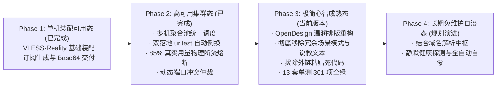

# 02 · VPN-OwnLine · 长青 (Evergreen OwnLine) 产品规划与定位白皮书

> Status / 状态：**Active / 现行生效（产品战略与路线图基准）**  
> Project / 开源项目：**VPN-OwnLine（个人专线）**  
> Brand / 项目品牌：**Evergreen (长青)**  
> Slogan / 理念：*Turn your own Linux server into a private, dedicated cross-border line.*（默认 SSH 接入，下方可选腾讯云 Lighthouse 授权；其他云原生能力按实际适配扩展）<br>
> Version / 适用版本：全生命周期通用纲领  
> Team / 责任团队：系统架构与产品团队  
> Audience / 核心受众：无技术背景的普通个人、跨境电商团队、外贸业务人员、科研学术者

---

## 1. 终极产品定位与业务边界

系统核心业务边界由以下基本原则确立：

```mermaid
flowchart LR
    subgraph 明确边界 (我们不是什么)
        N1["❌ 不是商业代理服务商<br/>(不售卖节点 / 不收取流量费 / 零中继审计)"]
        N2["❌ 不是本地翻墙客户端<br/>(不替代 Shadowrocket / Clash)"]
    end

    subgraph 核心价值 (我们到底是什么)
        CORE["✅ 长青 · 个人专属专线 (VPN-OwnLine)<br/>自动化装配母机与全流程辅助中枢"]
    end

    N1 -.-> CORE
    N2 -.-> CORE
```

1. **非商业代理属性**：
   * 不经营商业翻墙服务，不售卖共享节点，不收集或转发用户流量。
   * 用户流量 100% 仅在用户自购的云服务器与个人终端之间端到端直连，保障纯净独享 IP、防关联风控与数据隐私。
2. **非本地客户端属性**：
   * 不替代 iOS Shadowrocket（小火箭）、macOS/Windows Clash Verge Rev 或 FlClash 等成熟原生客户端（注：sing-box 仅作为云端服务端内核运行，客户端不采用 sing-box）。
   * 终端用户持续使用成熟客户端建立系统级代理。
3. **系统真实定位**：
   * **「协助用户将个人所属云服务器，自动化装配为专属独立专线 (VPN-OwnLine) 的自动化母机与全流程辅助中枢」**。
   * 将选机规避风控、镜像拉取、依赖编译、防火墙规则、伪装证书、路由分流、动态容灾与防超额熔断等运维操作，封装为单页面傻瓜化流水线。
4. **接入优先级与原生适配范围**：
   * **默认 SSH**：所有厂商先准备公网地址、用户名（默认 root）和密码/私钥；添加服务器直接展示 SSH 表单，下方才提供可选腾讯云授权，不要求先接入云账号。
   * **可选 Lighthouse 原生云能力**：已有腾讯云 provider 提供实例发现、支持的防火墙操作与真实流量包数据。其他厂商及 CVM 仍走通用 SSH，不具备相应原生云用量保护。
   * **实现边界**：支持的系统、端口、权限及尚未实现的只读 Connect 等能力以[交互规格 v1.3](../设计/客户端Web交互设计规格说明书.md)为准；其他云原生 API 后续按需扩展，不提前承诺。

* **CVM 支持边界**：符合系统要求的 CVM 可通过通用 SSH 方式接入；当前未实现 CVM 原生实例发现、安全组和流量用量 API，不能视为与 Lighthouse 同等自动化。

---

## 2. 全生命周期三大闭环环节

```mermaid
flowchart TD
    subgraph 环节一：选择与选购服务器 (辅助决策)
        S1["README 统一购买指南<br/>· 以实惠为主，核对实际续费与流量成本<br/>· 免费额度、限时试用和赠送额度分开说明"]
        S2["售前辅助规避风控<br/>· 检测 IP 阻断状态 · 排除二手黑卡与风险机房"]
    end

    subgraph 环节二：将服务器转化为节点 (静默装配母机)
        S3["默认 SSH 地址与登录信息<br/>· 下方可选腾讯云授权，不增加先选厂商步骤"]
        S4["自动化静默装配流水线<br/>· 探测硬件/系统 + 国内加速镜像 + SHA256 强制验签<br/>· Reality / Hysteria2 证书下发 + Google BBR 算法调优"]
        S5["抗脆弱与安全防护<br/>· 动态端口避让 (443 被占平滑降级 8443)<br/>· 85% 水位真机物理断流熔断 (杜绝超额账单)"]
    end

    subgraph 环节三：导出至客户端长期使用 (交付与维护)
        S6["客户端一键唤醒<br/>· 经由 URL Scheme 直跳 App，消灭手动复制粘贴"]
        S7["聚合订阅与到期预警<br/>· 多机聚合池单订阅漫游<br/>· 到期前7天节点名称动态注入【剩3天到期】"]
        S8["换机级灾难恢复<br/>· 一键导出 JSON 离线底账 · 换母机一键上传快速复原"]
    end

    S1 --> S2 --> S3 --> S4 --> S5 --> S6 --> S7 --> S8
```

---

### 环节一：选择与选购服务器（选型指导与避坑）
* **解决痛点**：新手不知道选哪类服务器，也容易将促销首价、免费算力和完整使用成本混淆。
* **统一入口**：[README · Need a server?](../../README.md#need-a-server)链接唯一维护的英文购买指南；详细候选、官方产品与地区、免费资格和成本说明均集中在那里，本白皮书不另列价格或配置清单。
* **辅助决策**：以实惠为主，按预算、连接所在地、用途和流量缩小候选，核对真实续费、IP、磁盘、网络及试用到期后影响。不能承诺稳定免费、无身份验证、固定时延或所有地区都有库存。
* **购买与接入**：用户在官方渠道自行购买或激活；已有兼容机器直接准备 SSH。出现于指南不表示原生云适配；不自动购买、升级付费账号、接入 Harness 或增加产品内 AI。

---

### 环节二：将服务器转化为节点（静默装配与自愈守护）
* **解决痛点**：缺乏 Linux 终端操作经验；既有服务器运行宝塔或 Web 业务导致 443 端口冲突；轻量云超额流量单价极高（通常 0.8 元/GB），易产生超额欠费。
* **系统提供能力**：
  * **装配目标体验**：先通过默认 SSH 表单只读连接并确认目标，再点击开始安装执行环境配置、发行包下载与服务验证；下方可选腾讯云授权。实际耗时与能力差距按专项规格说明，不将现有连接安装合并任务当作只读检查。
  * **动态端口仲裁**：检测 443 端口占用，被占用时自动切换至 8443 / 20443 备用端口，保障翻墙服务与既有建站业务同机共存。
  * **85% 水位物理断流熔断**：真实采集腾讯云 Lighthouse API 用量包数据，达到 **85% 水位时远程停止代理服务（`systemctl stop sing-box`）并在订阅层同步剔除**；采集及执行可能失败，不承诺零账单。其他厂商没有对应云 API 时不覆盖其云计费用量保护。

---

### 环节三：导出至客户端长期使用（交付与灾备）
* **解决痛点**：长链接易受输入法和微信内置浏览器截断破坏；服务器到期后突发断网；主控服务器损坏后节点参数遗失。
* **系统提供能力**：
  * **URL Scheme 快速拉起**：浏览器端直接唤醒 Shadowrocket 或 Clash 并载入订阅，规避人工输入错误。
  * **订阅即通知中心**：服务器到期前 7 天，客户端节点名自动增加前缀 **`【剩X天到期】`**（1天内为 `【⚠️明天到期!】`），直观提示续费。
  * **文件级灾备复原**：支持导出包含节点完整元数据与备用单机直连链接的 `ladder-nodes-backup.json`；新母机搭建后，拖拽上传文件即可完全复原节点配置。

---

## 3. 奥卡姆剃刀与产品边界（六大不为清单）

为保证系统高稳定性与低维护负债，本系统遵循**六大不为准则**：

| 不建内容 | 原因与代价 | 现行收敛解法 |
|---|---|---|
| **不建第三方节点导入** | 外部链接无 SSH 控制权，无法探活验真、无法监控流量及执行 85% 熔断、无法换密钥与自愈。 | 坚决剔除，专注纳管具备 root 权限的自建服务器。 |
| **不建多云 SDK 复杂矩阵** | 引入多家云厂商庞大 SDK 导致依赖包体积剧增与环境冲突。 | 统一基于标准 SSH（IP + root 密码）纳管；仅收敛腾讯云轻量 API。 |
| **不建 Windows 节点自动化** | 绝大多数代理节点基于 Linux LTS 部署，专有 WinRM/PowerShell 维护负债高。 | 统一支持 Linux LTS（Ubuntu 22.04/24.04、Debian 11/12）。 |
| **不建商业订阅防刷限流** | 面向个人独立使用，32 位高熵 Token 在数学上不可穷举，无需承担高并发频控负担。 | 保持纯静态轻量服务。 |
| **不建云端自动换 IP 编排** | 独立节点 IP 被封属极低频事件，云控制台手工更换仅需几十秒，全自动编排得不偿失。 | 界面提供清晰的手工换 IP 引导。 |
| **不建客户端排障向导套娃** | 小火箭与 Clash 自带成熟的网络测速与日志工具，无需重复开发客户端排障。 | 依赖客户端原生日志，母机输出真实探活状态。 |

---

## 4. 系统演进路线图（Roadmap）



* **Phase 1（单机装配可用态 · 已完成）**：实现核心 Reality 协议自动化编译部署、Web 控制台与客户端订阅导出。
* **Phase 2（高可用集群态 · 已完成）**：支持多节点管理、国内中继双落地自动倒换、85% 真实用量物理断流熔断、动态端口冲突自动协商。
* **Phase 3（极简心智成熟态 · 当前版本）**：全面采用 OpenDesign 设计规范；消除模式选择与冗余说明；拔除外链粘贴死代码；本次离网单测 13 套 301 项通过；生产 21 项为历史验收记录，本次修复尚未部署或重新验收。
* **Phase 4（长期免维护自治态 · 规划演进）**：结合 Cloudflare DNS 解析，实现母机迁移时客户端完全无感的自动化漫游。
