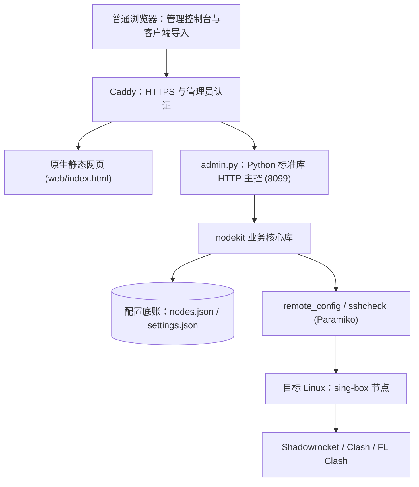

# 03 · 长青轻量实现技术方案

| 属性 | 内容 |
|---|---|
| 文档编号 | TECH-LITE-001 |
| 方案版本 | v1.4，2026-11-10 |
| 状态 | 控制面解耦、工作区四态治理上线，测试门禁538项全绿，生产机walker-sv部署验证 |
| 产品与交互依据 | [PRD](01-PRD-产品需求规格说明书.md)、[交互规格 v1.8](../设计/客户端Web交互设计规格说明书.md) |
| 工程依据 | [工程规范与验收标准](04-工程规范与验收标准.md) |
| 维护原则 | 本文是唯一现行技术方案；旧稿保存在现有历史包的 `revisions/20261101-03-轻量方案修订前.md`，不再维护平行正文 |

> **2026-11-10 控制面解耦、源码解构与 538 项门禁（v1.4）**：
> 1. 控制面通信与代理数据面彻底解耦：Clash 订阅规则首行强制注入受控节点 IP 32 位直连规则（ADR-008），彻底消灭切换或关闭 HY2 时代理自锁死循环；
> 2. 远端配置重启防抖与多轮重试：`verify.py` 的 `tcp_ok` 增加 4 次防抖探测，消除 sing-box 启动 70ms 端口未绑定导致的虚假回滚与 systemd 重启限流熔断；
> 3. 前端源码解构：`web/index.html` 模块化拆分至 `web/src/{css,html,js}`，配合零外部依赖确定性合成管线（`scripts/build_web.py`，ADR-006）；
> 4. 工作区四态分层治理：根目录扁平化开发，历史归拢于 `archive/`，私密凭据隔离至 `.ops-private/`（ADR-007）；
> 5. 统一自动化门禁 `scripts/test.sh` 扩充至 538 项 100% 全绿，生产机 `walker-sv` (43.153.56.137) 热更上线。

> **2026-11-08 架构单轨收敛与数据面真绑定（v1.3）**：
> 1. 架构彻底收敛为单轨主控：全面废弃半成品 Flask 安装器（server/installer/），全系统仅保留基于 Python 3 标准库的极简主控（server/admin.py + nodekit）与原生单页 Web（web/index.html）；首装交付纯靠 setup-mac.sh / install.sh 脚本，纯 paramiko 远程检查模块收敛至 `server/nodekit/sshcheck/`。
> 2. 控制面与数据面 100% 绑定：中转倒换（/api/relay/switch）、HY2 开关（/api/hy2/toggle）、ISP 住宅挂载通过 live SSH 原子重写远端 sing-box 配置、配置检查、重启及真实出网验真，失败自动安全回滚，彻底消灭「假通过」。
> 3. 客户端支持矩阵对齐 PRD：下线 Sing-box 客户端按钮与 JSON 订阅，客户端仅面向 Shadowrocket、Clash、FL Clash。
> 4. 探活诚实可信：彻底清除 probe.py 中人为扣减延时逻辑，如实标注探针视角与本地主控。
> 5. 统一测试门禁 scripts/test.sh，全套 458 项测试 100% 通过；生产机 master-sv (203.0.113.10) 保持稳定运行。

> **2026-11-06 架构演进与交付（v1.2）**：
> 1. 新增 Mac 零依赖自动化自举脚本 `deploy/setup-mac.sh`，基于原生 SSH 流式传输安装包并自动打开默认浏览器直达控制台。
> 2. 完善 Web 仪表盘节点装配流水线：只读检查（`/api/node/check`）与安装部署（`/api/addnode`）解耦且闭环，通过 `#node-install-confirm-box` 实现确认后安装，支持自定义命名与角色选择。
> 3. 落地独立域名更换脚本 `server/change_domain.sh`，支持 Caddy 自动证书与零中断平滑热载。
> 4. 支持 sing-box 链式静态住宅代理（ISP Egress）挂载，出站流量通过 SOCKS5/HTTP 住宅代理转发防风控。
> 5. 生产机 `master-sv` (203.0.113.10) 已上线热更，全套 431 项测试 100% 通过。

## 1. 目标与实现边界

将用户自己的 Linux 服务器连接、装配为个人专线，完成“购买准备 → 连接检查 → 主动安装 → 本机客户端导入”。中文普通 Web 展示全部四项任务，每次只展开一项；公网 IP、用户名、密码在同一任务填写，私钥与 SSH 端口按需展开。AI 和腾讯云授权均可选。

生产采用原生 HTML/CSS/JavaScript、Python 3 标准库 (ThreadingHTTPServer, json, urllib, ssl)、Caddy、Paramiko (用于安全远程 SSH 预检及控制)、systemd 和 sing-box。架构坚决贯彻单轨化，不引入 Flask、Waitress 等重量级 Web 框架或外部数据库。独立 React/Vite 原型只提供交互参考，不直接当作生产实现。

面向服务器主人、单管理员和小规模自用。第一版单机部署；不引入 Redis、Celery、独立数据库服务、微服务、容器编排、内置 AI 或多租户平台。

## 2. 技术栈与职责

| 层次 | 选型 | 使用范围 |
|---|---|---|
| 浏览器 | HTML + CSS + JavaScript | 状态呈现、表单、原生 dialog、复制与客户端唤起；无生产 Node.js 运行时或前端构建要求 |
| HTTP 接口 | Python 3 标准库 (admin.py / ThreadingHTTPServer) | 参数验证、业务 API、节点管理、中转与协议控制；复用 nodekit 核心逻辑 |
| 数据持久化 | 本地 JSON (nodes.json, settings.json, status.json) | 状态底账、配置与状态流；原子文件写入并支持锁同步 |
| 公网入口 | Caddy | HTTPS、管理员认证、静态资源代理、接口与订阅转发 |
| 远程执行与控制 | Paramiko 与固定脚本 | 只读 SSH 检查 (sshcheck)、远端配置原子重写与出网真实验收 (remote_config.py) |
| 进程与定时任务 | systemd | 守护 admin.service、sing-box.service、caddy.service 及探活定时器 |
| 节点服务 | sing-box | 沿用现有协议模板和订阅分发；客户端路由与选点不进入 Web |

默认验证基线为 Ubuntu 22.04、x86_64、systemd 与可达公网 IPv4。现已新增锁定版本及哈希的 Python 依赖文件（`requirements.lock`），包含 Paramiko、bcrypt、cryptography 和实际传递依赖，在独立 venv 安装。

日常管理服务由 `server/admin.py` 绑定 `127.0.0.1:8099`，前端静态资源与公网反代统一由 Caddy 处理。

## 3. 部署拓扑与模块职责



这是一套 Python 应用，分为 API 和 worker 两个进程，由 systemd 分别管理。API 不在 HTTP 请求线程内执行完整安装；worker 不依赖浏览器保持连接。增加一个轻量 worker 是为了避免重启网页接口时直接杀掉安装，不新增消息队列服务。

| 模块 | 职责 | 不负责 |
|---|---|---|
| 页面 | 渲染后台事实、发起明确动作、恢复原任务 | 计时假进度、推断客户端已安装、直接连接 SSH |
| API | 验证输入与检查快照、原子创建任务、查询脱敏状态 | 执行用户提交的任意命令、直接拼接 Shell |
| worker | 执行白名单操作、更新阶段、调用现有业务模块、核验结果 | 自动重复执行不明状态的安装、猜测用户授权 |
| transport | SSH 参数、主机身份核验、认证与超时 | 绕过主机密钥校验、把 SSH 端口当代理端口 |
| nodekit/providers | 复用模板、订阅、生命周期、用量及 Lighthouse 适配 | 因指南列出某厂商就宣称其云 API 已支持 |

API 与 worker 使用专用低权限系统账号，代码与依赖由 root 持有且不可被服务改写。远程操作通过目标机 root 或已明确验证的提权权限执行，不自动开启 root 密码登录。

管理机本身需要启停 sing-box、应用配置或重载 Caddy 时，由 worker 调用唯一的 root 所有本地辅助程序。sudo 规则只允许该固定程序；程序验证固定操作和目标服务，不接受任意命令、脚本路径或可执行代码。API 不获得通用 sudo 权限。写入业务数据的现有定时器也迁移到专用服务账号，避免 root 原子替换文件后改变所有权；确需特权读取的备份步骤由固定辅助程序提供受限结果。这一权限拆分需要实现，当前 admin 服务没有因此完成降权。

## 4. 首次图形入口与后续节点接入

必须区分三条路径，避免裸机还没有网页、却要求先打开裸机网页的循环：

| 路径 | 运行位置 | 执行内容 |
|---|---|---|
| Mac 零依赖自举工具 | Mac 本机终端 | 原生 `deploy/setup-mac.sh` 流式推送并执行安装，自动唤醒默认浏览器直达控制台 |
| 首次图形搭建 | 预先运行的可信安装入口 | SSH 检查后，在裸目标机完整部署管理系统及本机节点，交付用户自己的管理地址 |
| 已有管理页添加服务器 | 用户现有管理机 | 检查（/api/node/check）确认后安装（/api/addnode），实时展示进度，不重复安装整套管理网页 |
| 熟悉者一条命令 | 目标机终端 | 复用 bootstrap/install 直接完成首次部署，之后进入自己的网页 |

推荐图形入口使用同一应用的 `setup` 模式，部署在已有可信 Linux 主机上，不另建安装平台或第二套后端。入口面向单个服务器主人、需要管理员认证；成功交付后，后续操作回到用户目标机的管理页。`managed` 模式承担日常管理，两种模式不是新手/高手选择页。

**上线阻塞项**：首次图形入口的实际运行主机、可信 HTTPS 地址和管理员访问交接尚未配置。必须落实后才能在 README 提供真实 Start setup 链接。纯静态站点不能执行本方案；只有一台裸服务器且入口也不存在时，当前可用基础仍是一条命令路径，不能宣称手机图形全链路已经上线。面向多个互不信任的用户公开服务不属于本期单管理员方案，不能直接将入口开放为匿名安装站。

## 5. 持久任务与数据模型

继续以现有 `nodes.json` 等文件保存其既有业务事实；SQLite 只存装配任务和事件，不复制维护第二份节点底账。数据库位于 `/opt/web-data/tasks.sqlite3`，保留代码与数据分离。

只需要两张表：

| 表 | 主要字段 | 说明 |
|---|---|---|
| jobs | id、kind、target_key、state、stage、request_key、request_digest、request、check_job_id、release_id、attempt、heartbeat_at、result、error_code、created_at、updated_at | result 保存白名单检查/结果摘要，不含密码、私钥、完整订阅 token |
| job_events | job_id、seq、stage、level、code、message、created_at | 每任务 seq 递增，消息在写入前脱敏；默认每任务保留最近 200 条可展示事件 |

`kind` 使用固定枚举：只读检查、完整首次安装、节点安装、接入已有服务、确认后的修复、移除清理、备份恢复。检查结果直接存于检查任务，不另建检查表。request 只保存规范化、无秘密的执行参数（地址、SSH 端口、用户名、版本与确认范围）；不能把收到的整个 POST 请求原样序列化入库。安装任务必须核对服务器端保存的检查快照，不信任页面自行提交的“检查成功”。

SQLite 连接按请求或 worker 独立创建，启用外键、短事务和锁等待；不跨线程共享一个连接，不把 SSH 调用放在事务内。初版使用 SQLite 默认日志模式和保守同步设置，不为少量个人任务提前调优 WAL。备份使用 SQLite backup API 生成一致快照，不能随手复制正在写入的数据库。

### 5.1 去重与目标互斥

1. 页面为一次提交生成 `Idempotency-Key`，超时重试沿用同一键；数据库原子校验键和请求摘要。相同键/相同请求返回原任务，不同请求返回冲突。
2. 即使页面生成了新键，同一目标已有未完成变更任务时，也返回原任务或冲突，不再排第二次安装。worker 初版一次只处理一个变更任务。
3. 已纳管目标沿用稳定服务器标识；首次目标先规范化地址与 SSH 端口，检查后绑定核验的主机身份。别名归并不确定时拒绝并发变更，不把两个域名当作两台已确认机器。
4. worker 领取任务使用短事务比较并更新状态，并取得进程级执行锁。心跳过期只表示需要复查，不自动让第二个执行器接手重复安装。
5. nodes.json 的读—改—写使用跨进程的底账锁及原子替换，不能继续仅靠 HTTP 进程内的 threading.Lock。锁内不执行 SSH。
6. 现有定时器与手动任务对同一服务器的变更共用目标锁。85% 保护仍自动执行，使用优先处理的已有保护路径，不因新队列静默取消保护或解除未知用量的熔断。

### 5.2 状态与恢复

| 状态 | 含义 | 恢复规则 |
|---|---|---|
| queued | 已创建，等待执行 | 凭据仍有效且检查未过期时领取 |
| running | 正在执行具体阶段 | 以 worker 和目标机证据更新，不凭页面计时推进 |
| verifying | 正在核验服务与交付地址 | 验证通过后才可进入成功 |
| reconciling | 执行中断后复查目标 | 只读检查任务标记、配置与服务，不立即重装 |
| awaiting_credentials | 进程重启或凭据过期，需要重新输入 | 原任务暂停，用户补充后继续原任务语义 |
| needs_attention | 配置不兼容、交付条件不足或存在不确定影响 | 原位解释影响，等待明确处理 |
| succeeded | 本次任务的成功条件已核验 | 检查成功不等于安装成功，安装成功不等于客户端已连接 |
| failed | 后台确认执行失败 | 保存失败阶段与恢复入口 |
| cleanup_pending | 移除尚有远程残留 | 订阅保持摘除，针对残留重试 |

- 页面刷新、切后台、断网：后台继续；返回查询同一个 job id。浏览器只保存任务标识等非敏感状态。
- API 重启：worker 独立运行，任务不因 HTTP 进程退出而取消。
- worker 或管理机重启：从 SQLite 找回未完成任务并转入复查；内存凭据已丢失时要求重新输入，不承诺无凭据自动续装。
- SSH 断线或目标重启：检查远程阶段标记、实际版本、配置及服务。已执行阶段按真实后置条件判断，不只看标记文件。
- 任何状态不明都不能直接重跑完整 bootstrap；用户关闭页面也不等于取消或回滚。首版不提供“强制停止正在改配置”的按钮。

## 6. 凭据与授权生命周期

只读检查与主动安装分开，但正常情况下不要求用户重复输入密码：API 将凭据经受限 Unix socket 交给 worker 的内存凭据池，返回与目标/检查任务绑定的随机引用。引用不是登录凭据本身，不能用于获取明文。

未使用凭据的初始有效期建议为 10 分钟，检查快照初始有效期为 5 分钟；已用于受控首次安装实现；正式环境有效期仍需部署验收。已开始任务在执行期间保留必需凭据，结束后立即清除；会话/worker 丢失或需要再次连接时按实际情况重新输入。

- 统一使用 Paramiko：密码和私钥经受限 Unix socket 进入执行器内存，密钥在内存解析；连接固定到已解析、已验证的 IP，并绑定核对后的主机指纹。禁用自动加载本机密钥和 ssh-agent，不增加 askpass 或代理进程。
- 不将临时 SSH 密码或私钥写入 SQLite、JSON、命令行参数、环境变量值、普通磁盘临时文件、URL 或浏览器持久存储。现有 `.jobs/*.secret` 路径不符合新目标，需要替换。
- 新入口首次连接必须核对并确认指纹；快照和安装绑定该指纹。变化时拒绝，不使用自动接受主机密钥策略。旧路径的 known_hosts 行为仍需迁移验证。
- 管理页新密码与 SSH 密码分开；用户主动交付、复制，响应使用 no-store。明文只在执行与短期交付内存中存在，持久结果仅保存地址、用户名和交付状态。
- 新管理密码未交付前 worker 意外重启而丢失明文时，明确显示需要恢复交付；不得自动重置已有密码或从日志找回。需要重设时先确认。
- 长期云 API 授权与临时 SSH 凭据分开，沿用受限配置与明确授权，不存进任务事件。没有长期云授权不阻断 SSH。

## 7. 检查、安装、接入与交付流程

### 7.1 只读连接

检查地址、SSH 端口、凭据与主机身份，再读取系统、架构、systemd、权限、现有 sing-box 版本和配置摘要。SSH 端口默认 22、允许高级选项修改；代理端口单独处理。

只读阶段不下载程序、不写远程公钥、不修改配置、防火墙或服务。缺少工具时返回未知或采用已有只读手段；sudo 权限不足时明确返回，不自动打开 root 登录或修改 sudoers。

检查结果包含 `check_job_id`、目标身份摘要、系统、兼容性、现有服务状态、拟执行范围与失效时间。目标、端口、安装范围或关键配置变化后，原确认失效，必须重新检查。

### 7.2 主动安装

用户提交已确认检查结果和安装动作后，按真实阶段执行：准备 → 获取固定版本包 → 配置 → 启动 → 验证 → 交付。

- 首次安装复用并改造 bootstrap/install；节点安装复用 addnode。脚本只是受控执行工具，业务判断与任务状态统一由 worker 记录。
- 下载采用固定 release/commit、官方哈希与明确失败处理，不在一次任务中追随不断变化的 main。哈希比对是完整性校验，不写成已经完成数字签名验证。
- 脚本输出有限的结构化阶段事件，明确 stdout/stderr 的脱敏边界；不把默认日志尾部直接给前端。不承诺固定 30 秒完成。
- 安装前记录实际接管范围及必要配置快照。阶段完成既记录任务状态，也验证目标实际状态；命令退出码 0 不独立证明成功。
- 管理网页端口和代理监听端口分别检查、保存和展示。已有站点占用端口时不抢占、不停止其他业务；选择可用端口并验证相应网络条件。

### 7.3 已有 sing-box

程序和配置均有效且兼容时，说明接管范围后接入，不重新安装或重置密钥。只有程序没有有效配置时进入配置流程。不兼容时列出差异与调整影响，等待确认；无法理解的配置不覆盖，其他代理程序不清理。

### 7.4 结果交付

首次安装成功条件为：目标管理服务可用、可信 HTTPS 地址可从安装入口侧访问、预期 HTTP/认证行为正确、受管节点和订阅可用。随后返回管理地址、管理用户名及新安装随机密码。最后一步仍由用户浏览器实际打开验证，不能保证安装入口与用户网络环境相同。

不能把 `curl -k` 的连接成功当作公网和证书验证。只拿到公网 IP 不代表已经具备可信证书；域名解析或其他可信证书条件不足时显示待处理，不降级为明文传送管理凭据，也不让用户绕过浏览器警告。实际域名、证书条件和网页端口在只读检查后的安装准备中按需补齐，不预先给新手增加一页网络问卷。

已有管理页添加节点时验证节点与订阅，不生成另一套管理网页账号。服务端成功不自动完成“导入客户端”；平台识别、应用名按钮、复制与下载恢复继续遵循交互规格。

## 8. 最小接口契约

下表为拟实施契约，不表示当前接口已存在。路径统一以 `/api/` 开头；Caddy 保留此前缀，Flask 按完整路径路由。当前 handle_path 的去前缀行为需要与后端同一版本调整，不能分别上线。

| 方法与路径 | 输入/输出摘要 | 副作用 |
|---|---|---|
| POST /api/checks | 地址、SSH 端口、用户名、认证输入；返回 202 和检查 job id | 仅在目标执行只读检查 |
| GET /api/jobs/{id} | 状态、阶段、检查/结果摘要；after_seq 获取后续脱敏事件 | 无远程变更 |
| POST /api/jobs | 操作枚举、check_job_id、凭据引用、确认范围、Idempotency-Key；返回 202 | 创建明确授权的变更任务 |
| POST /api/jobs/{id}/credentials | 用户重新输入临时认证信息 | 绑定原任务，恢复前仍核对目标 |
| GET /api/jobs/{id}/delivery | 短期管理地址与独立凭据，管理员认证、no-store | 不重新生成或重置密码 |
| GET /api/setup | 当前服务器事实、最近任务与下一步 | 无远程变更 |

### 8.1 订阅原生配额标头契约（Subscription-Userinfo）

为解决用户日常在手机端（如 Shadowrocket 小火箭）下拉即可直观感知已用流量、总配额容量与最早到期时间的诉求，在订阅路由中注入工业标准 HTTP 标头：

| 路径 | 格式 | 注入标头 | 计算逻辑 |
|---|---|---|---|
| `GET /s/{token}` | Base64 订阅文本 | `Subscription-Userinfo` | 聚合监控主机已用字节、总容量字节及最早到期时间戳 |
| `GET /s/{token}/clash` | Clash YAML 配置 | `Subscription-Userinfo` | 聚合监控主机已用字节、总容量字节及最早到期时间戳 |

- **标头标准格式**：
  `Subscription-Userinfo: upload=0; download=<bytes>; total=<bytes>; expire=<epoch_seconds>`
- **纯函数契约**：由 `server/nodekit/subscriptions.py` 的 `subscription_userinfo(usage_data)` 纯函数负责计算（转字节单位并提取最早到期时间），与底层 Web 框架完全解耦。

现有订阅 `/s/{token}` 与未重构的管理能力按既有契约保留；新安装链路切换后停止旧的一步提交即安装路径，不为其长期维护第二套任务实现。

统一错误结构为 `{code, message, job_id?, retryable}`，message 使用中文，code 保持稳定。初版区分 400 输入错误、401 未认证、403 未授权/跨站请求、409 状态或幂等冲突、422 不兼容、503 暂时不可用；GET 不发起远程写操作。

页面仅在有活动任务时约每 2 秒轮询，失败退避到 5/10 秒；隐藏时暂停轮询，返回立即查询原任务。服务端继续执行；没有活动任务时停止任务轮询，不引入 WebSocket 或 SSE。

## 9. 数据目录、备份与移除

```text
/opt/web/                    root 所有的程序与静态资源、只读 venv
/opt/web-data/               专用服务账号所有，0700
├── nodes.json               既有节点底账，唯一写入口
├── settings.json            既有设置与受限长期授权引用
├── tasks.sqlite3            任务、检查结果、脱敏事件
└── snapshots/               确认变更前必要快照，受限权限与保留期
/run/evergreen/              socket、进程锁等临时运行资料，不保存普通秘密文件
```

现有独立的云授权文件及状态快照继续按实际配置管理，不因上图省略就迁入公开目录；API 不直接向浏览器提供整个数据文件或云密钥。当前 Caddy 直读四份状态 JSON 的路由同步改为受控接口投影，新前端从 `/api/setup` 等接口获取必要字段；Caddy 不再读取 0700 的私有数据目录。旧前端与该路由同版本替换，不增加第二套状态文件或兼容服务。若升级现有 root 所有的数据目录，必须由安装器显式迁移所有权并验证原订阅、定时器与备份仍可工作。

- SQLite 通过 backup API 一致导出；JSON 持续使用原子写入，节点底账只有一个写入口。任务库使用 schema 版本与单事务迁移。
- 备份只包含说明中列明的配置和一致快照，不包含临时凭据/socket/过期交付密码；长期秘密按现有备份授权处理，不通过普通页面泄露。
- 配置与任务快照记录同一备份批次；导出时在短一致窗口内取得底账锁与任务快照，不让相互冲突的写入穿插。任务库恢复后，未完成任务全部进入复查，不直接重放旧的 queued/running 记录；新旧管理机不能同时对相同目标执行变更。
- 恢复前显示版本、时间、内容摘要和覆盖影响；确认后执行，逐项验证目标授权及服务。无异地目标明确显示未开启。
- 移除先摘除该服务器全部关联节点，再清理已接管的 sing-box（含复用安装）。不删除云服务器、停止云计费或删除管理网页；最后一个节点也允许移除。
- 远程清理失败进入 cleanup_pending，保留目标与重试信息。清理范围采用已记录归属，不能按全局程序名强杀其他代理或业务。

## 10. 公网入口与认证

沿用现有 Caddy 管理员认证，API 仅监听回环地址；Caddy 负责静态页及转发。管理凭据只通过可信 HTTPS 发送。HTTP 入口仅用于证书流程或重定向，不提供带认证的明文管理操作。[Caddy 反向代理文档](https://caddyserver.com/docs/caddyfile/directives/reverse_proxy)

不增加注册、普通用户角色、语言设置或第三方登录。单管理员仍需防止跨站提交：变更接口验证配置允许的 Origin、JSON Content-Type 和由 `GET /api/setup` 同源发放的短期请求令牌；不开放任意 CORS，不用 GET 修改状态。请求体、凭据和交付内容不进入普通访问日志。

安装入口只接受服务器主人授权的目标。任意网页输入不能用于访问控制平面内部端口或元数据地址；目标地址与 DNS 解析需校验，并在连接前绑定复查。对管理机本身的维护通过已有受管标识及本地固定辅助程序处理，不通过任意用户地址绕过范围限制。

## 11. 最小代码改动范围

下列是实施时的目标位置，本轮不创建空壳模块或安装服务：

| 位置 | 改动 |
|---|---|
| web/index.html、web/app.js、web/style.css | 原型转原生 Web，按需要拆为三份静态文件；保持中文和四项任务，不移入 React 运行时 |
| server/admin.py | Flask 应用入口，沿用现有业务；逐步移出 HTTP 手写路由和安装线程 |
| server/installer/state.py | 两张表、状态转换、幂等及查询；使用标准库 sqlite3 |
| server/worker.py | 单 worker、内存凭据、领取任务与中断复查 |
| server/installer/transport.py | 统一 SSH 端口、认证、主机身份与超时；只读/变更操作明确区分 |
| server/local_actions.py | 唯一受限本地特权辅助程序，固定动作，不接受任意命令 |
| server/nodekit/、server/providers/ | 复用并按差距修正原逻辑，不整套重写 |
| server/addnode.sh、deploy/bootstrap.sh、deploy/install.sh | 固定版本、可验证阶段、保留已有配置和安全交付 |
| deploy/systemd/ | 原 admin 服务改用 Waitress，增加一个 worker 服务；现有定时器继续使用 |
| requirements.lock | 锁定实际测试过的 Python 依赖与哈希；生产无需 Node.js |

API 与 worker 的重启/停止策略分别配置。worker 停止后任务进入复查，不依赖将 subprocess 脱离监管来假装“永不中断”。systemd 负责进程存活，任务业务恢复由本应用判断，两者不能混为一谈。[systemd 服务文档](https://www.freedesktop.org/software/systemd/man/latest/systemd.service.html)

## 12. 实施顺序与完成门槛

| 阶段 | 交付内容 | 必须证明 |
|---|---|---|
| P0 基础 | 锁定依赖、Flask/Waitress、API/worker 服务、SQLite、凭据通道 | 新服务本地启动、API 不以 root 运行、接口前缀/认证正确、秘密不进普通持久存储 |
| P1 连接 | 原生四项清单、真实只读检查、SSH 端口、帮助与可选腾讯云发现 | 检查不改目标；普通 SSH 无云授权也可使用；目标/权限变化能被识别 |
| P2 装配 | 幂等任务、完整安装/节点接入区分、已有配置复用、真实进度与中断复查 | 重复点击仅一个任务；页面/API/worker/目标重启分别测试；不重复安装、不覆盖未知配置 |
| P3 交付 | 可信管理地址、独立账号交付、订阅、三个客户端入口与复制恢复 | HTTP/证书/认证/订阅各有证据；真实平台客户端链路验证；临时交付丢失不自动改密码 |
| P4 完整生命周期 | 修复确认、85% 保护集成、完整移除、备份恢复与最后节点场景 | 目标锁一致，其他业务保留，未知用量不假正常，部分失败可恢复 |

每阶段先完成对应离网检查，再在受控机器上验证真实链路，最后按发布范围部署；不把“构建通过”当成安装成功。生产完整交付以交互规格 62 项场景与工程门禁为准，不能只交付 P1 表单就宣称全流程完成。

技术验证至少覆盖：相同/不同幂等键重复提交、同一目标不同别名、SQLite 锁冲突、worker 单实例、检查过期、秘密引用过期、SSH 主机密钥变化、现有配置不兼容、API/worker/目标重启、特权动作白名单、可信证书不足、交付密码丢失、恢复快照一致性与部分卸载失败。新增检查按实际修改编写，不堆砌与实现逐行相同的测试。

## 13. 当前代码差距与本轮结果

| 当前静态核对事实 | 方案要求 | 状态 |
|---|---|---|
| admin.py 使用 ThreadingHTTPServer，JOBS 主要在内存 | Flask/Waitress + SQLite + 独立 worker | 旧后台待迁移；独立首次入口已跑通 |
| _write_job 将临时认证写入 .jobs 的 secret 文件 | worker 内存凭据及受限 IPC | 新入口已实现内存交接；旧 secret 路径待替换 |
| 远程安装主要在一个任务内连接、预检和安装 | 独立只读检查与明确开始安装 | 新入口独立检查已实测；旧路径待迁移 |
| 前置探测固定 SSH 22，表单 port 为代理端口 | SSH 端口贯通，代理/管理端口分别处理 | 新入口自定义 SSH 端口已实测；旧维护/卸载待贯通 |
| bootstrap/install 能完整部署；addnode 主要安装节点 | 两种任务范围、持续状态和公网交付 | 仅首次完整安装已实现；节点接入编排与公网交付待验 |
| 安装器本机 curl -k 检查不足以证明公网可用 | 可信证书、HTTP、认证、节点和订阅分别验证 | 新 worker 已独立验证本地 CA、认证与订阅；公网证书待验 |
| 新 Web 只有独立前端模拟 | 转为生产原生网页并接真实接口 | 新独立 Web 已接真实接口；完整日常首屏待迁移 |

以上为方案与旧系统差距；后续独立首次安装入口的实际实现和验证范围见第 14 节。当前改动未部署到现有云服务器，也未推送。


<a id="controlled-first-install"></a>

## 14. 受控首次安装实现（2026-11-01）

**节点平台补充：** 首批目标是 Windows 与 Linux 节点；本节实现仍是空白 Linux 的首次完整管理端安装。新入口可经 SSH 只读检测 Windows 系统、sing-box 进程和 TCP 监听端口，并拒绝将其交给 Linux 安装流程；新界面在连接任务内展示目标、系统、sing-box 运行状态和监听端口，并说明接入尚未实现；结果恢复后不允许进入 Linux 安装流程。它不判断现有配置兼容性，也不导入、创建或接管 Windows 节点。现有管理页的节点装配与该首次安装入口是不同流程，不可将单台已有节点的验证当作自动接入能力。

2026-11-01 只读检查现有新加坡 Windows Server 2022：sing-box 运行并监听 TCP 8443；实测经其代理访问外网，出口位于新加坡；现有订阅中该节点出现一次。未安装、重启、改配置或重复添加节点。此为当时单机证据，不代表其他机器或未来状态；订阅凭据与服务器配置不写入文档。

Windows 自动安装和接管仍待实现：先确认身份、权限、端口和现有服务；保留现有配置和其他业务；在用户确认范围内创建或接入节点，确保重复操作幂等，并分别验证服务、订阅及真实转发。需覆盖空白 Windows、已有兼容/不兼容配置、端口冲突、失败恢复和 Linux 回归。现阶段没有空白 Windows 端到端装配验收，也不能宣称任意电脑均可成为可用节点；公网连通性、权限与系统条件仍需满足。

本次新增只读识别后，安装器离网测试运行 34 项，33 项通过、1 项跳过；真实 Windows 只读探测另行验证。未部署本地更改。

本轮交付独立的 `server/installer/` 和原生 `web/setup.*`，对应首次完整安装的最小闭环。目标机仍安装现有 `admin.py` 管理网页与本机双协议节点，未将旧日常后台迁为 Flask。既有配置接管、sudo 登录、完整卸载和全套四任务准备帮助仍在后续范围；不是 P0–P4 全部完成，也不是已有用户的迁移版本。

- 输入一次 SSH 密码或私钥，先执行只读检查；目标要求 root、Ubuntu 22.04+/Debian 12+、systemd、x86_64/aarch64 和安装脚本所需空间。检测已有配置直接停止，不能当作已有服务接管已实现。
- 显式“开始安装”后创建持久任务。提交幂等键和目标活动任务约束防止重复任务；目标原子 owner 声明再防止另一入口重复装配。发布包固定哈希，排除凭据、隐藏文件、测试文件和第三方二进制缓存；用户确认开始后才准备目标安装资源。
- 目标由独立 systemd oneshot 执行固定脚本。原始输出丢弃，只保留实际阶段编号与退出状态；HTTP 或本地执行器退出不结束远程任务。
- API 重启继续查询；执行器重启必须重输 SSH，然后复查原目标任务。对于节点配置写入之前、明确标记为软件源或二进制下载失败的阶段，用户复查原任务时核对服务器身份、发布归档及解压源码、现有配置与 Caddy 文件是否发生变化，再安全重试前置依赖；其他失败和目标重启中断仍停在待处理，不自动重跑完整安装。
- 明文交付密码仅留在执行器内存。丢失时需明确确认恢复密码，且仅允许修改该任务标记对应的新管理页；服务、HTTPS、认证与订阅未验证时不交付成功。
- 节点配置与底账使用 root 私有 `.setup-seed.json` 恢复快照，逐文件原子替换；配置与快照不一致时停止。SQLite 与目标文件不构成同一个事务；本轮不声称已完成所有旧底账写入路径的跨进程迁移。
- 流量停机通过独立短锁 `/run/ownline-service.lock` 设置 `/var/lib/ownline/quota-paused` 再停代理；新安装启动检查该标记，下载不持锁。云用量未知仍不能宣称保护；旧修复路径统一遵循保护标记仍需后续验证。

<a id="installer-deployment"></a>

### 14.1 运行与部署

依赖在 `requirements.in` 声明、`requirements.lock` 锁定并记录哈希；仅新入口需要 venv，现有目标管理后台保持原运行方式。准备受信 HTTPS 安装入口服务器后，运维者安装 Python 3.10+、venv、Caddy，创建专用 `ownline-setup` 用户，将仓库放在 `/opt/ownline`，执行：

```bash
python3 -m venv .venv
bash deploy/install-python-deps.sh
```

由该专用用户运行初始化（密码交互输入，只保存哈希）：

```bash
.venv/bin/python -m server.installer init --config /var/lib/ownline-setup/config.json --origin https://setup.example.com
```

`/var/lib/ownline-setup` 需提前由运维创建并归属专用用户；配置与任务目录禁止公开读取。复制 `deploy/installer/` 中两份 systemd 单元，核对实际路径后启动。API 仅监听 `127.0.0.1:4180`；Caddy 使用如下独立站点代理，保留 `/api/` 前缀：

```caddyfile
setup.example.com {
    reverse_proxy 127.0.0.1:4180
}
```

不公开 HTTP 或免认证入口。这里没有提供运营中的托管安装网址；入口管理员、域名与 HTTPS 由部署者准备，不能让普通用户误以为裸浏览器可直接 SSH。目标需允许 SSH 端口以及管理 HTTPS 8443、证书验证 80、代理 TCP/UDP 443；云安全组由用户明确配置，不自动宣称已放行。目标如已预装 Caddy，要求 2.8+，旧版本明确停止。

`development`、`allowed_targets`、`test_internal_tls`、`verification_url`、`tls_ca_file` 仅用于隔离测试；生产配置禁止测试证书与交付地址覆盖。公网 IPv4 与域名已支持，IPv6、非 root sudo、已有配置复用尚未实现。API 与 worker 使用同一低权限用户，通过私有 Unix socket 通信。

### 网络来源与恢复

- 系统依赖先用目标机现有 apt 源；失败时按 Debian/Ubuntu、系统代号及架构生成仅用于当前 apt 命令的清华镜像列表。保留 apt 签名验证，不改现有系统源文件。Ubuntu ARM 使用 `ubuntu-ports`。
- 安装端和目标分别尝试两个经过本次比对的第三方 GitHub 反向代理和官方地址，优先目标下载；失败后查找安装端本地缓存，再尝试由安装端下载并通过 SSH 传送。只传公开的固定版本程序；sing-box 1.14.4 验证 SHA-256，Caddy 2.10.2 官方包验证 SHA-512。目标在使用前再次验证。
- Caddy 优先使用官方仓库提供的锁定版本及软件包签名；官方仓库失败时使用经校验的官方发行包与受限 systemd 服务。新建的 Caddy 官方 apt 源只供本次命令使用，不设置后续自动更新；需另行解决长期更新。已有 Caddy 至少为 2.8 时保留，遇到已有服务冲突则停止。
- 产品源码镜像仅接受独立可信渠道提供的完整提交号和相应 GitHub 归档 SHA-256；没有可信校验值时只尝试官方 GitHub。部署者需先通过可信渠道获得 bootstrap 本身；当前没有已发布的可信入口或发布校验值，不能声称大陆用户的首次下载已完全解决。第三方镜像可能不可用，文件不匹配始终拒绝执行。
- 验证成功后清理目标上的安装归档、已上传的第三方程序与临时下载缓存，保留目标程序、源码、任务状态及 owner 标记。清理失败不虚报清理成功；失败或未验证前保留恢复所需数据。
- 当前 Google/Cloudflare 连通性探测失败只提示，实际依赖来源仍各自检查；用户是否在大陆不作为目标服务器所在地域的推断依据。

### 14.2 验证边界

离网合约测试：`.venv/bin/python -m unittest discover -s tests/installer -p 'test_*.py' -v`。旧离网回归：`bash scripts/test.sh`。真实安装测试为显式运行的 `tests/installer/smoke.py`，仅接受独立 `ownline-smoke-*` Docker 测试容器，不接受真实服务器凭据。fixture 使用真实 SSH、systemd 和安装脚本；其 CA 为显式信任的本地测试 CA，不代表公网证书或真实云网络已经验收。具体结果以本轮验证记录为准，产品 62 项场景仍按设计规格逐项待执行。


此前首次安装本地验证（2026-11-01）：旧 13 套离网回归 304 项通过；当时新首次安装合约测试 17 项通过；两次真实隔离 Linux 安装均成功，最终版本完成 20 项链路断言（密码/私钥、自定义端口、只读无装配写入、幂等与目标互斥、API/worker 重启、确认恢复密码、HTTPS/认证/订阅、真实代理停启与保护标记、用量未知不解保护、数据库不含临时凭据）。浏览器验证真实任务恢复、交付可见、指纹确认后的错误处理与单项展开；发现并修复旧轮询重复弹出指纹窗口。API 与 worker 本地进程使用当前非 root 用户；Linux 低权限 systemd 单元仅提供配置，尚未实装验收。没有使用已有云机或宣称 62 项产品验收完成。

复现实机测试时，先从 Caddy 官方 v2.10.2 发布页将本机架构 tar.gz 缓存为 `packages/caddy_2.10.2_linux_<arm64|amd64>.tar.gz`，Dockerfile 内校验官方 SHA-512；sing-box 对应版本可预缓存于 `packages/`，仍执行脚本中的 SHA-256 校验。构建 `tests/installer/Dockerfile` 后，仅启动私有 cgroup、tmpfs `/run`、本地绑定 SSH 18422 与 HTTPS 18443 的一次性测试容器，名称必须以 `ownline-smoke-` 开头，再运行 smoke 脚本。Docker 的 privileged 权限仅供隔离 systemd fixture，不是产品部署要求。本次 Debian 软件源使用任务内镜像及 host 映射；复现者应使用当地可达的官方/镜像解析，不修改系统全局 DNS。测试脚本保留本地 API/worker 以便网页检查；结束后先核对 `.installer-local/<容器名>/processes.json` 记录的进程仍属于该测试配置，再停止进程和对应测试容器。


镜像与恢复补充验证（2026-11-01）：当前设备分别从 GitHub、ghproxy.net 和 ghfast.top 获取同一公开提交归档，SHA-256 一致；两家镜像的 ARM64 sing-box 包与官方固定值一致。这仅证明本次网络条件下的内容一致，不能代表大陆所有网络可用或镜像长期可靠。离网回归 304 项、安装合约测试 31 项通过，覆盖损坏包拒绝、镜像/缓存回退、安全续装互斥、HTTPS 降级拒绝与仓库排除二进制。隔离 Debian ARM64 真实测试覆盖目标 GitHub/代理/Caddy 官方源不可达时安装端缓存兜底、Caddy 官方发行包安装、系统源中断与恢复原任务、HTTPS/认证/订阅、流量保护、完成后清理缓存；组合场景 23 项通过。另在隔离 Debian 容器真实访问清华镜像、用 Debian 官方密钥验证软件源，并确认原软件源文件未改；相关测试可通过 `OWNLINE_APT_FIXTURE` 显式启用。已存在 Caddy 配置不会被发行版默认文件处理逻辑覆盖。公网证书、大陆网络与 x86_64 真机尚未实测。
