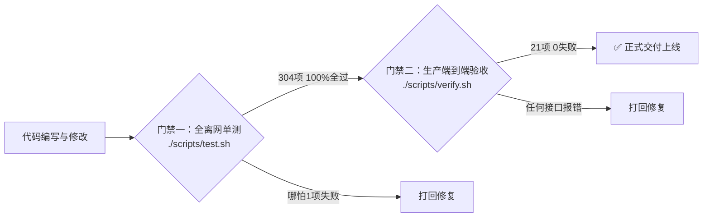

# 04 · VPN-OwnLine · 长青 (Evergreen OwnLine) 工程规范与验收标准 (DoD)

> Status / 状态：**Active / 现行生效（质量与验收硬性准则）**  
> Project / 开源项目：**VPN-OwnLine（个人专线）**  
> Brand / 项目品牌：**Evergreen (长青)**  
> Slogan / 理念：*Turn your own Linux server into a private, dedicated cross-border line.*（默认 SSH 接入，下方可选腾讯云 Lighthouse 授权；其他云原生能力按实际适配扩展） 
> Version / 适用版本：全生命周期通用  
> Audience / 核心受众：所有参与项目开发、重构、自动化演练与交付的开发者及 AI Agent  
> Core Rule / 核心法则：**“判断完成的唯一标准是命令输出的客观证据，严禁假通过”**

---

> **节点平台补充（2026-11-01）**：Windows 与 Linux 是首批节点目标；Windows 自动安装及已有节点接管尚未完成。验收须覆盖系统识别、空白与已有配置、端口冲突、其他服务保留、重复操作、故障恢复、订阅唯一性和实际代理转发；只读检测或历史单机成功不等于自动装配通过。管理端首次安装仍只支持受约束 Linux。

> **交互补充（2026-11-02）**：[交互规格 v1.7](../设计/客户端Web交互设计规格说明书.md)列出待执行场景。首次安装在用户自己的腾讯云终端执行，公共介绍页不接收 SSH 凭据；AI 可选且敏感步骤交给用户。不得将既有离网单测或本机自检当作公网访问、恢复或客户端链路已经验收。

生产技术栈约束适用于产品仓库；独立前端设计原型使用 React/Vite，不代表生产依赖已改变。原型浏览器 QA 与生产发布门禁分别记录；仅文档修订不要求操作生产，也不引用历史结果冒充新验收。

## 1. 开发与架构底线标准（Development Standards）

### 1.1 轻量技术栈与依赖边界

以[轻量技术方案 v1.3](03-技术方案-全自动化装配中枢架构方案.md)为实施基线。生产坚持单轨主控，采用 Python 3 标准库（admin.py + nodekit），彻底废除 Flask / Waitress / SQLite 等冗余双轨实体。远程检查与控制使用 Paramiko（在独立 venv 中安装锁定版本的依赖 requirements.lock）。

- 前端采用原生 HTML/CSS/JavaScript ES Modules，由 Caddy 托管静态资源；生产不依赖 React、Node.js 或前端构建服务。独立原型的 React/Vite 选择不扩展为生产要求。
- 控制面采用 Python 3 标准库，由 systemd 托管；配置持久化采用原生 JSON，保留代码与数据分离。不新增 Redis/Celery、MySQL/PostgreSQL、微服务、容器编排或内置 AI。
- 运行依赖在 venv 内锁定版本与哈希（requirements.lock），部署优先使用匹配目标平台的预构建包，不在生产机器追随浮动版本。
- 代码与数据分离：`/opt/web` 存程序、静态资源及只读 venv，root 所有；`/opt/web-data` 为专用服务账号所有、0700，存配置与状态底账。临时运行资料位于 `/run/evergreen/`。
- API 进程遵循最小权限原则，不给 Web 接口通用 root 命令执行能力；远端操作通过 `remote_config.py` 执行白名单配置重写与出网验证。

### 1.2 纯函数架构与配置防漂移标准
* **无副作用纯函数**：订阅生成、熔断判定、端口仲裁、配置模板等计算逻辑保持可测试纯函数；SSH、服务启停和数据写入等副作用隔离在执行层，离网检查使用替身验证边界。
* **配置唯一形状来源**：`nodekit/templates.py` 是各节点配置的唯一基准。任何线上配置改动必须同步回填模板，通过 `python3 scripts/drift.py` 严格校验配置无漂移。
* **单一写入口**：用户变更经面板 API 校验并创建任务，worker 执行；定时器使用同一受控业务函数与目标锁。节点底账读改写必须使用跨进程锁和原子替换，不用各进程独立的线程锁代替。不得绕过任务边界手工修改受管配置。

---

## 2. 安全红线与操作契约（Security Redlines）

### 2.1 凭据“三不”原则
1. **不打印**：任何脚本、日志、测试输出中，绝对不得输出 root 密码、云厂商 SecretKey、UUID、私钥、订阅 Token。
2. **不落普通持久存储**：临时 SSH 密码、私钥与新管理密码不进入 SQLite、JSON、URL、普通临时文件、命令行或环境变量值；worker 内存与受限进程通道用于交接，进程丢失时重新输入或确认恢复。长期云授权与临时凭据分开。
3. **不提交**：Git 仓库中严禁出现任何真实机房的连接密钥与敏感配置。

### 2.2 鉴权与边界防线
* **管理接口鉴权**：所有管理性 API（增删节点、自愈、备份还原）强制走 Caddy 的 HTTP Basic Auth 认证。
* **订阅防遍历**：订阅链接强制使用 32 位高熵随机 Token（`/s/{token}`），数学上杜绝穷举遍历。
* **合规与伦理边界**：本系统仅做个人专属网络连通工程，**严禁修改系统时区、浏览器语言、字体、Intl 区域去伪造虚假海外身份**。

### 2.3 必须停下来向用户确认的三件事
1. **删除**任何现有节点之前；
2. **重置**任何服务器密码之前；
3. **重装**任何云主机操作系统之前。

---

## 3. 高可用与系统级容错标准（HA Standards）

| 场景 | 硬性标准与容错指标 |
|---|---|
| **流量防超额熔断** | 监控到月度流量达到 **85%** 刚性红线，必须在 10 分钟内执行**远程真机物理断流（`systemctl stop sing-box`）并在订阅层同步剔除**，远程命令成功后才更新熔断状态；失败保留原状态并在下轮重试，单节点异常不阻断其他节点。仅有效用量低于 85% 时允许恢复，未知或无效用量不得解除熔断。该机制降低超额风险，不保证零费用。 |
| **装前 3 秒连通性排雷** | 连接检查先探测用户选择的 SSH 端口（默认 22），初始 TCP 超时建议 3 秒，随后进行受控只读检查。连接失败必须弹出人话指引（提示检查开机与安全组），严禁直接抛出 `Permission denied` 等生涩技术堆栈。 |
| **动态端口仲裁** | 遇 443 端口被 Nginx/宝塔占用，系统必须自动降级到 `8443` 或 `20443`，绝不允许强行抢占导致原建站业务崩溃。 |
| **中继高可用冗余** | 国内中继节点必须配置双落地通道（主出口 + 备用出口），依托 sing-box 原生 urltest（30秒周期）实现主链路受阻无感自动倒换。 |
| **单节点原地自愈** | 节点探活异常时，先说明中断影响并确认，只针对已接管的 sing-box 执行修复和实际验证；按真实阶段反馈，不承诺固定 5 秒完成。85% 用量保护按已确认例外执行。 |

---

## 4. 交付与验收硬性判准（Definition of Done）

任何功能开发、漏洞修复或重构，必须通过以下**两道刚性检验门禁**才算完成：

### 门禁一：全自动化综合测试门禁（Integrated Test Gate）
* **执行指令**：`./scripts/test.sh`
* **硬性标准**：**22 套 nodekit 单测（427 项）+ 49 项 Python unittest + 前端与加密单测及构建同步校验（40 项）+ Shell 语法与兼容性校验（16 项），总计 544 项 100% 全绿**。
* **覆盖范围（544 项综合全绿自动化测试）**：
  1. `server/nodekit/*_tests.py`：22 套独立单测套件共 427 项校验（含基础模型 tests 59项、连通验真 verify 28项、建议 advise 20项、指引 hints 16项、模板 templates 31项、订阅分发 subscriptions 70项、日志 logger 15项、自愈 repair 5项、来源存证 provenance 6项、盲区决策 jev 5项、生命周期 lifecycle 22项、中转守护 relay_guard 19项、配额熔断 quota_guard 77项、配额API quota_api 6项、远端配置 remote_config 33项、物理网卡流量 host_traffic 8项、端口仲裁 ports 6项、HTTP工具 http_utils 5项、节点管理 node_manager 11项、中转服务 relay_service 6项、HY2服务 hy2_service 3项、节点服务 node_service 4项）；
  2. `python3 -m unittest discover -s tests -p "test_*.py"`：49 项功能与回归单测（含 SSH 检查、中转绑定、探活诚实性、交付自检、客户端交付等）；
  3. `tests/*.test.js` 与合成管线：39 项前端 DOM/加密契约测试（含情境唤醒、防竞态轮询与节点状态推导）及 `web/src -> web/index.html` 确定性同步强校验；
  4. 部署与运维脚本语法校验与 Bash 3.2 兼容性测试：15 个 Shell 脚本语法与 macOS Bash 3.2 空数组兼容性检验全部通过。

---

### 门禁二：生产真机端到端验收（Production Verification）
* **执行指令**：`./scripts/verify.sh https://<主控域名:端口> <账号> <密码> <Token>`
* **硬性标准**：**21 项真实验收用例全部通过（0 失败）**。
* **检验清单**：
  * **访问控制**：未授权拦截（401）、认证通过（200）、直接访问非法路径（404）、伪造 Token 遍历（404）；
  * **订阅聚合与标头**：Clash 节点数与 Base64 节点数严格一致且大于 0；`/s/{token}` 与 `/s/{token}/clash` 真实透传标准 `Subscription-Userinfo` 响应标头且字段数值完整有效；
  * **核心接口**：节点查询（200）、探活数据（200）、跨站请求拦截（403）；
  * **输入校验**：非法 IP / 域名录入阻断（400）；
  * **系统解法验证**：中继多落地状态接口（200）、85% 流量熔断接口（200）、熔断监控真实数值校验（准确率 100%）、生命周期到期标记校验。

---

## 5. 验收铁律（反敷衍法则）

1. **拒绝“无报错即成功”**：必须在 `ss -tulpn` 里看到监听端口、在订阅里取到对应节点、并在真实客户端测出公网出口 IP。
2. **一次只改一个变量**：严禁多处并发修改；改完立即跑 `./scripts/test.sh` 验证。
3. **交付必须给证据**：任何交付汇报必须附带测试输出摘要，严禁口头声明“已完成”。
