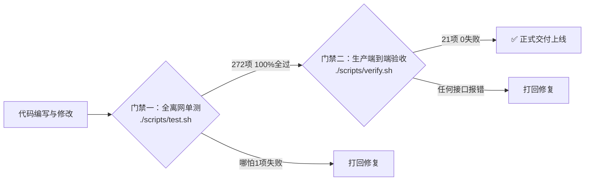

# 04 · VPN-OwnLine · 长青 (Evergreen OwnLine) 工程规范与验收标准 (DoD)

> Status / 状态：**Active / 现行生效（质量与验收硬性准则）**  
> Project / 开源项目：**VPN-OwnLine（个人专线）**  
> Brand / 项目品牌：**Evergreen (长青)**  
> Slogan / 理念：*Turn any cloud VPS into your private, dedicated, and self-healing cross-border line.*（把云服务器自动化装配为你个人的专属出海专线）  
> Version / 适用版本：全生命周期通用  
> Audience / 核心受众：所有参与项目开发、重构、自动化演练与交付的开发者及 AI Agent  
> Core Rule / 核心法则：**“判断完成的唯一标准是命令输出的客观证据，严禁假通过”**

---

## 1. 开发与架构底线标准（Development Standards）

### 1.1 极简技术栈与零外部运行时负担
* **后端准则**：主控仅使用 **Python 3 标准库**，严禁引入任何重量级 Web 框架（如 Django/Flask/FastAPI），严禁引入额外运行时（如 Node.js、Redis、MySQL、Sub-Store 等）。
* **前端准则**：纯原生 HTML5 / CSS3 / ES5+，无打包工具依赖，静态文件直接由 Caddy 伺服，秒开即用。
* **数据与代码严格物理解耦**：
  * `/opt/web`：仅存放代码与静态页，支持公开开源，无任何敏感信息；
  * `/opt/web-data`：私有数据目录（权限严格设为 `700`），存放 `nodes.json`、`servers.json`、`status.json`、`usage.json` 等动态业务底账。

### 1.2 纯函数架构与配置防漂移标准
* **无副作用纯函数**：所有核心业务逻辑（`subscriptions.py` 订阅生成、`quota_guard.py` 熔断判定、`ports.py` 端口仲裁、`templates.py` 配置模板）必须实现为可测试的纯函数，不依赖外部动态网络，确保离网单元测试可秒级复现。
* **配置唯一形状来源**：`nodekit/templates.py` 是各节点配置的唯一基准。任何线上配置改动必须同步回填模板，通过 `python3 scripts/drift.py` 严格校验配置无漂移。
* **单一写入口**：系统装配入网后，所有写操作一律通过面板 API（`/api/*`），严禁手工 SSH 窜改配置文件造成数据分叉。

---

## 2. 安全红线与操作契约（Security Redlines）

### 2.1 凭据“三不”原则
1. **不打印**：任何脚本、日志、测试输出中，绝对不得输出 root 密码、云厂商 SecretKey、UUID、私钥、订阅 Token。
2. **不落盘**：临时安装输入的密码绝不写入任何文件或持久化环境变量。
3. **不提交**：Git 仓库中严禁出现任何真实机房的连接密钥与敏感配置。

### 2.2 鉴权与边界防线
* **管理接口鉴权**：所有管理性 API（增删节点、自愈、备份还原）强制走 Caddy 的 HTTP Basic Auth 认证。
* **订阅防遍历**：订阅链接强制使用 32 位高熵随机 Token（`/s/{token}`），数学上杜绝穷举遍历。
* **合规与伦理边界**：本系统仅做个人专属网络连通工程，**严禁修改系统时区、浏览器语言、字体、Intl 区域去伪造虚假海外身份**。

### 2.3 必须停下来向用户确认的三件事
1. **删除**任何现有节点之前；
2. **重置**任何服务器密码之前；
3. **重装**任何云主机操作系统之前。

---

## 3. 高可用与系统级容错标准（HA Standards）

| 场景 | 硬性标准与容错指标 |
|---|---|
| **流量防超额熔断** | 监控到月度流量达到 **85%** 刚性红线，必须在 10 分钟内执行**远程真机物理断流（`systemctl stop sing-box`）并在订阅层同步剔除**，宁可断网绝不产生按量扣费。低于 85% 自动拉起恢复。 |
| **装前 3 秒连通性排雷** | 提交装机时，前置 3 秒 TCP 22 端口探活。连接失败必须弹出人话指引（提示检查开机与安全组），严禁直接抛出 `Permission denied` 等生涩技术堆栈。 |
| **动态端口仲裁** | 遇 443 端口被 Nginx/宝塔占用，系统必须自动降级到 `8443` 或 `20443`，绝不允许强行抢占导致原建站业务崩溃。 |
| **中继高可用冗余** | 国内中继节点必须配置双落地通道（主出口 + 备用出口），依托 sing-box 原生 urltest（30秒周期）实现主链路受阻无感自动倒换。 |
| **单节点原地自愈** | 节点探活异常时，一键自愈必须在 5 秒内完成「杀灭残留僵尸进程 $\to$ 校验并重刷配置 $\to$ 重启 systemd 并自检出网」。 |

---

## 4. 交付与验收硬性判准（Definition of Done）

任何功能开发、漏洞修复或重构，必须通过以下**两道刚性检验门禁**才算完成：

### 门禁一：全离网单元测试（Unit Tests）
* **执行指令**：`cd 仓库 && ./scripts/test.sh`
* **硬性标准**：**13 套测试套件全部通过（272 项 100% PASS，0 失败）**。
* **覆盖范围**：
  1. `server/nodekit/tests.py`：46 项基础接口与模型校验；
  2. `server/nodekit/verify_tests.py`：27 项连通性与探活校验；
  3. `server/nodekit/advise_tests.py`：20 项节点智能建议；
  4. `server/nodekit/hints_tests.py`：16 项小白人话指引；
  5. `server/nodekit/templates_tests.py`：25 项配置模板形态校验；
  6. `server/nodekit/subscriptions_tests.py`：50 项订阅生成与动态到期注入；
  7. `server/nodekit/logger_tests.py`：8 项日志审计；
  8. `server/nodekit/repair_tests.py`：7 项单节点自愈；
  9. `server/nodekit/jev_tests.py`：5 项 Jev 盲区预警；
  10. `server/nodekit/lifecycle_tests.py`：21 项节点到期排空与生命周期；
  11. `server/nodekit/relay_guard_tests.py`：19 项中转双落地故障倒换；
  12. `server/nodekit/quota_guard_tests.py`：22 项真实 GB 用量与 85% 物理熔断；
  13. `server/nodekit/ports_tests.py`：6 项动态端口冲突仲裁。

---

### 门禁二：生产真机端到端验收（Production Verification）
* **执行指令**：`./scripts/verify.sh https://<主控域名:端口> <账号> <密码> <Token>`
* **硬性标准**：**21 项真实验收用例全部通过（0 失败）**。
* **检验清单**：
  * **访问控制**：未授权拦截（401）、认证通过（200）、直接访问非法路径（404）、伪造 Token 遍历（404）；
  * **订阅聚合**：Clash 节点数与 Base64 节点数严格一致且大于 0；
  * **核心接口**：节点查询（200）、探活数据（200）、跨站请求拦截（403）；
  * **输入校验**：非法 IP / 域名录入阻断（400）；
  * **系统解法验证**：中继多落地状态接口（200）、85% 流量熔断接口（200）、熔断监控真实数值校验（准确率 100%）、生命周期到期标记校验。

---

## 5. 验收铁律（反敷衍法则）

1. **拒绝“无报错即成功”**：必须在 `ss -tulpn` 里看到监听端口、在订阅里取到对应节点、并在真实客户端测出公网出口 IP。
2. **一次只改一个变量**：严禁多处并发修改；改完立即跑 `./scripts/test.sh` 验证。
3. **交付必须给证据**：任何交付汇报必须附带测试输出摘要，严禁口头声明“已完成”。
