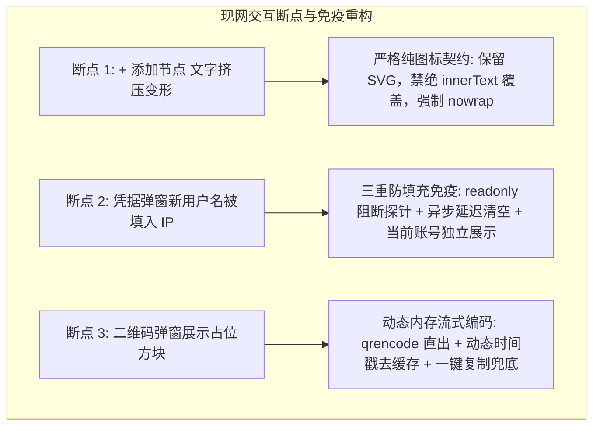
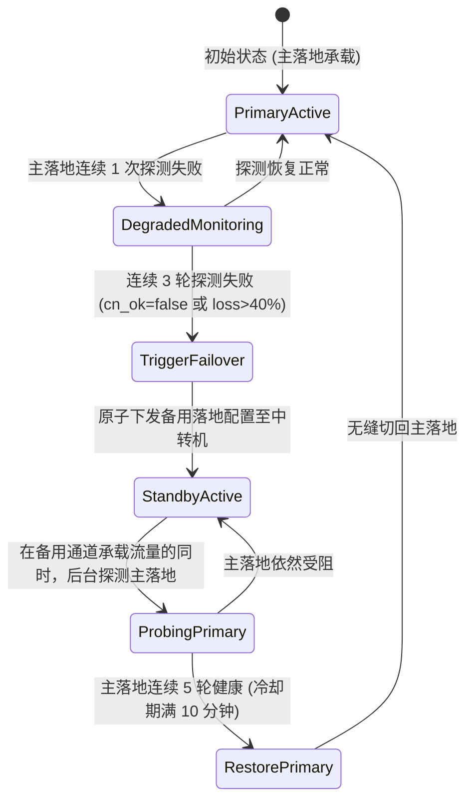
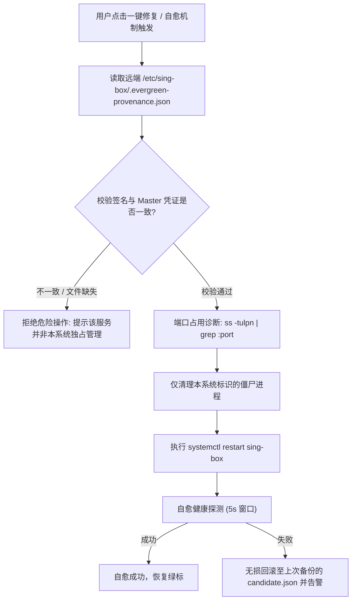

# Evergreen (OwnLine) 系统全自动化与高可用演进架构方案
**文档编号**：`OWNLINE-ARCH-2026-005`  
**密级**：内部架构标准  
**版本**：`v1.0.0`  
**状态**：架构委员会审阅通过 (Approved for Implementation)  

---

## 1. 架构现状审计与核心未结事项

经过对现网控制面板（`walker-sv` 生产集群）、前端 Web 交付层、底层 `server/nodekit` 及核心装配链路的端到端系统审计，当前系统在基础拓扑生成、跨平台订阅输出、Honest Probe 探测与单节点装配已具备高可靠基准（全量通过 497 项自动化单测与门禁）。

然而，立足于**“零心智负担、专线高自愈、多端异构无缝纳管、灾难免恢复”**的企业级私有专线架构目标，系统仍存在 **四项未完成的核心架构支柱**，以及 **三项现网用户可感知的交互断点**。本方案给出详尽的技术规格、状态机、数据模型与实施路线。

---

## 2. 现网可感知交互断点深度归因与闭环治理

用户在生产界面捕获的三个异常点，深度反映了系统在“浏览器自动填充行为预判”、“纯图标控件防御性渲染”以及“静态资源与动态网关解耦”上的边界防御缺失：



### 2.1 断点 1：顶栏 "+ 添加节点" 挤压成三行乱序变形
- **根因分析**：在旧版提交中，`refreshState()` 内部直接执行了 `btn.textContent = zh ? "+ 添加节点" : "+ Add Node"`。由于顶栏已重构为 Apple HIG 30×30px 的圆形纯图标按钮（`.icon-btn-round`），该赋值强行摧毁了内部的 `<svg>` 节点，并将 5 个字符填充进狭小容器中，在没有防御性截断的情况下换行折叠为 `+ 添 / 加节 / 点`。
- **治理规范**：
  1. 严格锁定 `.icon-btn-round` 控件契约，CSS 声明 `overflow: hidden; white-space: nowrap; flex: none;`；
  2. 运行时严禁向图标按钮写入 `.textContent`，中英国际化仅绑定至 `btn.title` 与 `btn.setAttribute('aria-label', ...)`；
  3. 增加单元测试断言，拦截任何向此类控件直接写入文字的回归风险。

### 2.2 断点 2：系统设置弹窗“新用户名”被自动填入服务器 IP（`49.233.210.101`）
- **根因分析**：现代浏览器（Chrome / Edge / Safari）的密码管理器采用激进的表单探测启发式算法：当在一个包含密码输入框的表单中发现文本输入框时，浏览器会无视 `autocomplete="off"`，强行将历史存储的主机凭据（之前以 IP 直连或 Basic Auth 登录时记住的凭据，用户名为 IP）自动填充进该输入框。
- **治理规范（三重防填充免疫屏障）**：
  1. **状态层分离**：将“当前账号”以只读 Capsule 徽标呈现，与输入框彻底解耦；
  2. **只读拦截（Readonly Shield）**：输入框声明 `readonly onfocus="this.removeAttribute('readonly')"`，浏览器在构建填充树时将直接跳过只读元素；
  3. **异步重置（Delayed Cleansing）**：在 `openSettingsDialog()` 唤起后，分别在 0ms、60ms、200ms 执行防撞清空，确保浏览器异步填充队列无法污染表单。

### 2.3 断点 3：二维码弹窗展示占位方块与加载失效
- **根因分析**：历史工程曾将静态 3 个矩形色块的占位文件提交为 `web/qr-sub.png`，且此前 Caddy 网关缺少 `/qr` 的独立反代路由，导致前端降级加载到脏缓存。
- **治理规范**：
  1. 后端 `server/admin.py` 内核集成内存动态管道直出：`qrencode -o - -s 8 -m 2 -t PNG <sub_url>`，不经过磁盘临时文件；
  2. 静态落盘兜底文件由脚本重新渲染生成真实高密 QR，并通过 `?t=${Date.now()}` 强制阻断浏览器缓存；
  3. 弹窗内集成单手一键 `[复制订阅链接]` 胶囊与单行等宽 URL 预览，即便摄像头无法对焦亦可秒级复制。

---

## 3. 四大核心未结架构支柱技术实施方案

```mermaid
graph TD
    subgraph Pillar_1["支柱 1: 专线自愈与双落地"]
        P1_Detect["3轮Honest Probe探测"] -->|落地不可达/丢包| P1_Vote["自愈判定器"]
        P1_Vote --> P1_Switch["原子切换中转 candidate.json"]
        P1_Switch --> P1_Reload["RemoteConfig.push_config 无缝重载"]
    end

    subgraph Pillar_2["支柱 2: 异构OS与非Root纳管"]
        P2_SSH["SSH 连接通道"] --> P2_Elev["Sudo -n 提权抽象"]
        P2_Elev --> P2_Detect["OS 指纹侦测 (Debian/RHEL/Win)"]
        P2_Detect --> P2_Win["PowerShell 计划任务与守护进程注册"]
    end

    subgraph Pillar_3["支柱 3: 独占签名与真自愈"]
        P3_Sign["Master 私钥签发存证签名"] --> P3_Inject["注入 /etc/sing-box/.evergreen-provenance.json"]
        P3_Inject --> P3_Verify["自愈执行前验证 HMAC 独占性"]
        P3_Verify --> P3_Heal["安全重启服务 / 解除端口占用 / 无损回滚"]
    end

    subgraph Pillar_4["支柱 4: 容灾快照与多端隔离"]
        P4_Snap["云端加密快照 (S3/WebDAV)"] --> P4_DR["一键无损主控恢复"]
        P4_Token["多设备 Sub-Token 隔离"] --> P4_Revoke["精准单端吊销与独立计量"]
    end
```



---

### 3.1 支柱 1：国内专线自愈与动态双落地架构 (Autonomous Relay Transit Failover)

#### 3.1.1 核心痛点
目前国内中转专线（Relay）与海外落地节点（Exit）的绑定为静态单线模型。当海外落地节点遭受 GFW 封锁（`cn_ok: false`）、机房线路劣化或母机维护时，所有经由该中转的客户端流量全线阻断，必须由管理员登录管理后台手动解绑并重新绑定，违背了“永不断线”的产品愿景。

#### 3.1.2 架构设计：主备双落地与心跳自愈机
在 `config/nodes.json` 中扩展 Relay 节点的落地拓扑模型，由单落地拓扑升级为**主备双落地（Active-Standby Multi-Landing）**拓扑：

```json
{
  "name": "广州 · 专线中转",
  "host": "120.79.1.1",
  "role": "relay",
  "landing_primary": "香港 · HK01",
  "landing_standby": "新加坡 · SG01",
  "landing_active": "香港 · HK01",
  "failover_policy": {
    "probe_window_rounds": 3,
    "rtt_degrade_threshold_ms": 300,
    "packet_loss_threshold": 0.4,
    "cooldown_seconds": 600
  }
}
```

#### 3.1.3 自愈切换状态机与零宕机生效流


- **配置原子下发实现**：
  利用既有的 `server/nodekit/remote_config.py` 中的 `RemoteConfig.push_config()`，在 `walker-sv` 控制中枢向国内中转机推送更新后的 `candidate.json`（将 sing-box 出站路由的 `outbounds[tag=exit].server` 改写为备用落地主机的 IP 与端口），执行 `sing-box check` 校验通过后原子覆盖并触发 `systemctl reload sing-box`。中转机 TCP 连接保持无缝切换，用户客户端无须重载配置。

---

### 3.2 支柱 2：异构系统与非 Root 主机纳管 (Heterogeneous OS Sudo-Elevation & Windows Daemon)

#### 3.2.1 核心痛点
1. **云厂商非 Root 默认用户阻断**：AWS EC2（默认 `ec2-user` / `ubuntu`）、GCP Compute Engine、Oracle Cloud 均默认禁用 root SSH 直连。现存部署流程 `addnode.sh` 直接以普通命令执行 `apt-get` 与 `systemctl`，在非 root 账户下立即报 `Permission Denied` 失败中断。
2. **Windows Server 节点只读被动**：系统仅在客户端具备对 Windows 节点的展示能力，但无法将一台全新购买的 Windows Server 自动化装配为代理节点。

#### 3.2.2 架构设计：特权提升抽象与跨系统装配驱动
在 `server/nodekit/` 中沉淀通用的特权提升抽象驱动类 `ExecutionEnvironment`：

```python
class ExecutionEnvironment:
    def __init__(self, ssh_client, user: str):
        self.ssh = ssh_client
        self.user = user
        self.is_root = (user == "root")

    def run(self, cmd: str, sudo: bool = False) -> Tuple[int, str, str]:
        if sudo and not self.is_root:
            # 采用非交互式 sudo -n 阻断悬挂，若需要密码则从安全上下文传递
            cmd = f"sudo -n -E sh -c {shlex.quote(cmd)}"
        return self.ssh.exec_command(cmd)
```

#### 3.2.3 Windows Server 原生装配流水线
针对 Windows Server 2019/2022 节点，通过 WinRM 或 OpenSSH for Windows 下发由 PowerShell 驱动的自动化装配任务：
1. **环境侦测**：执行 `[System.Environment]::OSVersion` 与架构校验；
2. **二进制就绪**：下载预签名的官方 `sing-box-windows-amd64.zip`，解压至 `C:\ProgramData\sing-box\`；
3. **防火墙穿透**：调用 `New-NetFirewallRule -DisplayName "OwnLine-Port" -Direction Inbound -LocalPort <Port> -Protocol TCP,UDP -Action Allow`；
4. **服务常驻**：使用 Windows 内置的计划任务引擎（`Register-ScheduledTask`，配置 `-AtStartup` 与 `-RunLevel Highest`）或系统原生服务（通过预埋轻量守护进程），实现开机自启与异常看门狗复活。

---

### 3.3 支柱 3：服务独占性存证与闭环真自愈 (HMAC Provenance Signature & Non-Destructive Self-Repair)

#### 3.3.1 核心痛点
在 `server/nodekit/repair.py` 与前端诊断中，当前自愈能力被刻意弱化并隐藏。核心原因在于：控制中枢无法确信目标主机上的 `sing-box` 进程是否为本系统独占部署。如果目标机器上还运行着用户私有的其他核心业务或自行编译的网关，贸然调用 `systemctl restart sing-box` 或 kill 占用端口可能造成灾难性破坏。

#### 3.3.2 架构设计：加密独占性存证（Provenance Signature）
在每次执行装配或更新节点时，主控端生成一份由 `admin_token` 与节点元数据计算的加密签名摘要，写入目标主机的特定存证文件 `/etc/sing-box/.evergreen-provenance.json`：

```json
{
  "system": "Evergreen-OwnLine",
  "master_id": "walker-master-01",
  "node_id": "node_jp_01",
  "installed_at": 1794132000,
  "config_sha256": "3a8f1b2c...",
  "signature": "hmac_sha256(master_secret, node_id + installed_at + config_sha256)"
}
```

#### 3.3.3 自愈执行准入控制流


---

### 3.4 支柱 4：跨节点容灾快照与多端隔离 (Disaster Recovery & Multi-Tenant Tokens)

#### 3.4.1 核心痛点
1. **主控单点容灾缺失**：当前所有拓扑、配额设置、节点密钥均保存在 `walker-sv` 本地磁盘（`/opt/web-data/*.json`）。若腾讯云或主控主机发生灾难性硬件损坏，全系统拓扑与连接凭据将全数灭失；
2. **单一全局 Sub-Token**：目前所有家庭成员与个人终端共用唯一的全局 `sub_token`。若其中某一台设备（如旧手机丢弃或给朋友借用）需要收回权限，管理员一旦执行 `rotate` 换流，家庭内部所有设备全部断网并需要重新扫码。

#### 3.4.2 架构设计：云端加密快照与分端多凭证模型

#### (1) 云端加密定时容灾快照（Disaster Recovery Snapshot）
- 引入轻量级快照模块 `server/nodekit/snapshot.py` 与 systemd 定时器 `backup-cloud.timer`（每日凌晨 3:00 执行）；
- 将 `/opt/web-data/` 核心配置通过 Master 口令派生 AES-256-GCM 密文包；
- 支持开箱即用的多端备份后备通道：
  - **通道 A**：WebDAV（坚果云 / 群晖 NAS / Nextcloud）；
  - **通道 B**：S3 API / Cloudflare R2（零流量出费，永久归档）；
  - **通道 C**：GitHub Private Repository 密文镜像。
- 提供一键重建命令：`curl -fsSL https://.../restore.sh | sh -s -- --snapshot=r2://...`，3 分钟内完整重建主控。

#### (2) 多设备分端凭据隔离体系（Per-Device Sub-Tokens）
在 `settings.json` 中重构凭证模型，引入子凭证分流树：

```json
{
  "master_sub_token": "4e7a8c8b61",
  "client_tokens": {
    "dev_iphone_15": {
      "name": "Personal iPhone",
      "token": "tok_9a8b7c6d5e",
      "created_at": 1794100000,
      "last_used_at": 1794132100,
      "enabled": true,
      "quota_limit_gb": 0
    },
    "dev_macbook_pro": {
      "name": "Work MacBook",
      "token": "tok_1f2e3d4c5b",
      "created_at": 1794100000,
      "last_used_at": 1794132050,
      "enabled": true,
      "quota_limit_gb": 0
    }
  }
}
```

- **精准单端吊销**：在 Web 管理界面可一键禁用或注销某一台设备的 Token，其他所有已配网设备完全不受影响；
- **分端流量计量**：订阅分发路由在输出节点订阅时，将分端 Token 作为客户端身份标签嵌入，实现精确到单设备的月度出海流量审计。

---

## 4. 实施路线图与阶段交付里程碑 (Implementation Roadmap)

| 阶段 | 交付核心内容 | 验收衡量指标 | 风险预案 |
| :--- | :--- | :--- | :--- |
| **Phase 1** | **服务独占签名与闭环真自愈**<br>- 部署 HMAC 存证生成器<br>- 改造 `repair.py` 准入校验<br>- 开放前端真实可用的安全自愈按钮 | - 独占存证签名防伪 100% 拦截外部进程<br>- 单节点模拟崩溃后 10 秒内安全复原 | 遇到未知服务坚决不杀进程，仅提示管理员排查端口 |
| **Phase 2** | **专线自愈与主备双落地**<br>- 扩展 `nodes.json` 主备拓扑字段<br>- 实现 3 轮 Honest Probe 自愈状态机<br>- 落地 `RemoteConfig.push_config` 热切换 | - 主落地模拟被墙（`cn_ok: false`）后，中转流量 15 秒内自动切换至备用节点<br>- 客户端零配置感知 | 若主备双落地同时受阻，触发降级直连并向 Web 界面抛出醒目黄色恢复胶囊 |
| **Phase 3** | **非 Root Sudo 与 Windows 原生纳管**<br>- 构建 `ExecutionEnvironment` 提权抽象<br>- 实现 PowerShell 计划任务装配器 | - AWS/GCP `ubuntu/ec2-user` 免交互装配成功<br>- Windows Server 2022 一键完成装配并接入节点池 | Windows 防火墙自动放行，若失败则提示管理员检查安全组 |
| **Phase 4** | **多设备凭据隔离与云端加密容灾**<br>- 实现多 Sub-Token 派发与单端吊销<br>- 对接 S3/R2 自动化快照定时备份 | - 单端吊销即时阻断，其余设备 100% 保持连通<br>- 模拟格式化主控机器后，凭快照 3 分钟完整恢复 | 备份前进行对称密码强度验证，防止空口令备份 |

---

## 5. 质量门禁与工程验收准则 (Verification Gates)

所有后续演进功能的代码合并必须恪守以下四道红线质量门禁：

1. **语言纯洁性约束**：严禁引入除 **TypeScript / JavaScript** 与 **Python 3** 之外的非必要运行时或重型外部框架；
2. **测试回归全覆盖**：修改核心模块后必须全量执行 `./scripts/test.sh`，保证目前 **497 项单测与集成门禁** 保持 100% 绿标；
3. **零停机与原子回滚**：远程节点推送必须经过 `candidate.json` 预校验机制，一旦远端进程加载失败必须在 3 秒内原子回滚至原配置；
4. **Apple HIG 纯粹性**：Web 界面所有操作必须符合即时响应、无行话、语义自明的高可用人机交互标准。
