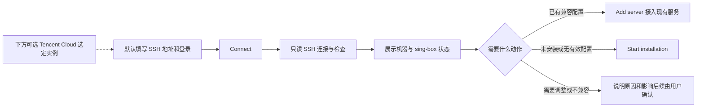
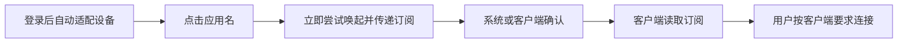
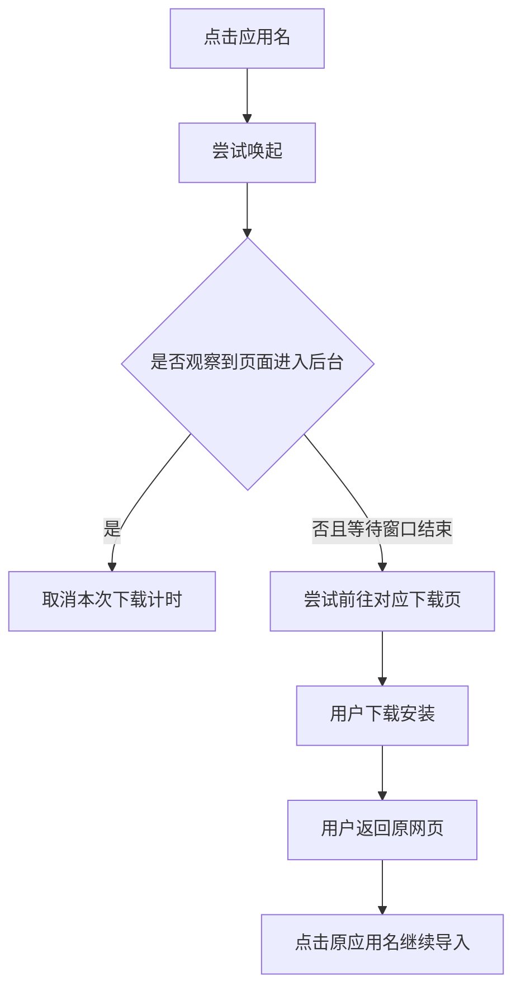

# 客户端 Web 交互设计规格说明书

| 文档属性 | 内容 |
|---|---|
| 文档编号 | UX-CLIENT-WEB-001 |
| 项目 | Evergreen / VPN-OwnLine · 长青 |
| 版本 | v1.8 |
| 编制日期 | 2026-10-31（Asia/Shanghai） |
| 修订日期 | 2026-11-06（Asia/Shanghai） |
| 文档状态 | v1.8 极简减法交互已落地并全量单测通过；添加节点与 Mac 自举部署闭环完成；生产机已热更验证 |
| 文档类型 | UX 交互设计规格，供产品、设计、研发、测试共同使用 |
| 适用范围 | 服务器主人自用：未购服务器的选购准备、README 新手 AI 辅助、首次部署、远程连接与装配、已有 sing-box 接入、订阅交付、日常维护、卸载及备份恢复 |
| 界面语言 | 当前 Web 界面与本规格正文均为中文；客户端名称、技术标识和命令保留原文 |
| 设计依据 | 本次讨论中用户明确的要求与接受的交互取舍 |

> 核心原则：如无必要，勿增实体。产品负责远程装配服务器并交付订阅；小火箭、Clash、FL Clash 负责设备侧的实际连接和节点选择。
>
> 本文描述设计目标与交互约束。中文 Web 管理页面已部分上线；自有管理服务支持腾讯云实例读取和 SSH 只读连接检查。检查前须核对服务器指纹，现有服务不会因检查而被安装或修改。节点自动安装、已有服务接管及客户端导入的完整实机验收仍待完成。SSH 检查已在本机 Docker 及隔离环境测试，线上真实目标的端到端连接尚未验收。本文不记录真实订阅、账号或密码。

> **v1.8 优先级与交付声明（2026-11-06）**：
> 1. **全网交互文案做减法**：全页面依据电饭煲哲学完成极简重构（动宾极限收敛，剔除所有说教与技术废话，词数精简 40%~70%，核心意图 100% 成立）。
> 2. **添加节点全闭环**：Web 仪表盘只读检查与 `/api/addnode` 自动化安装成功贯通；检查通过后展示 `#node-install-confirm-box` 确认安装，自动切回主看板展示 5 步进度，完成后自动刷新节点池。
> 3. **Mac 零依赖自举**：落地 `deploy/setup-mac.sh`，原生系统命令流式传输部署包并自动唤醒 macOS 默认浏览器直达面板。
> 4. **域名绑定与住宅代理**：落地 `server/change_domain.sh`（推荐 Spaceship 独家域名）；落地 `mountIsp()` 住宅代理挂载（推荐 Webshare 静态住宅 IP）。
> 5. **质量门禁全绿**：21 项 Node.js 前端契约测试 + 348 项 Python 核心测试 + 62 项外部安装测试全部通过（431 项全过）；生产机 `master-sv` 已热更上线并校验一致。首次终端安装由用户在自有控制台或通过 `setup-mac.sh` 执行，公共入口绝不代管 SSH 凭据。敏感交接由用户完成。下文“SSH 表单/后台”仅指用户自己部署的管理服务，不解释为运营者托管公共安装入口。

## 目录

1. 设计目标与边界
2. 决策基线与术语
3. 信息架构与首屏
4. 设备适配与客户端映射
5. 完整任务流程
6. 服务、装配与导入状态机
7. 异常、恢复与边界场景
8. 界面文案
9. 视觉、响应式与无障碍
10. 工程交接约束与 AI 可读注释
11. 验收场景与发布门槛
12. 决策、现有能力、实现缺口与待验证事项
13. 资料依据
14. 版本记录

## 1. 设计目标与边界

### 1.1 产品定位与使用者

产品以**让用户用上自己的专线**为核心，是服务器主人自用的远程装配与订阅交付辅助工具。完整旅程为“购买服务器 → 准备公网地址与 SSH 登录资料 → 安装配置 → 导入本地客户端”，页面围绕用户当前下一步组织；AI 只作可选帮助，不是完成流程的前提。

目标是让用户通过管理网页连接自己的远程 Linux 或 Windows 电脑，查看检查结果并主动开始节点装配，再向小火箭、Clash、FL Clash 交付订阅。当前完整管理端首次安装仅支持受约束的空白 Linux；Windows 节点自动安装与已有节点接管仍待实现。

必须区分用户设备、用户自己的管理服务和目标服务器。首次尚无管理网页时，用户在腾讯云终端执行安装命令；外部 AI 仅为可选帮助。公共介绍页不收取或转发 SSH 密码、私钥或云密钥。用户自建管理网页后，授权资料只能在其自有服务使用；已存在的独立安装后台属于本地受控工具，不作为运营者公共入口上线。

既有三种对象：

| 对象 | 职责 |
|---|---|
| 用户设备 | iPhone、Android、Mac、Windows、Linux 上的浏览器与原生客户端；不是因访问网页就变成节点 |
| 管理服务所在服务器 | 提供网页、SSH 装配任务、订阅与状态管理；可以同时提供节点服务 |
| 目标节点电脑 | Linux 或 Windows；接受用户授权后的连接与节点装配，可能与 Linux 管理服务同机。Windows 自动装配尚待实现 |

本产品不接管原生客户端的流量转发、常用节点选择、自动优选或路由策略，不为这些功能增加模式、选择页或开关。后台既有装配机制与客户端原有能力不因此被宣称为新 Web 功能，也不在本次文档修订中被改写。

### 1.2 目标路径

主旅程按下列顺序组织，不作为四个常驻大面板或必须从头完成的身份问卷：

| 顺序 | 用户要完成的事 | 下一步依据 |
|---|---|---|
| 1 | 购买服务器 | 没有机器者先选购；已拥有服务器直接准备资料，不要求再购买 |
| 2 | 进入腾讯云控制台和目标服务器终端 | 可选 README 的现有 AI 提示词；敏感登录验证由用户完成 |
| 3 | 检查、确认目标、开始安装配置 | 目标服务器执行安装；交付经验证的管理地址和独立的网页登录信息 |
| 4 | 导入本地客户端 | 已有经验证服务者直接进入本机客户端导入；原生客户端完成实际连接 |

以下为各情况的行为规则。只根据已有资料、用户确认与真实服务/任务状态选择起点；没有云授权时不能推断用户未买服务器。

| 阶段或情况 | 用户操作 | 系统应完成的工作 |
|---|---|---|
| 尚无管理网页 | 在腾讯云控制台的目标服务器终端运行项目安装命令；AI 可选 | 目标是部署完整管理系统与本机节点，交付经过验证的管理地址及独立网页登录信息；不得向项目运营者提交服务器凭据 |
| 没有服务器 | 从 README 的 Need a server? 查看统一购买指南；按需使用 AI | 以实惠为主，区分付费、长期免费额度及限时试用；用户自行购买或激活 |
| 准备资料 | 使用腾讯云控制台及 README 中可选 AI 提示词 | 导航不等于授权；AI 无工具时只能引导，不自动代管或读取用户秘密 |
| 默认 SSH 接入 | 先填公网地址、用户名（默认 root）、密码或私钥，点击连接 | 不要求云账号授权；只读连接检查，展示机器、系统、兼容性及已有 sing-box 状态 |
| 可选腾讯云授权 | 在 SSH 区域下方选择腾讯云，从发现列表选一台 | 仅 Lighthouse 原生适配；辅助发现与云能力，不自动安装全部机器 |
| 尚未安装或缺少有效配置 | 查看检查结果，点击开始安装 | 下载适配包、配置、启动、验证并交付订阅 |
| 已有可兼容配置 | 查看接管范围，点击添加服务器 | 保留程序与配置，接入管理并生成订阅；需要写入控制权限时提前说明 |
| 已安装客户端 | 点击一次应用名 | 尝试唤起并传递适配后的订阅；系统与客户端确认由用户完成 |
| 未安装客户端 | 点击应用名；安装后回来再点击 | 提供下载兜底，保留原任务与订阅上下文 |
| 使用复制方式 | 点击复制链接 | 复制稳定订阅地址，失败时提供手动复制 |
| 日常维护 | 查看必要提示；确认会中断连接的修复 | 自动检查；按授权执行修复；记录可证实的结果 |
| 移除服务器 | 确认完整卸载影响 | 摘除全部关联节点，停止并清理已接管的 sing-box，保留管理网页和其他业务 |
| 备份与恢复 | 导出文件；可选配置异地目标；恢复前确认 | 如实展示备份状态、覆盖影响和恢复结果 |

登录沿用现有管理员认证，本轮不增加用户注册、亲友权限或多租户账号。原生客户端的系统授权、购买及连接确认仍需纳入旅程验证，不能算作本产品已自动完成。

### 1.3 范围与不做清单

本规格覆盖完整使用流程。**日常首页**依次展示客户端导入与复制链接、各服务器状态及真实用量、最近 2～3 条日志；详情和维护按需展开。首次无可用服务器时展示下一步，不让用户面对无效导入操作。

不增加：自研代理客户端、浏览器内连接开关、客户端节点优选与路由控制、应用市场、其他客户端推荐列表、客户端偏好设置页、协议或订阅格式选择器、跨设备偏好同步、用户自填 App Store 账号地区表单、自动购买服务器、邮件或 Telegram 通知配置。

**不接入 Harness 功能。** 允许首次由 AI 帮助运行现有部署流程，不代表产品增加 Harness、Agent 执行器、AI 调度平台或运行时。供研发 AI 阅读的实现约束与注释见 §10.7；供新手复制给自己 AI 的提示词统一放在项目 README，交互要求见 §10.8。

## 2. 决策基线与术语

### 2.1 已确认的产品决策

| 编号 | 决策 |
|---|---|
| D-01 | 自动识别设备，按平台筛选可用客户端。 |
| D-02 | 支持范围限于小火箭、Clash、FL Clash 三类客户端，以及复制订阅链接。 |
| D-03 | 当前设备适用的应用并列展示，省去先选客户端、再确认导入的中间步骤。 |
| D-04 | 应用按钮只显示名称：Shadowrocket、Clash、FL Clash；不添加 Open、Import 等动词前缀。 |
| D-05 | 页面使用中文，应用按钮下方独立提供“复制链接”；客户端名称保留原名。 |
| D-06 | 点击即尝试导入到所点应用；未观察到唤起时，尝试进入该应用对应的下载渠道。 |
| D-07 | 用户接受自动下载兜底可能误判，例如取消系统打开应用弹窗后被送往下载页。 |
| D-08 | 小火箭的下载条件需提前说明：需要中国大陆地区以外的 App Store 账号。 |
| D-09 | 用户安装后返回原网页，再点击原应用按钮继续导入；保留原订阅与登录上下文。 |
| D-10 | 进入后台后取消该次下载计时；返回、刷新均不自动再次唤起或跳下载。 |
| D-11 | idapp.app 作为用户提供的免费共享外区 Apple ID 可选渠道；仅供 App Store，不登录 iCloud；与项目无关，不保证账号或付费应用可用。 |
| D-12 | 使用者是服务器主人本人；规格覆盖接入、装配、导入、日常维护及退出恢复完整流程。 |
| D-13 | 首次使用腾讯云终端运行安装命令；README 的 AI 帮助可选。公共网页不处理服务器凭据；完成后进入用户自己的管理网页，不新增注册系统。 |
| D-14 | 通用 SSH 为所有厂商的默认接入方式；其下方保留可选腾讯云授权。当前原生云适配只有 Lighthouse，其他云原生适配属于后续扩展。 |
| D-15 | 云账号发现多台机器后，由用户选择目标；不自动批量安装。 |
| D-16 | 先只读连接并展示机器，再由用户主动点击开始安装；连接成功不等于安装完成。 |
| D-17 | 已有 sing-box 保留程序和原配置，兼容就接入；需要调整时说明影响并征得确认。其他代理服务不纳入管理。 |
| D-18 | 正常首页依次展示导入及复制、首屏 Hero 额度总览卡片、节点列表（每行单行内嵌该节点的用量进度条与剩余额度，消灭独立重复的流量表格）；节点卡片底部直接放置备份/恢复，用量详情收纳保护阈值设置，最近日志与诊断操作收纳于诊断日志卡片。 |
| D-19 | 自动检查与状态更新；影响连接的修复先说明再确认，含代理重启、重装、服务器重启及密码重置。 |
| D-20 | 流量保护阈值全局共用、用户可修改，默认 85%；各服务器以自己的真实有效用量独立判断。自动保护仅暂停本项目可安全控制的代理；未知、失败如实展示，按有效新用量恢复，不保证零费用。客户端订阅接口（`/s/<token>` 和 `/s/<token>/clash`）注入标准 `Subscription-Userinfo` 标头，客户端下拉直出已用量、总配额与到期时间。 |
| D-21 | 重要提醒仅在网页和客户端内提供；不增加邮件或 Telegram 通知配置。 |
| D-22 | 支持用户手动导出加密备份及恢复；默认不自动异地备份，用户主动选择目标开启才发送。恢复先预览覆盖影响、确认并验证，云 API 密钥默认不纳入备份。 |
| D-23 | 移除前确认完整卸载：含复用后接管的 sing-box 和该机全部关联节点；保留管理网页、必要共享组件及其他业务，不删除云服务器或代替停止计费。 |
| D-24 | 只辅助装配与导入，客户端节点选择与路由不进入本产品交互范围。 |
| D-25 | 不接入 Harness 功能；用文档约束及注释帮助 AI 理解和执行，不增加 AI 产品功能。 |
| D-26 | 新手 AI 辅助操作说明统一从项目 README 获取，采用“一句话开始＋分场景提示”，不要求用户先熟悉云控制台或填写长参数表。 |
| D-27 | AI 可帮助查找目标服务器、公网地址和登录方法，辅助配置专用腾讯云子账号；能否实际执行取决于外部 AI 的工具与用户授权，不由提示词或产品 SSH 连接自动赋予。 |
| D-28 | 服务器 SSH 登录与云 API 授权分别准备；旧密码不能承诺从控制台找回，遗失凭据按官方流程由用户安全输入、重置或重新创建。 |
| D-29 | AI 接手不越过只读检查和开始安装边界；用户确认后继续既有自动化，有正在运行的任务时不另开第二套安装。 |
| D-30 | 腾讯云子账号按任务授予必要权限；新增敏感权限、密钥创建、密码重置及可能中断服务的动作按需要确认或交由用户完成，不默认授予整个云账号管理员权限。 |
| D-31 | README 先说明完整新手旅程和选购准备，再提供命令与可选 AI；详细推荐只维护一份购买指南。网页在尚未准备服务器或添加服务器时按需链接指南，正常导入首屏不增加推荐。 |
| D-32 | 选购候选为用户指定的国内五家（腾讯、阿里、火山引擎、华为、雨云）与国外四家（Google Cloud、Oracle Cloud、AWS、Azure），以实惠为主，不代表行业排名或新增原生适配。 |
| D-33 | 选购部署范围为中国大陆以外，含有实际对应产品的港澳台地区；购买前核对官方地区、优惠、续费、流量、公网 IP 和身份/支付验证，不承诺统一覆盖、轻松注册或永久免费。 |
| D-34 | 默认准备 Ubuntu 22.04、x86_64、公网 IPv4、systemd 和管理权限；其他已适配架构按实际包与环境检查，不把厂商免费规格当成本项目最低配置。用户可按预算、连接所在地、用途与流量比较候选，AI 辅助可选；用户自行购买。 |
| D-35 | 添加服务器直接展示 SSH 表单与连接，用户名默认 root、允许密码或私钥，SSH 端口在高级选项；腾讯云在下方低强调展示，不先选厂商、不先授权。root 不是强制登录方式，不能自动开启 root 密码登录或声称现有脚本已支持非 root 自动提权。 |
| D-36 | 核心是让用户用上自己的专线，界面围绕当前下一步组织；购买、资料准备、安装配置、客户端导入为连续旅程，不做四个常驻功能模块。 |
| D-37 | 首次从腾讯云终端安装；用户可选 README 的 AI 提示词辅助，不额外建设厂商图文终端引导，不要求 AI。 |
| D-38 | 查找信息可使用 README 中既有 AI 提示词；腾讯云控制台导航与云 API 授权分开。不新增厂商终端图文向导，也不猜测用户是否已购买。 |
| D-39 | 首次部署目标为完整管理系统与本机节点；已有管理页再添加服务器时按节点接入语义处理。连接前后说明目标与安装范围，不能把现有 addnode 任务当作首次完整系统部署。 |
| D-40 | 用户在自身服务器终端获得经验证的安全管理地址、用户名和随机初始密码；首次登录后自行修改密码。SSH 与网页凭据分别标识；已有配置不因重复安装重置。 |
| D-41 | 首次使用采用轻量设置清单，四项一行，只展开当前任务及一个主操作；不增加独立待办管理器、任务创建/排序功能或四张大卡片。 |
| D-42 | 清单完成依据分别为已有服务器的明确事实、用户确认进入所选目标终端或用户自有管理页的真实 SSH 检查、安装后的服务及交付验证、当前设备的用户确认；打开控制台不自动等于进入终端或完成安装。未知不显示已完成或未安装。 |
| D-43 | 前三项按目标服务器实际状态，客户端项按当前设备/订阅上下文处理；不跨设备同步“已导入”。清单可收起并从帮助重开，日常以导入为主；可选完成仅记录用户确认，不阻挡应用按钮和复制链接，也不伪装成系统检测到连接成功。 |
| D-44 | 当前交付为中文普通 Web 原型，不使用手机外框、设备切换、模拟键盘或状态栏。适配真实浏览器宽度与平台；表单继续使用“用户名”“密码”，不增加字段改名或语言切换设置。原型模拟结果与产品真实状态、生产验收分开。 |
| D-45 | 首次安装由用户在腾讯云终端执行；公共介绍页不收服务器账号、密码或私钥，不提供运营者代管执行服务。AI 可能读取工具输出，敏感步骤与结果由用户接手。 |

### 2.2 统一术语

- **Shadowrocket**：小火箭。讨论中的“Shadowsocks”按小火箭的口语误称处理；本文不新增 Shadowsocks 客户端支持。
- **FL Clash**：界面显示名，工程项目名为 FlClash。保持用户确认的按钮拼写。
- **Clash**：界面类别名。研发需为不同平台配置明确的发行版和兼容版本，不表示支持所有同名软件与历史分支。
- **外区账号**：中国大陆地区以外的 App Store 账号，不指设备所在地、界面语言或专线出口地区。
- **服务器与节点**：同一台物理服务器可生成多个协议节点；管理与卸载以服务器为对象，协议节点在详情中展开，不能当作多台机器。
- **资料准备**：找到目标实例、公网地址和真实 SSH 登录方式；打开控制台不等于完成登录或获得 API 授权，服务器 SSH 凭据也不是安装后交付的管理网页凭据。
- **AI 辅助说明**：用户从 README 复制任务给自己使用的 AI；既不是产品内聊天，也不是自动向外部 AI 转交 SSH 会话、云密钥或执行权限。
- **远程连接成功**：仅表示管理服务通过 SSH 读取到了目标服务器信息；不表示安装、节点验证或用户设备代理连接成功。
- **已接管**：用户已主动确认将该机的 sing-box 纳入本系统维护及完整卸载范围；只扫描发现或只读检查不等于已接管。
- **唤起**：浏览器尝试将导入链接交给应用。观察到页面进入后台仅是间接信号。
- **导入完成**：客户端实际读取并接受订阅。当前网页没有可靠的通用完成回执。
- **连接成功**：客户端完成连接且有相应验证证据；不能由点击、页面隐藏或导入动作推断；界面不使用含糊的“已连接” 同时指 SSH 与代理。

### 2.3 设计与能力的区别

网页能进行设备适配、构造导入链接、发起导航、观察自身可见性并提供下载链接。网页不能可靠枚举第三方已安装应用，也不能读取当前 App Store 账号地区。

因此，自动下载使用“未观察到应用唤起”的兜底规则，不将用户标记为“确定未安装”。规则属于用户接受的交互取舍，不承诺百分之百准确。浏览器能力依据见[安装检测说明](https://developer.chrome.com/docs/capabilities/get-installed-related-apps)。

## 3. 信息架构与首屏

### 3.1 页面结构

| 层级 | 元素 | 显示规则 |
|---|---|---|
| 品牌 | Evergreen / VPN-OwnLine | 轻量显示，沿用现有品牌，不新增大幅宣传区域 |
| 服务状态 | 一行状态文字 | 由真实数据驱动；不冒充设备 VPN 连接状态 |
| 主操作 | 正常时为适用应用名按钮；未就绪时为接入服务器 | 正常时显示一至两个应用；进入添加服务器后直接显示 SSH 表单，不以云授权为前置 |
| 备用操作 | 复制链接 | 位于应用按钮下方；链接有效时可用 |
| 服务器概览 | 各服务器状态与用量 | 每台一行；未知用量如实显示；详情按需展开 |
| 最近日志 | 最近 2～3 条 | 展开查看完整日志；不显示密码、私钥或完整订阅链接 |
| 必要说明 | 外区条件、打开反馈、安装返回或错误提示 | 只在相关平台或当前任务需要时显示 |
| 帮助 | 帮助 | 低强调入口，容纳下载帮助、设备识别修正；新手 AI 辅助说明仅指向 README，不在界面复制提示词库或新增聊天 |
| 购机帮助 | Need a server? | 仅添加服务器区域的低强调链接，指向 README 维护的统一指南；不占正常导入首屏 |
| 次级管理 | 节点备份与恢复、流量保护阈值、撤销旧订阅、日志与体检 | 功能强关联归位（电饭煲哲学）：备份恢复嵌入节点列表底部；流量阈值置于配额详情内部；撤销订阅收纳于连接弹窗手动链接区；健康检查/诊断快照/服务日志统一汇聚于「运行时和诊断日志」卡片；密码修改归入页脚。坚决消除孤立杂糅的「运营与系统」垃圾堆叠 |

应用按钮上方允许一行 `导入客户端`，帮助用户理解应用名称对应的操作。

### 3.2 层级规则

- 并列应用按钮使用同等级视觉样式，不预先要求用户选择默认应用。
- 设备识别在后台完成，不额外放置“已检测到 Mac”等卡片或确认步骤。
- 完整订阅地址默认不占据首屏；复制失败时才在原操作区域展开只读地址。
- 反馈在导入区原位置出现，不使用强制关闭的成功弹窗。
- 帮助可以按需展开；四阶段只表达旅程，同一任务区域展示当前下一步，不新增独立身份问卷、四个常驻模块或必须从第一步重走的多步向导。
- 服务不可用、鉴权失效等状态替换原状态文字，不持续堆积提示条。
- 初次打开若脚本已自动装好本机节点且验证通过，直接进入正常导入态，不强制再走一次连接安装。
- 无已接入服务器时主操作显示添加服务器，进入后先展示 SSH 地址与登录表单，用户名默认 root；不知道资料时按需展开查找服务器信息，下方保留可选腾讯云授权及 Need a server?。不增加先选厂商或新手/高手身份的中间页。已有备份者可通过备份恢复；已有服务器但异常时优先恢复，不重走选购。
- 服务器列表一台机器一行，展示名称或地址、系统、接入状态和当前动作；多个协议节点收进该机详情。
- 用户可正常移除最后一台节点服务器；完成后回到接入空状态，不用“至少保留一个节点”将用户困住。管理网页保留规则见 §5.7。

### 3.3 当前下一步与返回规则

| 已知情况 | 主区域呈现 | 恢复和跳过规则 |
|---|---|---|
| 用户表示尚未购买 | 统一购买指南入口 | 购买在官方渠道完成，回来继续资料准备；不代购 |
| 已有服务器但资料不足 | 查看腾讯云控制台与可选 README AI 提示词 | 首次安装由用户在目标服务器终端进行；控制台导航不等于登录或授权，公共网页不收凭据 |
| 登录资料已准备 | 连接与机器检查结果，随后开始安装 | 检查系统、架构、权限和已有配置；不让用户为安装额外研究技术参数 |
| 原任务正在执行或查询失败 | 当前真实阶段或暂时无法获取进度 | 查询同一任务，恢复失败给明确处理入口，不因刷新、锁屏或切后台重装 |
| 服务已验证可用 | 本机客户端名按钮和复制链接 | 已就绪者直接进入此处；原生客户端确认和连接由用户完成 |
| 服务异常 | 原因与一个明确的恢复操作 | 不用无关购买、重装或客户端下载安装掩盖服务器故障 |

日常首页显示导入、各服务器用量与最近 2～3 条日志；其他管理操作按需展开。主旅程最终以用户设备实际可用为验收目标；网页只能报告自身能验证的状态。

### 3.4 轻量设置清单

清单标题为完成设置，直接嵌在首次安装任务区。四项分别显示购买服务器、连接服务器、安装与配置、导入客户端。已完成项用勾与文字表达，当前项强调并展开必要说明和一个主操作，未开始项保持一行；不另建待办页面或新手/高手选择页，不要求手工逐项勾选。

| 清单项 | 完成依据 | 未完成或不确定时 |
|---|---|---|
| 购买服务器 | 用户明确表示已有目标服务器、选定已有受管实例，或真实 SSH 检查证实目标可访问；不要求额外购买确认 | 用户表示未购时显示 Need a server?；未接云账号、打开购买页或控制台都不是购买状态证据 |
| 连接服务器 | 用户确认进入所选目标终端；已有用户自有管理页连接其他机器时，以目标 SSH 只读检查成功为依据 | 可使用 README AI 辅助；仅打开控制台或填入 IP/密码不打勾 |
| 安装与配置 | 完成必要安装/接入，服务与相应交付验证通过；已有经验证服务可直接完成 | 显示真实安装阶段、待验证、暂时无法获取进度或具体错误；不凭脚本退出/本机响应就打勾 |
| 导入客户端 | 当前设备/订阅任务中用户主动以可选完成确认 | 正常提供本机应用按钮与复制链接；点击、页面隐藏、唤起尝试不能自动打勾，也不能因此断言未安装 |

交互和恢复约束：

- 自动更新能够证实的状态，不让用户为系统已知的前三项反复打勾。当前任务缺资料或遇到问题时，原因紧贴该项，主操作指向可继续的处理步骤，原始日志按需展开。
- 普通服务故障在原任务显示需要处理及相应修复；不抹掉“已有服务器”等事实让用户重新购买。暂时读不到状态显示未知并恢复查询，不伪造进度百分比或已完成。
- 任务运行、页面返回与非敏感输入按 §3.3、§5.5 恢复；清单只是这些状态的呈现，不另起安装任务，不在浏览器长期存储 SSH 凭据。
- 用户可以主动收起收起清单，帮助中以设置清单重新展开；收起不等于完成、取消或清除后台任务。服务可用时，清单不得阻挡客户端按钮和复制链接，最后确认不是使用前置。
- 前三项跟目标服务器走，第四项跟当前设备的导入任务走。在电脑确认完成不代表新打开的 iPhone 已导入；不能靠账号或服务端全局完成标记替手机打勾，不增加设备指纹或客户端偏好同步。没有本地明确记录时状态为未确认，不声称“未安装”。
- 已导入稳定订阅后的节点更新沿用客户端刷新规则，不因添加服务器就强迫重复导入。用户完成是自报确认，不作为后端已检测到设备连接的证据。
- 状态有可读文字、键盘可操作和明确焦点；动态更新遵循非打断式辅助朗读，不只靠颜色或勾形状表达。

## 4. 设备适配与客户端映射

### 4.1 展示矩阵

| 平台 | 按钮及顺序 | 默认下载方向 |
|---|---|---|
| iPhone / iPad | Shadowrocket | 官方 App Store 应用页 |
| Mac | Shadowrocket、Clash | 小火箭进入 App Store；Clash 进入对应桌面发行版的官方渠道 |
| Android | FL Clash、Clash | 对应安卓客户端的官方下载安装渠道 |
| Windows / Linux | Clash、FL Clash | 对应系统的官方下载安装渠道 |
| 未识别设备 | 复制链接；帮助中允许修正平台 | 修正平台后展示该平台下载入口 |

此矩阵定义页面呈现范围，不因 FlClash 支持 macOS 就自动向 Mac 增加第三个按钮。iPad 的识别与系统兼容性纳入移动 Apple 设备测试。

### 4.2 识别规则

1. 页面加载时自动推断系统；已登录用户直接进入适配后的页面。
2. 使用可获得的平台信息及 User-Agent 等信号，处理 iPad 采用桌面 UA 的情况。
3. 不使用系统语言、IP 所在地或浏览器语言推断 App Store 账号地区。
4. 平台无法可靠确定时保留复制能力，在帮助中提供平台修正；不要求所有人先选设备。
5. 操作系统架构不能可靠确定时，指向官方设备选择下载页，避免擅自给出错误安装包。

### 4.3 工程适配映射

| 界面名 | 工程适配方向 | 状态 |
|---|---|---|
| Shadowrocket | Apple 平台小火箭及其已验证订阅唤起方式 | 用户报告 iPhone 现有导入可用；本轮未独立实测 |
| Clash（桌面） | Clash Verge Rev 为工程候选 | 待锁定版本并实机验证 |
| Clash（Android） | Clash Meta for Android 为工程候选 | 待锁定版本并实机验证 |
| FL Clash | FlClash 的目标系统版本及专用唤起方式 | 待锁定版本并实机验证 |

发行版候选属于研发落地建议，不视为用户已确认具体版本。配置中必须分别保存：显示名、平台、发行版、导入方式、订阅格式、下载地址、回归验证版本。

## 5. 完整任务流程

### 5.1 首次部署与登录

- 用户先通过腾讯云控制台进入自己选择的目标服务器终端，使用现有安装命令；README AI 提示词可选。不建设单独的终端图文向导，公共介绍页不接收 SSH 密码、私钥或云账号密钥。
- AI 帮助定位服务器与终端；其读取屏幕或终端时可能看见敏感输出。登录验证、执行安装及保存初始密码由用户自己接手；不要求将任何密钥或密码发送到 AI 对话。
- 安装前检查机器与现有服务、说明影响并由用户主动确认。操作失败或终端断开时先检查实际状态，不盲目重装或覆盖其他业务。
- 首次部署完整管理系统和本机节点；已有管理页的添加服务器默认接入目标节点，不能为每台新增节点无条件重复部署管理系统。操作前显示将安装什么，遇到已有程序/配置按 §5.4 处理。
- 目标终端交付验证后的安全管理地址、管理用户名及新安装随机初始密码；首次登录后用户自行设置新密码，之后使用新密码登录。已有安装沿用现有凭据，不因重试重置。区分管理网页凭据与 SSH 凭据，不写普通日志、截图或公开链接；忘记管理密码时由用户在服务器终端恢复。
- 验证需分别检查服务状态、实际公网管理入口及订阅读取，包含证书校验、真实 HTTP 状态和目标响应；不能以本机 curl 请求完成代替外部可达性，更不能宣称客户端已经连接。安装完成但交付入口未验证时显示待处理的原因与下一步。
- 终端断线后先复查目标服务器和既有任务，报告真实状态；不能把浏览器返回或终端输出缺失当作安装成功，也不能自动创建重复安装任务。
- 使用现有管理员身份，不新增注册、社交登录或多用户系统；标准新安装的首次改密及终端重置已有隔离 Caddy 实测，腾讯云和生产环境尚未验收，旧安装配置不会自动改写。
- 登录后读取已有机器与任务：有可用节点直接导入；无服务器进入接入；已有任务则恢复任务状态。
- 尚未购买且管理网页也不存在时，从[项目 README 的 Need a server?](../../README.md#need-a-server)进入统一英文购买指南；该入口位于 AI-assisted setup 之前。网页不是选购的唯一入口，避免先买机器部署网页才能看到买机说明的循环。
- 已有管理网页时，仅在添加服务器区域放低强调 Need a server?，链接同一份指南；正常导入首屏不出现厂商卡片、排行榜、价格广告或购买按钮。
- 指南集中维护候选产品、官方入口、真实地区与成本核对方法；本规格、PRD、索引和 prompt 导航只链接，不复制推荐清单详情或活动价格。
- 以持续使用总成本比较候选，区分长期免费额度、限时试用和赠送额度；公网 IPv4、磁盘及出站流量可能单独计费。免费 VM 不等于完整部署零费用，不能承诺 Google/Oracle 身份审核宽松或无需验证。
- 默认准备 Ubuntu 22.04、x86_64、公网 IPv4、systemd 与管理权限；CPU/RAM 没有经过本项目基准验证的最低值。购买或免费资源激活由用户在官方渠道完成，AI 不代购、不自动升级付费账号；不合适的已有机器先解释差距，不擅自重装或要求重新购买。

### 5.2 默认 SSH 与可选腾讯云授权

| 来源 | 用户提供 | 页面行为 | 能力边界 |
|---|---|---|---|
| 默认 SSH 表单 | 公网 IP 或可解析地址、用户名（默认 root）、密码或私钥 | 添加服务器时直接可见，连接进行只读检查；腾讯云及其他厂商均可从这里开始 | 需要公网可达、SSH 服务和足够权限；不要求先选厂商或云账号授权 |
| 下方可选腾讯云 | 云账号授权资料，以及目标机另需的 SSH 凭据 | 用户主动打开或使用已有授权时展示发现的机器，显示地区、系统和状态，选定后回填 SSH 目标；不替换默认表单或自动安装 | 当前仅 Lighthouse 原生适配；云 API 不等于 SSH 登录，不把 CVM 或其他云提前标为同等支持 |

手动接入未知系统时用户名可默认 root，但云镜像已有可信登录信息时应优先沿用。腾讯云 Ubuntu 等镜像可能使用 ubuntu 用户与 sudo/密钥登录，不能将打开 root 密码登录作为所有人的前置步骤。AI 应按官方说明帮助确认实际登录方式，不把“找 root 密码”理解成读取云平台不能返回的旧密码。

地址、用户名及密码/私钥入口靠前，用户名默认 root；已有可信默认用户时优先沿用。现有远程安装脚本直接以 SSH 用户运行特权命令，并不自动 sudo，属于需如实说明的能力差距；首次在管理机运行部署脚本可由 sudo 以 root 执行，不能将两条路径混为一谈。

SSH 端口放高级选项，默认 22；它与安装后的代理服务端口是不同字段。代理服务端口按现有规则与环境处理，不让用户把两个端口填混。

在用户自有管理页内，SSH 可用于后续添加服务器；腾讯云 API 授权可选，授权失败不等于没有服务器。首次安装不使用运营者公共 SSH 表单；新手可按需使用 README 的现有 AI 提示词，本轮不增加各厂商终端图示。

云账号接入失败不能显示“没有服务器”；应区分授权失效、发现失败、确实为空，并保留手动连接。云账号解绑本身不等于卸载服务器或取消云账单。

资料查找帮助只在需要时展开：

- 需要帮助时链接 README 既有 AI 提示词；打开腾讯云控制台不等于 API 授权。
- 旧密码不可读取时解释重置影响，不承诺找回；私钥支持选择本地文件避免手机只剩粘贴长文本一种方式，不新建各厂商图文教程。
- 需要购买者进入 Need a server? 的统一指南，再按明确的购买入口进入官方产品页；相同厂商名称不自动决定用户要查看实例还是购买。
- 从厂商网站返回原安装页时保留原任务与非敏感输入；不将未授权控制台中的信息假装自动回填，不长期保存 SSH 密码或私钥。

### 5.3 只读连接与机器确认



连接前默认填写用户名 root，保留自定义用户名及密码/私钥方式。连接成功后只展示足够识别目标的信息：名称或主机名、地址、系统与架构、权限检查、sing-box 安装/配置状态；详细信息按需展开。

**连接和只读检测不能安装依赖、写入远程控制公钥、改配置、开防火墙或重启服务。** 缺少检查工具时可以报告未知或采用现有只读方式，不为完成检查先偷偷安装工具。SSH 首次指纹验证按现有安全机制处理，不以关闭验证换取“自动成功”。

连接失败在原表单说明地址、端口、用户名、密码/私钥、权限或主机指纹问题，保留非敏感输入供修正，不把原始日志当唯一帮助。

<!-- AI-DESIGN NOTE-01 | D-16 | AC-26,AC-27：连接仅连接检查；写操作必须在用户选择添加服务器或开始安装并了解影响后开始。不要把现有“一次提交即安装”直接包装成只读连接。 -->

### 5.4 安装与已有 sing-box 的接入

| 检查结果 | 默认动作 | 需要说明的内容 |
|---|---|---|
| 没有 sing-box | 开始安装 | 安装位置、会新增的节点服务及必要网络配置 |
| 有程序、没有有效节点配置 | 开始安装 | 复用程序的兼容性与配置范围；不能伪装成已有可用节点 |
| 已有兼容程序和配置 | 添加服务器 | 保留现有配置，生成可导入订阅；接管后可维护并在确认移除时完整卸载 |
| 版本、配置或协议无法适配 | 显示检查结果及查看详情 | 说明所需调整与影响，确认后才修改；不静默覆盖、升级或重装 |
| 同一机器已被接入 | 显示现有机器与状态 | 默认不重复安装；需要重装时说明会影响现有设备并单独确认 |

“兼容”至少意味着：可以识别目标程序和配置，读取构造本项目支持订阅所需的参数，并验证生成结果可由受支持客户端使用。无法安全理解原配置时，不假装兼容，也不为了适配强制覆盖它。其他代理软件不扫描接管、不升级、不卸载；端口占用只按正常系统资源冲突处理，不借修复之名强杀其他服务。

用户点击开始安装后按实际阶段显示：连接与安装前检查 → 下载并校验所需内容 → 配置并启动 → 验证服务 → 交付订阅。复用现有安装时跳过不需要的下载步骤；不得伪造固定百分比或“30 秒一定完成”。

当前安装脚本从 GitHub 下载锁定版本的发行包，不执行 git clone。页面统一称“下载并安装”，用户不需要知道包管理细节；将来若更换下载方式，也不能未经说明更换为任意第三方安装脚本。

安装完成与服务可用是两个结果：写入成功但验证失败时显示“已安装，验证未通过”，提供原因与恢复入口，不显示服务可用。

<!-- AI-DESIGN NOTE-02 | D-17 | AC-28,AC-29：先检测、兼容则保留已有 sing-box 配置。接入不等于重新生成密钥。现有代码行为与本条冲突时应报告缺口，不能擅自改回覆盖安装。 -->

### 5.5 任务进度、失败与返回

- 进度来自实际任务阶段；主界面使用清晰中文，原始输出按需展开并脱敏。
- 网页关闭、刷新或网络中断不等于远程任务已取消。再次打开时查询原任务，不自动另开一次安装。
- 暂时读不到进度显示暂时无法获取进度，保留查询状态；只有明确的任务失败证据才显示安装失败。
- 后台无法恢复原任务标识时，先重新检查机器的实际状态，再提供下一步，不直接重跑下载与安装。
- 未实现真正取消及回滚的阶段，不放置声称能撤销远程任务的 Cancel 按钮。
- 失败后保留机器身份和阶段信息；非敏感输入可保留，密码/私钥如已清除则重新输入，不写浏览器长期存储。
- 重试前说明是否会覆盖配置或中断现有连接；需要改密码、重装、重启服务器时分别确认。

### 5.6 日常维护、用量与提醒

正常首页展示适用客户端与复制链接、各服务器状态和用量及最近 2～3 条日志；详细用量、完整日志和诊断恢复按需展开。

| 类别 | 默认行为 |
|---|---|
| 轻量检查 | 自动检查可达性、读取状态并更新显示，不要求用户重复点体检 |
| 会影响连接的修复 | 先说明目标、动作与影响，再确认；代理重启、重装、密码重置、服务器重启均在此列 |
| 自定义真实用量保护 | 用户设置全局共用阈值，默认 85%；各机独立判断并暂停可安全控制的本项目代理、更新订阅；真实用量有效恢复后自动放行，动作失败和未知状态如实展示 |
| 云用量与到期数据 | 有真实数据才显示数值与日期；读取失败显示未知，未适配显示未覆盖 |
| 通用 SSH 服务器 | 允许接入使用；没有云用量数据时明确说明不具备对应云账单保护，不拿 SSH 收发统计替代计费用量 |
| 重要提醒 | 网页显示到期、用量、故障及恢复；客户端能通过订阅刷新得到相关名称提示时沿用，不保证客户端主动推送 |

不增加邮件或 Telegram 通知配置；现有代码存在外部通知模块不代表本轮应在界面暴露它。用户不在线时，页面提示不会凭空送达手机，订阅名称提醒也依赖客户端拉取。

自动修复边界不扩展为客户端节点自动优选或路由管理。85% 保护降低超额风险；采集延迟与 SSH 失败意味着不能承诺零费用。

<!-- AI-DESIGN NOTE-03 | D-19,D-20,D-24 | AC-32,AC-33：一般中断性修复需确认，85% 用量保护是已确认例外；不要添加客户端路由设置或把未知用量显示成 0%。 -->

### 5.7 移除服务器与完整卸载

移除对象是服务器，而不是某一条协议记录。确认摘要应列出：机器身份、受影响的全部订阅节点、会停止和清理的 sing-box、管理网页或其他必要共享组件的保留项；并说明云服务器和费用不会因此自动取消。

用户确认后执行：

1. 将该机全部关联节点移出本系统订阅，避免新拉取继续使用它；不承诺已缓存配置的客户端立即清除旧记录。
2. 停止代理服务，验证已停止；清理由本系统安装或接管的 sing-box 程序、配置、证书、临时包、独占服务与控制权限，以及能明确归属本项目的规则。
3. 原本已有、后被明确接管的 sing-box 也属于本次已确认卸载范围；接管时就提前告知这一点。
4. 保留管理网页及必需的共享组件、SSH 登录服务和其他业务。共享系统依赖或网络设置仅在明确可安全恢复时处理，不盲目卸载整套依赖或清空防火墙。
5. 核验剩余状态并报告实际结果。无法连接、停机失败或文件清理失败时显示待清理，保留目标和失败阶段供重试；不能直接删除所有记录并显示完成。

必要的临时连接能力只用于完成清理。清理成功后撤销本项目独占控制权限；部分失败需要重试时不将密码或私钥长期保存在网页。

管理机同时提供节点时，仅卸载节点部分，保留管理网页与必需组件，并明确列出保留项。最后一个节点可以移除，完成后显示接入空状态。完整卸载不是删除云实例、重装系统或停止厂商账单。

<!-- AI-DESIGN NOTE-04 | D-23 | AC-35,AC-36,AC-37：停止代理不等于完整卸载；失败必须保留待清理记录。保留管理网页与其他业务是硬边界，不得用全盘删除换取“干净”。 -->

### 5.8 备份、异地副本与恢复

- 目标是手动导出加密备份并上传恢复，备份解密密码由用户保管；默认不自动异地备份，只有用户主动选择目标并启用后才可发送，不自动选择扫描到的机器。腾讯云 API 密钥默认不纳入备份，恢复后重新授权。
- 无目标时显示未开启异地备份；已开启也只展示实际执行结果，区分未执行、成功、失败和数据已过期。
- 导出时说明文件含敏感配置、需要用户保存备份和解密密码；密码遗失时不保证可恢复。记录备份时间、范围和版本；订阅地址变化时说明可能需重新导入。
- 恢复前先校验并预览机器数量、备份时间、将覆盖的配置与订阅地址影响。默认不做未经定义的自动合并；用户确认替换后才执行。
- 恢复后重新检查机器与控制权限，再判断是否可用；不因文件上传成功就显示所有节点正常。
- 订阅节点导出与完整灾备包不是同一种承诺。若缺少云授权、管理凭据或远程控制材料，明确要求重新授权，不声称只靠当前 JSON 就能无条件完整重建。
- 如需先迁移管理服务，仍允许脚本或 AI 辅助部署新管理页，再上传备份恢复；不增加 Harness 接入。


### 5.9 已安装



- 点击后在原位置显示 `正在打开 {app}…`，应用名按钮不改为含动词的标签。
- 不连续尝试其他应用；用户点 Clash，不因失败自动改向小火箭。
- 网页进入后台即结束该次下载兜底计时，但不将此信号写成导入成功。
- 用户返回网页时保留按钮位置、应用名称与复制入口，不自动再次导航。

### 5.10 未安装或未能唤起



分支判断使用的是网页信号，不是可靠的安装检测。“没有导入完成”不作为未安装判据。

下载前先在原页面保留返回提示；App Store 或下载网站打开后，原订阅上下文不得丢失。浏览器若阻止自动下载导航，在原位置显示直接下载入口；它是异常恢复控件，不常驻为新的一组主按钮。

### 5.11 小火箭与外区账号

- Apple 页面在 Shadowrocket 按钮附近提前显示下载条件，不能等用户下载失败后才告知。
- 已安装的用户可直接尝试导入，不先经过账号地区询问。
- 官方 App Store 是默认应用下载渠道。文案不暗示应用免费；实际价格与资格以商店为准。
- 地区限制针对获取应用的条件，不把大陆地区用户或设备标为“不支持导入”。网页不得显示未经证实的“你当前是中国区账号”。
- 在下载相关帮助中显示 `Apple ID 帮助`，指向用户提供的 [idapp.app](https://idapp.app/)，标注为第三方资源。
- 没有中国大陆以外地区 Apple ID 时，可查看该站提供的免费共享账号；该站与本项目无关，账号可用性及是否包含所需付费应用不作保证。共享账号仅供 App Store，勿登录 iCloud。
- 该资源不等于 Apple 或本产品官方服务；网页不抓取、保存、分发或代填其账号密码，不自动登录第三方账号。
- 用户主动打开共享账号帮助时，应在同处保留提示：共享账号仅用于 App Store，勿登录 iCloud。应用是否可获取及账号可用性由相应服务决定。

### 5.12 安装后返回

1. 下载前保存任务上下文，只需知道用户选择的客户端；不保存“确认已安装”标记。
2. 保持原页面可返回；同会话保留订阅上下文，刷新后通过现有鉴权与接口重新获取。
3. 用户返回时显示 `安装好了？点 {app} 继续。`。
4. 用户主动点击原应用按钮后，再开始新的唤起尝试。
5. App Store 的“打开”不视为自动恢复本次订阅导入；不承诺安装后自动回网页或自动导入。
6. 若登录已经过期，完成现有登录后恢复原任务，而非重新选择设备或客户端。

### 5.13 复制链接

- 点击复制链接时复制稳定订阅地址，不复制临时下载地址或应用唤起地址。
- Clipboard API 确认成功后显示 `已复制`；建议约 1.5 秒后恢复。
- 复制被拒绝、不支持或失败时，在原区域显示可选中的只读链接与 `请选择并复制链接。`。
- 不显示虚假的复制成功反馈，不在点击应用按钮时顺带自动写剪贴板。
- 链接有效时复制链接始终保留。没有可用节点时可保留订阅地址供后续使用，但不能借此显示专线可用。

## 6. 服务、装配与导入状态机

服务状态、远程装配任务和客户端导入动作分别记录，避免把 SSH 已连接、安装完成、服务可用和设备代理连接混成一个“已连接”。

### 6.1 服务状态

| 状态 | 显示 | 导入与复制 |
|---|---|---|
| 加载中 | 正在检查服务… | 订阅与状态尚未就绪时不发起导入 |
| 真实可用 | 服务可用 | 允许导入；有有效链接即可复制 |
| 无可用节点 | 暂无可用服务器 | 暂停导入；链接存在时保留复制；未接入时提供添加服务器，已有异常机器时提供管理恢复入口 |
| 状态读取失败 | 无法读取服务状态。 | 显示重试；不自动跳应用下载页；链接已有效时可保留复制 |
| 登录过期 | 请登录后继续。 | 使用现有登录恢复任务，不将 401 当作未安装客户端 |

可用性的判断应与后端实际订阅过滤保持一致；已有配置不等于当前服务一定可用。前端不可凭静态默认值显示绿色正常状态。

### 6.2 动作状态

| 状态 | 进入条件 | 允许行为 | 退出条件 |
|---|---|---|---|
| Idle | 初始或前一次任务结束 | 导入、复制 | 用户点击应用 |
| Opening | 有效点击且前置数据就绪 | 尝试唤起；显示“正在打开应用”；等待可见性信号 | 进入后台、等待窗口结束或用户发起新动作 |
| Away | 本次尝试期间页面进入后台 | 彻底取消本次兜底计时 | 用户回到网页；仅恢复界面，不导航 |
| Downloading | 等待结束且页面仍在前台，未观察到唤起 | 尝试打开同一应用的官方渠道一次 | 用户离开、返回或导航被阻止 |
| Returned | 观察到返回，或刷新后恢复待续任务 | 显示继续提示，等待主动点击 | 新的导入动作 |
| Recoverable error | 订阅读取失败、下载导航被阻止等 | 原位重试或复制，不显示已安装/未安装结论 | 错误恢复或新动作 |

### 6.3 计时与生命周期规则

- 每次有效点击生成独立尝试；新尝试取消旧尝试的全部回调。
- 同一尝试最多执行一次下载兜底，防止循环跳商店。
- `visibilitychange` 到隐藏态、`pagehide` 等离开信号取消本次计时。它们仅用于避免误跳，不证明应用打开、导入或连接成功。
- 单纯 `blur` 可能由系统确认弹窗引起，不作为导入成功证据；焦点变化与后台事件必须实机测试。
- 返回、`pageshow`、刷新及浏览器历史恢复均不自动重新启动导入或下载。
- 切换标签、锁屏也可能导致后台信号；返回后保留用户主动点击重试的能力。
- 等待参数 `T_launch` 的初始设计建议为约 3 秒，属于待实机校准参数；不是已确认的浏览器能力或不可调整的产品承诺。
- 用户在系统弹窗中取消打开后，仍可能进入下载兜底；这是 D-07 已接受的残余误判，不新增自建确认页来消除它。


### 6.4 远程装配与卸载任务状态

| 状态标识 | 中文文案 | 下一步与成功证据 |
|---|---|---|
| Unlinked | 尚未添加服务器 | 添加服务器进入默认 SSH 表单，或从备份恢复；购机说明仅作按需帮助 |
| Checking | 正在检查服务器… | 等待只读连接与检查结果；不能改远程系统 |
| ConnectedPendingInstall | 服务器可访问 | 机器身份与检查成功，等待用户开始安装；不代表节点已可用 |
| ExistingCompatible | 发现已有配置 | 保留程序与配置，说明接管范围，等待添加服务器 |
| AdjustmentRequired | 配置需要处理 | 说明不兼容点与影响，查看详情；不自动覆盖 |
| Installing | 正在安装… | 实际下载与配置阶段，显示后台阶段而非模拟进度 |
| Verifying | 正在验证服务… | 安装或接入后验证；尚不显示服务可用 |
| Available | 服务可用 | 已接入且验证通过，可交付订阅；不是设备已连接 |
| InstallError | 安装失败 | 后台确认失败，保留阶段、原因和恢复操作 |
| ProgressUnknown | 暂时无法获取进度 | 仅进度获取失败；查询状态查询，不擅自重装 |
| Uninstalling | 正在移除服务器… | 已确认移除，先摘订阅再停机清理，并显示真实阶段 |
| CleanupPending | 待清理 | 保留机器与失败阶段；重试清理再次处理，不虚报已清理 |
| Removed | 服务器已移除 | 关联订阅已摘除、目标清理核验完成；明确保留项，最后一台则进入空状态 |

云账号另需区分未接入、授权失败、发现中、发现成功且为空、发现成功有机器，不能用空列表吞掉错误。备份另需区分未开启、未执行、成功、失败与过期；这些状态不能用单一绿色“已保护”代替。

## 7. 异常、恢复与边界场景

| 场景 | 设计行为 | 禁止的错误反馈 |
|---|---|---|
| 同时安装小火箭与 Clash | 只尝试用户所点应用 | 失败后依次唤起所有应用 |
| Clash 与 FL Clash 同时安装 | 优先使用能区分目标的入口，允许必要的系统应用选择；无法独占时提供复制恢复 | 承诺按钮名称必然等于系统实际打开的程序 |
| 页面隐藏后返回 | 保留原页面；不再执行旧回调 | 回来立刻再次跳商店 |
| 下载导航被浏览器拦截 | 原位显示官方直接下载链接 | 无限重试、重复开页 |
| 微信等内置浏览器拦截唤起 | 显示在系统浏览器打开的简短说明；保留复制 | 把浏览器拦截直接定性为未安装 |
| 未知设备或桌面 UA 的平板 | 自动识别优先；帮助内可修正 | 给出确定但错误的安装包 |
| 应用已打开但订阅拉取失败 | 留给客户端说明；网页保留重试和复制能力 | 自动认定未安装并更换下载目标 |
| 订阅地址无法读取 | 在原处提示重试 | 跳下载页掩盖服务端错误 |
| 复制失败 | 展开可手动选择的地址 | 按钮显示已复制 |
| 无可用节点或触发服务保护 | 原位置说明不可用，暂停新导入 | 仍显示 Ready、Connected 或保证正常 |
| 同一订阅重复导入 | 固定名称与地址；逐客户端验证新增、更新与确认行为 | 未实测就宣称所有客户端自动去重 |
| 安装后只点商店内“打开” | 原网页仍保留继续提示 | 承诺订阅会自动随安装恢复 |
| 下载网站不可用 | 保留原任务和复制入口，提供官方链接重试 | 断言用户设备不支持 |
| 尚未购买服务器 | README 或添加服务器区域链接统一指南，购买后回到 AI 辅助与 SSH 准备 | 在正常导入首屏堆推荐，或要求先部署网页才能看购买指南 |
| 免费额度不足、已到期或套餐不适配 | 核对完整费用、地区、系统和登录能力；说明可选调整，由用户决定 | 把免费算力当作完整部署免费，自动升级付费或重装机器 |
| 云账号失效或发现失败 | 说明失败并允许重试或手动连接 | 显示没有服务器，或自动安装全部实例 |
| SSH 可达但安装权限不足 | 展示实际检查结果和需要的权限 | 仅因 root 密码可输入就声称可以安装 |
| 原机器已有 sing-box | 兼容则保留配置接入；否则解释调整 | 未确认就换密钥、升级或覆盖配置 |
| 安装中断、刷新或进度未知 | 查询原任务或只读复查机器，保留阶段 | 把读不到进度等同失败并自动另开安装 |
| 卸载清理部分失败 | 关联订阅仍摘除，保留待清理与重试入口 | 直接抹掉目标记录并宣称卸载完成 |
| 管理机兼作最后一个节点 | 允许移除节点，保留网页及必需组件，回空状态 | 连管理网页一起删掉，或禁止移除最后节点 |
| 通用服务器无计费用量 | 如实显示保护未覆盖 | 显示 0 GB 或保证不会超额 |
| 异地备份未配置或失败 | 展示真实备份状态，仍可本地导出 | 将跳过任务标成已成功备份 |
| 恢复文件有效但远程权限缺失 | 记录恢复结果，重新授权并验证 | 上传成功就显示全部服务器正常 |

## 8. 界面文案

当前界面使用中文。README 与购买指南保留英文，英文状态标识用于工程追溯，不作为当前网页显示文案。表内文案是统一基线；除应用名外，状态说明应放在按钮旁或下方，不改写应用按钮为长句。

| 用途 | 文案 | 显示时机 |
|---|---|---|
| 操作说明 | 导入客户端 | 应用按钮上方，允许一行 |
| 应用按钮 | Shadowrocket / Clash / FL Clash | 按平台显示，严格保持名称 |
| 复制 | 复制链接 | 应用按钮下方 |
| 复制完成 | 已复制 | 确认剪贴板写入成功后 |
| 复制恢复 | 请选择并复制链接。 | 自动复制失败时 |
| 加载 | 正在检查服务… | 服务数据尚未就绪 |
| 服务可用 | 服务可用 | 有真实服务数据支持时 |
| 无可用节点 | 暂无可用服务器 | 没有可供导入的有效节点时 |
| 状态失败 | 无法读取服务状态。 | 状态读取失败 |
| 重试 | 重试 | 仅错误恢复需要时 |
| 登录恢复 | 请登录后继续。 | 登录过期时 |
| 正在唤起 | 正在打开 {app}… | 点击应用后 |
| 首次导入说明 | 请在客户端内确认导入后连接。 | 首次尝试时按需显示，不作为常驻大段教程 |
| 等待下载 | 正在打开下载页面… | 开始下载导航时 |
| 导航失败 | 没有打开？ | 需要显示手动下载入口时 |
| 下载入口 | App Store / 下载 | 根据渠道显示，仅恢复或帮助区域使用 |
| 安装前返回说明 | 安装后请返回此页，再点 {app}。 | 去下载前写入原页面 |
| 返回后继续 | 安装好了？点 {app} 继续。 | 有待续下载任务时 |
| 外区说明 | 下载需要中国大陆以外地区的 App Store 账号。 | Shadowrocket 下载条件，提前显示 |
| 账号帮助 | Apple ID 帮助 | 下载帮助中，指向第三方资源 |
| 第三方标识 | 第三方资源 | 账号帮助链接旁 |
| 共享账号提醒 | 共享账号仅用于 App Store，请勿登录 iCloud。 | 主动查看共享账号帮助时 |
| 内置浏览器提示 | 请使用 Safari 或系统浏览器打开此页。 | 唤起被内置浏览器限制时 |
| 通用帮助 | 帮助 | 低强调入口 |
| 次级管理分类 | 服务器 / 云账号 / 维护 / 备份 | 管理区域，按任务展开 |
| 接入空状态 | 尚未添加服务器 | 尚无已接入服务器 |
| 添加入口/接入已有服务 | 添加服务器 | 接入入口，或已有兼容配置的接管动作；上下文说明明确区分 |
| 公网地址字段 | 公网 IP | 连接表单，填写可访问的公网地址 |
| SSH 用户字段 | 用户名 | 保留当前字段命名，默认 root 且可修改 |
| SSH 密码字段 | 密码 | 与私钥方式二选一，不是云账号密码 |
| SSH 连接区 | 连接服务器 | 添加服务器时默认展开；地址和登录信息靠前，用户名默认 root |
| 设置清单标题 | 完成设置 | 首次任务区，四项一行，仅当前项展开 |
| 设置清单项 | 购买服务器 / 连接服务器 / 安装与配置 / 导入客户端 | 购买、SSH 资料、安装配置、当前设备导入 |
| 待处理项 | 下一步 | 清单当前需继续的任务 |
| 任务需处理 | 需要处理 | 对应清单项说明具体原因和恢复入口 |
| 收起清单 | 收起 | 不取消任务、不冒充完成 |
| 重开清单 | 设置清单 | 帮助中恢复查看 |
| 客户端完成确认 | 完成 | 可选自报确认，非系统连接检测；不作为使用门槛 |
| 资料查找入口 | 查找服务器信息 | SSH 表单旁，按需展开厂商控制台引导 |
| 字段帮助 | 在哪里查看？ | 按需指向 README 现有 AI 提示词和腾讯云控制台 |
| 控制台导航 | 云控制台 | 帮助内指向实例列表，不等于云 API 授权 |
| 购买导航 | 购买服务器 | 购买指南内的官方购买入口，不自动代购 |
| 命令入口 | 命令行 | 熟悉者低强调展开，一条命令及复制 |
| SSH 凭据分组 | 服务器登录信息 | 连接目标电脑的 SSH 用户名及密码/私钥 |
| 网页凭据分组 | 管理页登录信息 | 安装后交付的管理网页登录信息 |
| 打开结果 | 进入管理页 | 公网管理地址已验证后主动打开 |
| 保存结果 | 复制访问信息 | 用户主动复制管理地址与登录信息，避免普通日志记录 |
| 腾讯云授权入口 | 腾讯云 | SSH 表单下方的可选入口，不是前置步骤 |
| 购买指南入口 | 需要服务器？（README 标题：Need a server?） | README 的 AI-assisted setup 前；网页仅在添加服务器区域低强调链接同一指南 |
| 只读连接动作 | 连接 | 提交远程地址及登录凭据后，仅进行连接检查 |
| 连接中 | 正在检查服务器… | SSH 和系统只读检查 |
| SSH 可达 | 服务器可访问 | 已连接但尚未安装 |
| 已有兼容配置 | 发现已有配置 | 可保留配置并接入 |
| 需要调整 | 配置需要处理 | 检查发现不兼容或需用户确认的调整 |
| 详情 | 查看详情 | 检查、错误及原始日志按需展开 |
| 开始安装 | 开始安装 | 用户主动确认开始远程装配 |
| 安装中 | 正在安装… | 真实安装任务正在进行 |
| 验证中 | 正在验证服务… | 节点服务正在验证 |
| 安装失败 | 安装失败 | 后台确认失败 |
| 进度未知 | 暂时无法获取进度 | 暂时无法读取后台任务 |
| 查询任务 | 查询状态 | 查询原任务，不另开安装 |
| 云授权失效 | 云账号授权需要处理。 | 云账号授权失败，附恢复动作 |
| 云发现失败 | 无法读取服务器列表。 | 无法枚举实例，不表示列表为空 |
| 用量未知 | 暂时无法获取用量 | 应有用量但读取失败或过期 |
| 无用量保护 | 此服务器未覆盖云用量保护。 | 未接入相应用量能力 |
| 保护断流 | 已暂停服务，以保护流量额度。 | 真实保护动作及状态支持时 |
| 确认会中断的修复 | 此操作将中断 {server} 的连接。 | 确认前说明具体动作与目标 |
| 移除动作 | 移除服务器 | 必须先展示范围并确认 |
| 移除中 | 正在移除服务器… | 订阅摘除与远程清理处理中 |
| 待清理 | 待清理 | 远程清理尚未完成 |
| 重试清理 | 重试清理 | 针对保留的未完成清理任务 |
| 移除完成 | 服务器已移除 | 清理已核验，说明保留的管理组件 |
| 云费用说明 | 云服务器仍然保留，计费仍在继续。 | 移除确认及完成说明中，不暗示已退订 |
| 导出/恢复 | 导出备份 / 恢复备份 | 备份内 |
| 异地未开启 | 未开启异地备份 | 没有启用异地目标 |
| 异地失败 | 异地备份失败。 | 已尝试但失败 |
| 恢复确认 | 此操作将覆盖当前配置。 | 备份预览后、执行替换前 |

应用名仅写名词的限制适用于三个客户端导入按钮；管理动作使用连接、开始安装、移除服务器等明确动作词，避免用户误解。`{server}` 为确认操作的目标机器标识。

`{app}` 必须替换为用户刚才点击的应用显示名。不要使用“未安装”“导入完成”“VPN 已连接”等未经证实的状态。

## 9. 视觉、响应式与无障碍

### 9.1 视觉方向

沿用已选第三个视觉方向的浅纸色与深蓝基础：背景 `#f5f4ed`、正文 `#1f1d18`、次级文字 `#6b665b`、操作色 `#1B365D`。当前原型为普通 Web 页面，使用原生表单、页面滚动及可关闭的网页弹窗；去掉手机外框、设备切换、模拟键盘与状态栏。桌面主内容最大宽度 600px 居中，窄屏保留边距并自然滚动；不把手机截图的像素尺寸当成浏览器固定画布。

- 系统字体优先，清晰区分品牌、状态、操作和帮助。
- 应用按钮同等级、同高度，文字完整可读；图标如使用，只作识别辅助，不替代名称。
- 以间距和对齐分组，避免多层卡片、装饰面板及无任务意义的数据展示。
- 不添加地图、实时速度图或无法验证的连接开关。

### 9.2 响应式与输入

- 有可用服务时，以手机首屏可触达导入操作为目标；无服务器时接入操作在首屏可达。桌面保持紧凑、清晰的操作区，不放大成管理仪表盘。
- 两个按钮优先并排；窄屏或放大文字时允许换行，保持阅读与操作顺序。
- 点击目标建议不小于 44 × 44 CSS px，并保留分隔，避免误触。
- 键盘可完整访问应用、复制、帮助和恢复入口；焦点清晰可见。
- 辅助技术名称可补充“将订阅导入到某应用”，不改变可见按钮只显示应用名的规则。
- 状态变化使用非打断式朗读区域；错误说明与对应控件关联。不能只靠颜色表达状态。
- 按下即时反馈，提交动作在正常点击释放时触发；不增加人为等待动效。
- 支持系统文字放大、减少动效及深浅色偏好；所有状态保持可读对比。
- 从应用返回网页时保持滚动位置和任务语境；不强制将焦点拉到弹窗。

## 10. 工程交接约束与 AI 可读注释

### 10.1 数据与任务

- 服务端提供已授权订阅地址及服务可用性信息；现有 API 路径是否复用由研发确认，不为本规格新增一套账号系统。
- 应用导入所需的订阅格式由适配器指定，避免仅靠通用浏览器 UA 猜测。
- 同一个订阅使用稳定地址与名称。地址失效、鉴权过期与网络故障分别处理，不归入客户端安装检测。
- 任务恢复仅存必要的客户端标识与待续任务，不把真实订阅 token 放进帮助、下载或第三方账号网站地址。
- 登录凭据不写入客户端偏好存储。刷新后按现有鉴权机制重新读取订阅。
- 同会话返回正常恢复；跨浏览器、用户关闭网页或清除站点数据后，不承诺恢复未完成任务。

### 10.2 唤起协议与应用冲突

- Shadowrocket、Clash、FL Clash 分别配置唤起方式与目标格式，不将三类按钮都绑定成同一个通用链接。
- 官方 FlClash 文档列出 `flclash://` 等兼容入口；FL Clash 按钮优先验证其专用入口。
- Clash 各发行版可能与其他应用共用 `clash://`；Android 可评估明确应用目标的方式，适用性必须逐浏览器验证。
- 若操作系统注册关系决定了接收者，网页不得声称能强制覆盖；需记录兼容边界并保证复制恢复可用。
- 唤起导航与计时处理必须保持在用户点击的任务内，不在加载、刷新或返回时无动作地触发。

### 10.3 下载地址

- 默认地址使用应用官方 App Store、官方项目或官方发布页；指向用户所点应用与当前系统。
- 对于浏览器无法准确识别 CPU 或发行版的情况，优先使用官方选择页。
- idapp.app 只作为用户指定的第三方帮助资源，不替代客户端的官方安装源。
- 未实测的页面跳转、发行版或版本不能被记录为已支持；发布前更新兼容记录。


技术落地以[轻量技术方案](../核心文档/03-技术方案-全自动化装配中枢架构方案.md)为准：原生 Web、Flask/Waitress、SQLite 与独立 worker。它定义拟实施接口和恢复语义，本轮没有新增这些 API；§12 的“现有能力”继续按实际代码区分。

### 10.4 远程操作与权限边界

- 原型改动本身不改变产品后端；后续独立首次安装实现另见 §12 与技术方案，不代表所有旧 API 已完成迁移。不能用前端改文案伪装尚未实现的能力。
- 只读连接、接管已有配置、开始安装、卸载为不同语义。现有 addnode 任务不能未经拆分就承担“只读检查”承诺。
- SSH 登录端口必须从连接检查到安装、验证、修复及卸载一致传递；不能只在表单加字段，却继续在后端固定使用 22。代理端口保持独立。
- 临时 SSH 密码/私钥不得出现在日志、地址、浏览器长期存储或备份预览中；云账号授权按现有安全规范管理，不与临时安装密码混为同一种生命周期。
- 安装任务需要可查询的身份与阶段。进度暂时不可读时，先恢复查询或只读复查，不自动重装。
- 云原生能力逐厂商标明；当前 Lighthouse 适配不能推导为所有腾讯云产品或所有云已支持。
- 修复只针对可证明由本项目独占管理的 sing-box；当前对无法证明独占的服务保守拒绝自动修复，不清理其他代理程序；安全归属仍需端到端验证。

### 10.5 清理清单与备份范围

- 后续实现需要记录已安装、已接管、共享及未知归属的组件。确认界面列出清理与保留范围，避免按全局目录名盲删。
- 接管原有 sing-box 时就说明未来确认移除将包含原程序与配置；尚未接管的扫描结果不能触发远程卸载。
- 移除先摘关联订阅，再停止并清理；失败保留任务和目标。不能仅靠删除 nodes.json 记录宣称完整卸载。
- 管理网页所需的共享程序、权限或数据保持可用；清理后记录实际保留项。目标机的其他业务、云实例及计费不在自动删除范围。
- 备份应说明能恢复什么，缺什么需重新授权。当前节点导出文件不自动获得完整灾备能力；目标范围与恢复结果须可核验。

### 10.6 兼容与交付证据

已确认需求不等于已实现能力，已有代码不等于已验收结果。文档、实现状态和设备验证分别报告。客户端的路由、选点和流量转发留在客户端，不为通过验收新增此类 Web 功能。

### 10.7 供 AI 阅读与遵循的注释约定

本节只是文档与后续代码注释约定，不接入 Harness，不创建 AI 运行时、工具调用平台、自动执行入口或额外配置系统。用户可以使用自己的 AI 协助准备、部署和诊断；新手入口统一在 README，见 §10.8，不在产品内另做 AI 执行功能。

正文是需求依据；`AI-DESIGN` 注释补充“为什么如此、实现边界、对应决策与验收项”。注释不能扩展任务权限，不能覆盖用户后续明确要求，也不能被解释为允许 AI 自动执行重启、卸载或部署。

未来修改到对应逻辑时，可在现有函数旁保留简短注释；本次不为此修改应用代码或另建指令文件。示例格式：

```text
Design constraint: Connect performs read-only inspection; installation needs an explicit user action.
Reason: reaching a remote server is not consent to modify it.
Reference: UX-CLIENT-WEB-001 v1.7, D-16, AC-26.
```

应在注释中明确的约束：

1. 浏览器设备、管理服务器、目标节点服务器是不同对象；不把用户本机因访问网页就视为节点。
2. 默认先展示 SSH 地址和登录，root 为可修改的默认用户名；可选腾讯云授权放下方。云发现、只读连接和安装不能混成一个动作。
3. 已有 sing-box 兼容时保留原配置；不处理其他代理软件，不静默覆盖。
4. 一般中断性修复需确认；85% 真实用量保护是明确例外；缺失数据不等于零用量。
5. 页面隐藏只用于取消下载兜底，不是安装、导入或连接成功的证据。
6. 移除包含已接管组件的完整清理；失败保留待清理状态，管理网页与必要共享组件保留。
7. 本产品仅装配和交付订阅；不新增客户端选点/路由界面、不新增 Harness 集成。
8. 任务范围为文档时，只更新规格、关联说明与索引；不得顺带实施未授权的功能变更。
9. 购买资料只维护一份指南，提示词只维护在 README；推荐厂商不等于原生适配，试用与赠送额度不等于永久免费或免身份验证。
10. 新手可使用 AI 辅助，但首次安装由用户本人在腾讯云终端执行；公共网页不代管 SSH 凭据。当前下一步由真实已知状态决定，未实现及未验证的能力不能通过文案宣称上线。

注释要指向具体状态或决策，避免“智能处理”“AI 自行决定”等无法执行或验收的表述。实现与规格冲突时，应标注缺口和证据，不能通过注释假称已实现。


### 10.8 README 新手 AI 辅助操作说明

#### 10.8.1 入口和交付方式

参考用户指定的 [gefei-agent README](https://github.com/AdgaiWalker/gefei-agent#readme)的呈现结构：先给一段短开场语，再提供分场景提示。只参考入口设计，不安装或复制该项目的 Skill，也不把其机制引入本产品。

AI 是可选帮助；不使用 AI 的用户也必须能按主旅程完成。README 先呈现新手路径，熟悉者命令随后，AI 放在可选帮助位置。**可复制提示词的唯一维护入口是[项目 README](../../README.md#ai-assisted-setup)。** 本文定义其内容与边界，不再维护另一份完整开场提示词。已有 `prompt/README.md` 只做入口导航，旧三段任务书标为需核对的历史参考。

尚未购买者先从 README 的 Need a server? 查看统一指南，再使用同页场景提示；已有机器可直接表达“我买了服务器，帮我完成准备和配置”，不限定腾讯云。不强制先填齐公网 IP、SSH 用户名或云 API 密钥；查找这些资料本来就是 AI 辅助任务的一部分。README 保持项目现有英文结构，提示词要求 AI 使用用户的语言交流。

界面在添加服务器区域提供 Need a server? 指向同一购买指南，在相关帮助中提供 README 的 AI 辅助链接；不新增“AI 接管”按钮、内置对话框、自动授权连接器或 Harness 集成。新手也可直接从 GitHub README 开始，无需先拥有管理网页。

#### 10.8.2 新手准备流程

| 用户卡点 | AI 应如何协助 | 用户与授权边界 |
|---|---|---|
| 尚未购买 | 读取 README 链接的统一指南，按预算、连接所在地、用途和流量，核对当前官方价格及资格后缩小候选 | 不代购或自动升级付费；不声称所有国外候选都永久免费或身份审核宽松 |
| 不知道买的是哪台机器 | 在实际厂商控制台中定位产品、地域、实例标识及服务器；有多台时请用户选定 | 未有浏览器工具时提供当前官方入口和步骤；不猜测目标或自动改所有机器 |
| 不知道公网 IP 在哪里 | 帮助区分公网地址和内网地址，并对应到用户选定实例 | 不用本机网络地址或不相关实例替代目标；结果与实例身份一起确认 |
| 不知道 root 密码或登录方法 | 先确认系统默认用户、已保存的密码或密钥；不可获取旧密码时说明重置方式 | 密码由用户安全输入；可能重启或改变 SSH 登录的操作先说明影响，按需要由用户完成验证与提交 |
| 想启用可选腾讯云授权 | 仅对 Lighthouse 协助创建专用 CAM 子用户并配置所需 API 访问；区分只读发现/用量和额外写权限 | 不默认授权整个云账号管理员权限，不自动接受权限扩大；创建与授权由用户确认或完成 |
| 不知道 API 密钥在哪里 | 指引 SecretId/SecretKey 的获取、保存及安全录入位置 | SecretKey 仅在创建时展示，无法要求云平台重新显示旧值；不让用户贴进普通聊天或截图 |
| 已经连接，不知道下一步 | 按当前代码先读状态并检查已有 sing-box，给出接入或安装摘要 | 产品的 SSH 会话不会自动转给外部 AI；连接本身不等于修改授权 |
| 已确认开始安装 | 使用项目已有脚本或 API 继续并验证结果 | 若产品任务已运行，观察同一任务，不另起一套 SSH 安装；能力缺口要如实说明 |

云 API 权限与 SSH 权限不是一套凭据。接入子账号并不自动获得服务器操作系统的 root 密码；拥有 SSH 密码也不自动获得云用量、实例列表或防火墙 API 权限。

#### 10.8.3 权限准备与执行条件

- SSH 准备在前，腾讯云授权为下方可选项；其他厂商不要求为尚不存在的原生适配创建云 API 密钥。用户选择 Lighthouse 原生接入时，围绕地域/实例发现及用量读取配置必要权限；安装确实需要云防火墙写权限时，再解释并确认对应范围。密码重置、重启、购买、销毁等不作为“读取实例”顺带授予的能力。
- 具体策略需根据当前代码实际调用与腾讯云官方权限说明核对，不在提示词中要求一键授予所有权限。
- 纯聊天 AI 只能解释步骤；读取控制台或远程执行需要对应浏览器、终端/API 工具及用户授权。只有浏览器或只有终端时，缺少的能力要说明，不能声称已代办。
- 浏览器登录、敏感输入、二次认证、创建密钥及扩展权限按相应工具的要求确认或交接给用户。README 本身不构成对所有后续操作的预先授权。
- 用户明确确认目标和开始安装后，AI 可在已授权范围内继续既有自动化，不必逐条解释下载命令；涉及新的破坏性动作或范围变更时仍停下来说明。
- 通过产品纳管后，使用现有管理 API 作为写入口；首次部署可用项目部署脚本。不得绕过后台任务同时手工修改受管配置，导致双重安装或数据分叉。
- 不索取腾讯云主账号密码、短信验证码、SecretKey 或 SSH 私钥到普通聊天，不把会话、Cookie 或凭据写入可复制提示词。应指导用户在对应控制台、受控输入或本地安全配置中完成。

<!-- AI-DESIGN NOTE-05 | D-26,D-27,D-28,D-29,D-30 | AC-41,AC-42,AC-43,AC-44,AC-45,AC-46：用户提示词从 README 获取；帮助找资料和准备授权，不代表已有会话可自动转给 AI。先检查、再授权安装，沿用同一后台任务；不得静默扩大权限或把纯聊天说成可执行。 -->

<!-- AI-DESIGN NOTE-06 | D-31,D-32,D-33,D-34,D-35 | AC-47,AC-48,AC-49,AC-50：README 先提供未购服务器入口，推荐集中维护，免费与试用分别说明；默认 SSH、下方可选腾讯云授权，不把买机候选当成云原生支持。仅文档修改不得顺带改网页。 -->

<!-- AI-DESIGN NOTE-07 | D-36,D-37,D-38,D-39,D-40,D-45 | AC-51 至 AC-56：首次由用户在腾讯云终端安装，公共网页不收服务器凭据；AI 可选，敏感步骤交还用户。控制台导航、SSH、云 API 授权与管理账号分开。 -->

<!-- AI-DESIGN NOTE-08 | D-41,D-42,D-43 | AC-57,AC-58,AC-59,AC-60：清单复用真实任务状态；不靠填写、导航或页面隐藏打勾。前三项跟服务器，客户端项跟当前设备的显式确认；隐藏不算完成，不阻挡导入，不增加待办管理器或跨设备指纹。 -->

<!-- AI-DESIGN NOTE-09 | D-44 | AC-61,AC-62：用户已改为中文普通 Web，不恢复手机模拟或英文默认，不改“用户名”“密码”字段命名；原型、产品仓库和生产证据分别报告。 -->

## 11. 验收场景与发布门槛

以下场景均为**待执行**的产品验收项，不是本轮测试通过记录。原型浏览器检查只覆盖前端演示，不能把生产或真实客户端场景标成通过。

| 编号 | 场景与操作 | 通过标准 |
|---|---|---|
| AC-01 | 在 iPhone、Mac、Android、Windows、Linux 打开页面 | 自动展示符合 §4.1 的客户端；无设备选择前置步骤 |
| AC-02 | 在 iPad 的默认及桌面 UA 模式打开 | 不错误提供桌面安装包；识别失败可通过帮助恢复 |
| AC-03 | 有可用服务时检查默认首屏 | 中文界面；应用名按钮不含动词；复制链接位于下方；无常驻客户端选择器；无服务器时按接入空状态处理 |
| AC-04 | iPhone 已安装小火箭，点击 Shadowrocket | 按预期传递订阅；由用户完成必要系统与客户端确认；客户端可见正确节点 |
| AC-05 | Mac 同时安装小火箭与 Clash，分别点击 | 只发起对应应用的尝试；记录实际接收程序；不轮流唤起其他应用 |
| AC-06 | 同时安装 Clash 与 FL Clash，分别点击 | 验证独有入口及系统关联；冲突有已记录恢复办法，不虚报导入成功 |
| AC-07 | 未安装目标应用，点击后留在网页 | 等待窗口结束后最多一次尝试进入对应官方下载页，不跳其他应用 |
| AC-08 | 应用已被唤起，停留超过下载等待窗口再返回 | 旧计时与回调已取消；返回后不跳商店、不自动再唤起 |
| AC-09 | 尝试期间手动切标签、锁屏或导航后返回 | 不执行遗留下载；仍可主动再次点击 |
| AC-10 | 快速重复点击或切换两个应用 | 旧任务被取消，最多一个有效等待任务，不出现串行下载或多页循环 |
| AC-11 | 在系统打开应用弹窗中取消 | 记录浏览器行为及可能误跳；不向用户断言未安装；该残余误判在兼容说明中可追溯 |
| AC-12 | 下载导航被拦截 | 原位保留官方直接下载入口与复制链接，可继续完成任务 |
| AC-13 | Shadowrocket 进入商店前 | 用户可先看到大陆以外 App Store 账号条件；不暗示免费 |
| AC-14 | 大陆区账号无法获取应用 | 不伪造账号地区检测；原页面可查看第三方账号帮助或继续复制链接 |
| AC-15 | 用户主动打开 Apple ID 帮助 | 第三方标识和 App Store / iCloud 提醒可见；不收集或代填共享凭据 |
| AC-16 | 安装完成后返回原网页并再次点击 | 原按钮、任务与订阅保持可继续；会话过期可经登录恢复；不要求重选设备 |
| AC-17 | 正常复制、拒绝剪贴板权限、无 Clipboard API | 仅真实成功显示已复制；失败可手动选择并复制稳定订阅地址 |
| AC-18 | 无节点、服务保护、读取失败、登录失效 | 显示对应真实状态；不错误跳下载；不显示未经证实的 Connected |
| AC-19 | 同一订阅重复导入、订阅更新后客户端刷新 | 记录各客户端的更新/重复行为；节点变化可通过稳定订阅获取；已知差异可恢复 |
| AC-20 | 小火箭/Clash/FL Clash 的目标系统与浏览器组合 | 锁定发行版、版本和导入格式；实际客户端读取正确节点，非仅验证 URL 拼接 |
| AC-21 | 手机窄屏、文字放大、键盘、屏幕阅读器、减少动效 | 主操作无裁切；焦点可见；状态可感知；应用名和操作目的可理解 |
| AC-22 | 检查完成反馈 | Opening、已复制、服务可用与连接成功有明确证据边界；无伪造成功提示 |
| AC-23 | 腾讯云终端首次部署后登录，AI 可选 | 获得自己的管理网页与独立初始登录信息，首次登录自行改密；无 Harness 功能；已有可用节点时直接进入导入态 |
| AC-24 | 接入腾讯云后发现多台服务器 | 发现结果有真实状态；用户选目标后才操作；不扫描后自动批量安装 |
| AC-25 | 云发现失败、授权过期、确实为空及手动 Linux 接入 | 错误与空列表分开；通用 SSH 不依赖云授权；未适配厂商不显示已支持 |
| AC-26 | 仅提交地址与凭据并点击连接 | 只读展示机器、系统、权限与 sing-box 状态；不安装、改配置、写远程控制权限或重启服务 |
| AC-27 | 使用非默认 SSH 端口与独立代理服务端口 | 两端口语义与传递独立；检查、安装、维护及清理均使用目标 SSH 端口 |
| AC-28 | 已有兼容 sing-box 配置，选择添加服务器 | 保留程序、配置及现有连接参数；接入前说明未来完整卸载的接管范围；生成有效订阅 |
| AC-29 | 仅有程序、已有不兼容配置、同机重复接入 | 分别进入必要配置、调整说明及现有状态；无静默覆盖、升级、换密钥或重复安装 |
| AC-30 | 安装阶段刷新、断网、任务状态丢失后返回 | 查询原任务或只读复查目标，不自动重装；进度未知与失败文案分别准确 |
| AC-31 | 安装成功但验证失败、以及重试会中断连接 | 前者不显示服务可用；后者先说明目标与影响并确认；其他代理服务不被杀进程或卸载 |
| AC-32 | 轻量检查与需要重启代理/服务器的修复 | 检查可自动；有连接影响的修复先确认，不用“一键修复”隐藏副作用 |
| AC-33 | 真实用量触达 85%、有效用量恢复、读取异常或无云能力 | 按已授权例外执行保护及恢复；未知数据不解除保护，未覆盖能力不显示零用量或保证无扣费 |
| AC-34 | 查看到期/流量/故障提示及客户端订阅更新 | 网页及可更新的客户端名称提供提醒；无邮件、Telegram 配置或虚假的离线推送承诺 |
| AC-35 | 移除自装及复用后接管的服务器 | 事先确认；全部关联协议节点摘除；停止代理并清理已接管内容；不删除云实例或宣称停止计费 |
| AC-36 | 远程停机失败、断连、文件清理失败 | 真实显示待清理并保留目标、阶段与重试清理，不把摘订阅当完整卸载 |
| AC-37 | 移除最后节点，或管理网页与节点同机 | 允许进入空状态；网页与必需共享组件、其他业务可用；保留项明确列出 |
| AC-38 | 文件导出、异地无目标、开启后失败或数据过期 | 显示真实范围、时间与状态；无目标不标已开启；异地接收方由用户选定 |
| AC-39 | 上传备份恢复与已有配置冲突、或缺远程控制权限 | 先预览替换范围并确认；恢复后检查；需重新授权的材料明确提示，不虚报完整重建 |
| AC-70 | 客户端订阅接口（`/s/<token>` 与 `/s/<token>/clash`）注入 `Subscription-Userinfo` 标头 | 响应标头包含合法 `upload`、`download`、`total`、`expire` 字段；Shadowrocket 下拉刷新直显已用量与到期时间 |
| AC-71 | Web 首页顶部 Hero 额度总览卡片与节点单行配额进度条 | 首屏直出总带宽进度条、已用/总量与剩余 GB；各节点单行内嵌自身配额；彻底消除底部冗余的「SERVER TRAFFIC」表格 |
| AC-72 | 消除「运营与系统」杂糅面板与功能按场景归位 | `#management-help` 完全移除；备份/恢复紧贴节点列表底部；撤销旧订阅位于连接弹窗；体检与日志汇聚于诊断日志卡片；改密位于页脚 |
| AC-40 | 核对页面、规格与 AI 可读注释 | 注释能追溯决策和验收；未新增客户端路由/选点控制、Harness 集成或 AI 执行入口 |
| AC-41 | 腾讯云新手只知道自己买了服务器，从 README 开始 | AI 可指导或按授权只读定位产品、地域、实例与公网地址；多台实例由用户选定；不强迫用户先填齐未知资料 |
| AC-42 | 按 AI 指引准备专用 CAM 子账号和 API 密钥 | 读权限与按需写权限区分；用户确认新增授权；密钥安全保存和录入；不索取普通聊天中的 SecretKey，不默认授予全账号管理员权限 |
| AC-43 | 遗失 SSH 密码、Ubuntu 禁用 root 密码登录、旧 SecretKey 不可查询 | 分别说明实际登录方式、必要的重置/重新创建；由用户完成敏感输入与必要验证，不声称找回不可读取的旧秘密 |
| AC-44 | 使用纯聊天、浏览器型或具备远程执行能力的外部 AI | 明确实际工具与授权；无工具只指导；产品连接不会自动转交会话，不虚报已配置或安装 |
| AC-45 | AI 协助已连接服务器继续配置，或产品任务已在执行 | 先只读检查并按确认范围继续既有脚本/API；复用正在进行的任务，不重复安装、不绕过管理 API 修改配置 |
| AC-46 | 从项目 README 复制一句话和各场景提示 | 能发现同一入口、设计约束和官方资料；没有 Skill/Harness 安装要求、内置 AI 聊天或新的执行集成；旧提示词不被误标为当前已验证流程 |
| AC-47 | 尚未购买，从 README 或已有网页的添加服务器区进入 | Need a server? 能进入同一指南，再返回 AI 场景提示及 SSH 准备；覆盖五家国内与四家国外候选、官方链接及完整成本边界；正常导入首屏无推荐内容，不要求先部署网页 |
| AC-48 | 已有其他厂商服务器，或从指南选择非 Lighthouse 产品 | 可直接准备通用 SSH，无腾讯云/CAM 前置；不宣称拥有该厂商实例发现、自动云防火墙或 85% 云计费用量保护 |
| AC-49 | 免费 VM 但公网 IP/流量收费、试用到期、资格/库存不足，或套餐系统/登录不符合要求 | 如实区分费用、资格、资源与兼容性；未知不当免费，不承诺免验证或稳定分配；已有机器先说明差距，不自动付费升级、重装或修改 SSH |
| AC-50 | 打开添加服务器，使用/跳过/授权失败及已有腾讯云授权 | 先出现 SSH 地址、用户名默认 root 和密码/私钥入口；SSH 端口在高级选项；腾讯云在下方可选，无厂商选择前置页；授权失败不阻断 SSH，云默认用户与 sudo 能力如实说明 |
| AC-51 | 没买、已买资料不全、资料齐全、已装好及服务异常的用户分别进入 | 根据已知情况呈现当前下一步，完整顺序为购买→资料→安装配置→本机导入；已完成步骤不强迫重走，不以未授权/云发现失败推断没有服务器 |
| AC-52 | 新手从手机或电脑通过腾讯云终端安装，可选 AI 帮助 | 用户执行命令并接手敏感环节；不要求公共安装后台或向项目运营者提交 SSH 凭据；真实移动浏览器和终端需实测 |
| AC-53 | 在尚未安装本项目的受支持 Linux 上首次部署 | 用户在所选腾讯云服务器终端确认并执行安装；已有服务先检查，不覆盖其他业务；已有管理页增加节点不重复部署整套管理系统 |
| AC-54 | 安装时断线、关闭终端或刷新 | 如实查询原任务或服务器状态，不凭页面断开重装，不虚报完成 |
| AC-55 | 用户寻找腾讯云服务器或选择 AI 辅助 | README 的可选提示词指向正确任务；控制台导航不等于授权；密码及密钥不发给 AI 或项目运营者 |
| AC-56 | 完成交付、重复安装，以及熟悉者选择命令行 | 公网 HTTPS 管理地址和订阅真实验证；服务器登录信息与管理页登录信息区分，新装随机密码、重试保留已有凭据；进入管理页可继续。熟悉者只有一条命令、无需先选身份；安装/服务/客户端连接成功分别报告 |
| AC-57 | 无服务器、资料未验证、已有经验证服务等状态查看清单 | 四项保持顺序，仅当前项展开及一个主操作；已知步骤自动完成/跳过，依据真实状态，不因填表、打开控制台或脚本结束就打勾 |
| AC-58 | 当前项缺资料、安装中、状态暂不可读及服务异常 | 当前项说明真实阶段或原因并给可继续的操作；不清空已有服务器事实、不重复安装、不伪造百分比，错误不以原始日志作为唯一帮助 |
| AC-59 | 电脑确认客户端完成后，用新 iPhone 打开；已导入稳定订阅后新增节点 | 服务器准备可复用，手机导入保持独立且未确认，不显示系统已检测到安装/连接；不增加设备指纹或跨设备偏好同步，稳定订阅更新不强迫重导入 |
| AC-60 | 未完成客户端确认时使用应用按钮/复制链接，收起后重开，键盘与屏幕阅读器操作 | 导入与复制始终可继续；完成可选且只记录当前设备自报；隐藏不标完成、不停任务；帮助可重开，状态和焦点可感知，无强制成功弹窗 |
| AC-61 | 在普通桌面与窄屏浏览器打开当前 Web 页面 | 无手机外框、设备切换、模拟键盘或状态栏；页面自然滚动；原生表单可用，弹窗可关闭且键盘焦点正确 |
| AC-62 | 检查首次设置、帮助、错误、安装状态及导入文案 | 当前界面中文，应用名保留 Shadowrocket / Clash / FL Clash；字段仍为“用户名”“密码”；模拟与真实状态明确分开 |
| AC-63 | 首次安装与 AI 交接 | 公共网页不接收 SSH 凭据；用户在腾讯云终端执行并私下保存结果，AI 不在对话索取秘密；工具读取边界说明真实 |
| AC-64 | 安装完成后首次登录及忘记密码 | 初始随机密码后由用户设新密码；重置只影响网页认证；不得更改 SSH 或重装覆盖其他配置 |
| AC-65 | 安全访问与失败 | 公网地址、证书、外部访问与真实 HTTP 均验证；未通过提供下一步，不宣称网页可安全访问 |
| AC-66 | 多服务器首页与最近日志 | 导入、各服务器真实状态/用量和最近 2～3 条日志可见；未知、过期和读取失败如实显示；日志不暴露凭据 |
| AC-67 | 修改共用流量保护阈值 | 默认 85%，修改后各服务器分别按自身有效用量判断；订阅过滤与保护采用同一阈值；未知不误恢复，动作失败不标成功 |
| AC-68 | 备份、恢复及异地备份 | 目标为加密文件、用户保管解密密码；默认不自动异地发送、恢复前确认、恢复后验证；默认不含云 API 密钥 |
| AC-69 | iPhone / Mac 下载帮助 | idapp 为独立第三方共享账号可选渠道，仅 App Store、不登录 iCloud；不承诺账号或付费应用可用 |

发布前需记录：系统版本、浏览器版本、客户端发行版及版本、实际唤起目标、后台/返回行为、下载兜底结果、节点读取结果、问题与恢复方式。涉及订阅的截图和记录需使用脱敏测试数据。

至少完成 Apple 设备 Safari、Android Chrome 和目标桌面浏览器的真实客户端链路验证。仅通过前端模拟、HTTP 200 或静态截图，不足以证明唤起与订阅导入可用。

## 12. 决策、现有能力、实现缺口与待验证事项

### 12.1 能力对照表

本轮实现验证与第 11 节完整产品验收分开记录；隔离容器通过不将产品场景自动改为已验收，详见[技术方案受控实现](../核心文档/03-技术方案-全自动化装配中枢架构方案.md#controlled-first-install)。

**v1.7 实现与证据边界**：以下保留既有能力盘点以供追溯；新增的公共入口隐私边界、首页、加密备份、默认关闭异地备份、可配置阈值及真实外网 HTTPS 交付，均以代码和实际验收为准，不因本次文档修改标为完成。旧独立安装后台不会作为运营者公共安装入口。当前网页备份仅覆盖部分节点数据，不能当作完整灾备；旧异地备份脚本曾自动选择中转节点并发送未加密配置，实际线上是否运行尚未核实。标准新安装的首次改密和终端重置已有无网络容器内真实 Caddy 测试，不代表腾讯云或生产验收。

**流量保护特别说明**：为避免误停其他业务，未能证明代理服务由本项目独占时，当前实现不得自动停止或重启服务；新旧机器的自动保护覆盖范围尚未完成验证，均不能显示为已受到自动流量保护。全局阈值可配置不等于自动保护已经生效；需另行补齐独占归属证明与安全执行。

**维护与移除特别说明**：无法证明独占时，自动修复及远程端口/密钥编辑保守禁用。当前移除只先从订阅停用并保留 `cleanup_pending` 及服务器地址，用户确认自行清理后才移除记录；该确认不代表系统已验证远程组件被清理。完整远程卸载仍是目标，不是现状。

本地工作区 `原型/evergreen-setup/` 为独立前端演示，当前入口及验证范围以其 `README.md` 和 `design-qa.md` 为准；当前截图为 `artifacts/browser-web-setup.png`。这些文件不随产品仓库发布，公开仓库不引用不存在的原型相对链接。原型中对示例服务器的“已完成”只表示演示场景，不是生产证据。工作区 `文档/` 与 `核心文档/` 现为正文的快捷入口；旧手机模板和证据集中为原型内历史包，不再维护重复正文或手机运行时。


以下产品能力基于 2026-10-31 源码核对、2026-11-01 安装路径补查与本轮独立首次安装实现；另列本地原型，不将其模拟行为计为后端或线上实现。决策编号对应 §2.1，验收编号对应 §11。

| 能力 | 已确认决策 | 现有能力 | 实现缺口 | 待实机验证 |
|---|---|---|---|---|
| 中文 Web 原型 | D-41 至 D-44 | 本地独立原型已具备四项任务、单项展开、帮助弹窗、原生输入、连接/安装/导入演示；已有浏览器检查记录 | 无真实 SSH、云授权、安装或原生应用唤起；不在产品仓库，未部署 | 普通桌面/移动浏览器完整适配、真实后端和客户端链路 |
| 首次终端部署与交付 | D-12、D-13、D-25、D-36 至 D-40、D-45 | 部署脚本 install.sh、Mac 端零依赖自举工具 setup-mac.sh（本地原生拉起并唤醒默认浏览器）、首次改密与终端重置已验证；生产机 master-sv 运行稳定 | 不提供运营者公共托管安装；仅通过个人受控工具或自建终端执行 | 真实外网 HTTPS 证书与敏感信息交接，生产实测健康 |
| Windows 节点 | 用户确认首批目标覆盖 Windows 与 Linux | 新独立入口可只读识别 Windows 和运行中的 sing-box 及监听端口；新加坡现有节点已独立验证真实转发与订阅 | 当前入口不能安装或接管 Windows 节点，不判断已有配置兼容；管理端首次安装仍限受支持的空白 Linux | 空白 Windows 安装、已有节点接管、端口冲突、幂等、失败恢复、原有服务保留、真实订阅及转发 |
| 首次设置清单 | D-41 至 D-43 | 本地原型演示完整四行清单；新独立入口四行可见、每次展开一项，连接及安装来自真实任务，购买完成仅随已验证服务器推导 | 完整准备帮助、日常主界面集成、收起重开与当前设备可选完成确认仍待实现；不把导出成功当作客户端已连接 | 完整产品完成证据、异常恢复、跨设备、可选确认及无障碍 |
| 当前下一步与资料查找 | D-36 至 D-38 | 有现有 README 购买指南和可选 AI 提示；本地原型只作演示 | 腾讯云终端完整新手流程与敏感信息交接仍待验证，不增加厂商图文教程 | 已有准备跳过、导航与授权分开、终端安装、买机后返回 |
| README 新手 AI 辅助 | D-26 至 D-35 | README 一句话入口、未购服务器等场景提示及统一购买指南，提供用户自己 AI 的操作说明 | 提示词不赋予外部 AI 浏览器/SSH 能力；云授权与独立只读检查仍需按现有差距核对，不新增执行集成 | 只知道买过服务器的新手能否完成准备；工具不足、敏感交接及任务重复防护 |
| 选购与准备 | D-31 至 D-34 | README Need a server? 与单份英文指南；购买指南新增独家域名推荐（Spaceship，首年$1-3免备案）；住宅代理挂载推荐 Webshare（静态住宅IP） | 网页添加服务器区域的帮助入口已接入购买指南链接；候选不代表原生 API、可用库存或零账单保证 | 未购、已有其他厂商机器、免费额度/资格、不可用套餐、购买后返回 |
| 默认 SSH 与可选腾讯云 | D-14、D-15、D-35 | 新入口 SSH 表单下方提供腾讯云轻量应用服务器一次性只读发现，显示系统与状态并选择回填公网 IP；密钥不持久保存，查询失败或部分地域失败保留手动连接 | 不持久保存云授权、不自动启用用量保护；CVM 与其他云原生 API 未接入；远程脚本不自动 sudo | 离线模拟已覆盖结果、权限错误及部分失败；真实腾讯云子账号权限、实例发现和网络仍待实测 |
| 连接与安装分离 | D-16 | Web 前端已完全打通：只读检查（/api/node/check）通过后平滑展开确认卡片，用户确认节点名和角色后才派发 /api/addnode 触发安装，看板实时展示 5 步进度并自动刷新节点池；内存密码即时抹除 | 旧已有配置兼容与接管仍需视配置结构决定；Windows 节点自动装配待实现 | 端到端已由 node-check-ui.test.js 自动化验证覆盖（21 项单测全部 PASS） |
| SSH 端口 | D-14、D-16 | 新入口贯通规范化、指纹核验、连接检查、安装与复查，已用非 22 端口测试 | 旧 API/维护/卸载尚未统一迁移；不代表全产品自定义端口完成 | 真实云环境、代理/管理端口区别、维护与卸载 |
| 复用已有 sing-box | D-17 | 安装脚本下载发行包并写入标准配置；预检存在 | 保留现有配置的兼容检测、接管及订阅生成未形成完整链路 | 已有程序、兼容/不兼容配置、接管权限及原设备连接 |
| 临时安装凭据 | D-16、D-40 | 新入口 Paramiko + 执行器内存 + 私有 Unix socket，SQLite 仅保存不透明引用；交付密码仅短期内存，重启丢失需明确确认恢复 | 旧 admin.py 的 .jobs secret 路径尚未迁移；新入口 Linux 低权限 systemd 单元已提供，部署验收待执行 | 新入口已隔离验证凭据不进入 SQLite、重启重新输入；生产日志/权限与旧路径待验 |
| 进度与恢复 | D-16、D-19 | 新入口持久任务、真实阶段、幂等键、目标任务声明与恢复查询已跑通；API/worker 重启不重复安装 | 仅配置写入前的软件源/程序下载失败支持复查同一任务后安全重试；目标重启后一般分阶段续装、旧后台任务迁移及完整异常路径尚未完成 | 隔离 API/worker 重启与重复提交已验证；公网断网、目标重启和产品场景仍待验 |
| 三类客户端与下载 | D-01 至 D-11 | 网页端已全量完成“电饭煲做减法”，按设备展示 Shadowrocket、Clash、FL Clash；提供唤醒尝试、轻量未安装引导（Not installed?）、直跳 App Store/下载及 US Apple ID 共享号帮助（idapp.app） | 实际客户端由用户设备环境决定；不把点击打开冒充已导入成功 | 三类目标客户端的实际协议、安装/未安装、下载与客户端导入 |
| 修复边界 | D-19、D-24 | 验证与修复保守拒绝无法证明本项目独占的服务；不清理其他代理进程 | 安全归属证明及有影响操作的确认与端到端链路需完善 | 目标限定、确认、正常业务不被中断 |
| 流量保护与提醒 | D-20、D-21 | 真实用量轮询、熔断与订阅剔除；网页、节点到期名称提示；代码另有外部通知模块 | 界面需区分未知/未覆盖；不为此暴露邮件或 Telegram 设置 | 阈值、恢复、部分数据缺失、失败重试及客户端刷新提示 |
| 完整卸载 | D-23 | 移除先停用订阅并保留待清理记录，不自动更改服务器；用户自报手动清理后才能删除记录 | 无自动完整远程卸载及清理验证；用户自报不能当成远程验收 | 双协议关联、复用安装、局部失败、同机管理组件保留 |
| 备份与恢复 | D-22 | 存在节点 JSON 导出/恢复及历史异地备份脚本 | 完整加密恢复、显式选择异地目标和恢复预览需核对；旧 JSON 不等于完整灾备包；线上状态未核实 | 无目标、失败、密码遗失、覆盖确认、订阅变化与重新授权 |

现有后台模板即便含自动选点或路由配置，也不能据此为本轮 Web 增加客户端控制功能；该能力不属于本规格需要实现的界面。

**新增节点平台验收（均待执行）：** 空白 Windows 与 Linux 的自动节点装配；已有 Windows 节点的安全识别与接管；端口冲突及其他业务保留；重复操作、失败恢复及订阅唯一性；经客户端真实转发与出口验证。现有新加坡单机只读与转发测试不代替上述完整产品验收。

### 12.2 仍需验证的工程与视觉事项

| 项目 | 当前结论 | 落地要求 |
|---|---|---|
| 最终视觉稿 | 尚未定稿 | 保持本规格层级，不把旧双栏管理页或早期探索图当作最终新客户端设计 |
| Clash 具体发行版与版本 | 桌面及安卓已有工程候选，尚未实机锁定 | 建立适配记录；界面仍显示 Clash |
| T_launch | 约 3 秒为初始建议 | 覆盖系统弹窗、不同浏览器与返回流程后校准 |
| 多客户端共享协议 | 系统关联可能影响实际打开目标 | 验证独有入口、系统选择与复制恢复，不隐藏残余限制 |
| 自动下载与安装检测 | 用户接受启发式兜底 | 不把观察信号当安装或导入完成回执 |
| 重复订阅处理 | 取决于客户端行为 | 固定地址与名称后实测，不保证完全去重 |
| 已有配置兼容性 | 保留现状优先，不静默调整 | 锁定可识别的版本/配置格式；无法理解时报告而非覆盖 |
| 第三方账号帮助 | 用户截图展示共享账号服务，未验证账号可用性或可靠性 | 按第三方资源处理，不作官方背书或可用保证 |
| 当前实现程度 | 用户报告既有 iPhone 小火箭导入可用；本地中文 Web 原型已有，产品仓库与线上未据此改版 | 设计、代码、线上部署和实机验收分别报告 |

## 13. 资料依据

以下资料用于能力边界与适配方向。原有 Apple/客户端资料此前核对日期为 2026-10-31；v1.4 于 2026-11-01 补充安装路径核对，云套餐资料仍沿用指南标注的核对日期；v1.2 核对了腾讯云账号/凭据说明与指定 README 参考；v1.3 于 2026-10-31 核对了购买指南引用的官方产品、地区、免费条件、身份验证及公网费用说明。资料后续变更应在实现与发布前重新验证。

- [Chrome：已安装关联应用检测能力](https://developer.chrome.com/docs/capabilities/get-installed-related-apps)：不能通用枚举任意第三方已安装应用。
- [Chrome：普通网页与 Direct Sockets 的边界](https://developer.chrome.com/docs/iwa/direct-sockets)：普通网页不能直接建立任意原生 TCP/UDP 连接；跨设备的网页 SSH 安装需要预先存在的执行后台，不能以 IWA 特例冒充手机普通浏览器能力。
- [Apple：自定义 URL Scheme](https://developer.apple.com/documentation/xcode/defining-a-custom-url-scheme-for-your-app)：应用可注册链接唤起入口；不等于网页获得安装或导入完成回执。
- [Apple：Universal Links](https://developer.apple.com/documentation/xcode/allowing-apps-and-websites-to-link-to-your-content)：网站与应用需要相应关联，不能由本网页单方面赋予第三方应用能力。
- [Apple：更改账号国家或地区](https://support.apple.com/en-us/118283)：账号地区由用户与 Apple 账户机制管理。
- [Shadowrocket 官方 App Store 页面](https://apps.apple.com/hk/app/shadowrocket/id932747118)：Apple 平台获取入口，实际价格与兼容要求以商店为准。
- [Clash Verge Rev：URL Schemes](https://www.clashverge.dev/guide/url_schemes.html) 与[下载说明](https://www.clashverge.dev/install)：桌面候选的导入和官方发布渠道。
- [Clash Meta for Android](https://github.com/MetaCubeX/ClashMetaForAndroid#automation)：安卓候选的订阅导入方式。
- [FlClash 官方项目](https://github.com/chen08209/FlClash#usage)：目标平台、订阅与兼容 Scheme 说明。
- [idapp.app](https://idapp.app/)：用户提供的第三方账号帮助资源。网页读取内容与用户截图曾有差异，不能据此宣称账号已验证可用。

新增资料：

- [腾讯云：重置实例密码操作说明](https://cloud.tencent.com/document/product/1207/44575)：登录方式、Ubuntu 默认用户与密码重置的必要用户操作及影响。
- [腾讯云：CAM 用户类型](https://cloud.tencent.com/document/product/598/13665)：专用子账号与最小权限原则。
- [腾讯云：子账号访问密钥管理](https://cloud.tencent.com/document/product/598/37140)：SecretId/SecretKey 的区分及 SecretKey 仅创建时展示。
- [gefei-agent README](https://github.com/AdgaiWalker/gefei-agent#readme)：用户指定的呈现参考，仅借鉴一句话开始与分场景提示的入口结构，不接入其 Skill 机制。

购买资料只维护在[README 的 Need a server? 所指指南](../../README.md#need-a-server)，内含国内五家与国外四家的官方资料、核对日期及限制；本文不再复制价格、免费额度或地区清单。网页来源部分需要 JavaScript，未进行登录购买、身份验证、库存或网络质量实测。

用户提供的第三方网页截图仅用来确认讨论对象，不构成对本产品的操作指令、账户授权或安全背书；本文不复制截图中的账号信息。

本地能力对照来源（仓库相对路径；仅静态核对，不代表实机验收）：

| 源码位置 | 用于核对的行为 |
|---|---|
| `server/admin.py`、`server/addnode.sh` | 连接与安装任务、固定 SSH 端口、已有配置写入和删除行为 |
| `web/index.html` | 现有表单、任务轮询、订阅导入及管理操作 |
| `deploy/bootstrap.sh`、`deploy/install.sh` | 下载仓库并完整部署、管理员登录及终端交付；本机自检的状态/证书局限，不等于新手图形首次安装已实现 |
| `server/nodekit/repair.py` | 修复只针对可证明独占的服务；无法证明时拒绝执行，需验证完整归属和恢复流程 |
| `server/backup_remote.sh`、`server/alert.py` | 备份目标选择、无目标跳过和已有外部通知能力，不能当作新交互已实现的证据 |


## 14. 版本记录

| 版本 | 日期 | 内容 | 验证状态 |
|---|---|---|---|
| v1.0 | 2026-10-31 | 整理本次客户端 Web 设计讨论，确定平台展示、名词按钮、导入下载、返回与复制规则，列出状态机、文案与验收标准 | 文档检查完成；原型与真实设备验收待执行 |
| v1.1 | 2026-10-31 | 扩展为服务器主人自用的远程连接、装配、已有 sing-box 接入、订阅交付、维护、完整卸载和备份恢复；新增能力差距对照与 AI 可读约束；明确不接入 Harness、不接管客户端选点和路由 | 本轮仅文档修订；40 项验收场景均待执行 |
| v1.2 | 2026-10-31 | 按用户补充增加 README 统一的新手 AI 辅助入口：帮助定位腾讯云服务器、公网地址与 SSH 登录方法，准备专用子账号及密钥，并在授权范围内继续既有配置；明确工具能力、敏感交接与防重复任务边界 | 仅文档与 README 更新；46 项交互验收均待执行，无 Harness 或应用代码接入 |
| v1.3 | 2026-10-31 | 补齐未购服务器入口和统一英文选购指南，以实惠为主，覆盖国内五家及国外四家；区分免费额度/试用/实际费用与原生能力；按用户纠正改为默认 SSH 登录在前，下方可选腾讯云授权 | 仅文档修订，35 条决策、50 项交互验收均待执行；未改网页/应用、未购买资源或部署 |
| v1.4 | 2026-11-01 | 明确以用户用上自己的专线为核心，购买→资料→安装配置→本机导入四阶段随当前下一步呈现；新手图形首次部署、熟悉者一条命令、AI 可选；补齐控制台查找引导和公网结果交付边界 | 仅文档更新，40 条决策、56 项交互验收均待执行；新安装入口/后台、手机全链路及任务恢复尚未实现或实测 |
| v1.5 | 2026-11-01 | 增加轻量设置清单：四项一行、仅当前项展开、完成依据明确、失败就地恢复、可收起重开；前三项随服务器，客户端完成仅作当前设备可选自报 | 仅文档更新，43 条决策、60 项交互验收均待执行；未实现或验证新清单及客户端状态回执 |
| v1.6 | 2026-11-01 | 同步用户最新决定：中文普通 Web、保留“用户名”“密码”、不使用手机模拟；更新文案、原型状态与能力差距；整理现行入口及旧界面资料 | 文档一致性检查；44 条决策、62 项产品验收仍待执行；原型浏览器证据独立记录，未改产品代码或部署 |
| v1.7 | 2026-11-02 | 首次改为用户在腾讯云终端安装、AI 可选且公共页不代管 SSH 凭据；首页包含导入、各机用量和最近日志；共用可配置保护阈值、首次改密、加密备份与第三方账号帮助 | 新增 AC-63 至 AC-69 均待执行；设计目标、现有代码及生产实测分别核对，不表示本次已部署 |
| v1.8 | 2026-11-06 | 全网交互文案极简做减法（电饭煲哲学）；添加节点只读检查至安装触发全闭环；Mac 零依赖自举工具 setup-mac.sh 落地；Spaceship 域名推荐与 Webshare 住宅 ISP 挂载集成 | 431 项全套离网测试通过；生产机 master-sv 热更部署验证完毕 |
| v1.9 | 2026-11-07 | 按钮按场景归位重构：消除「运营与系统」杂糅堆叠，节点备份/恢复归入节点卡片底部、流量保护阈值归入用量详情、撤销旧订阅归入连接弹窗手动链接区、体检与日志收纳至诊断卡片、改密移至页脚 | 22 项前端契约测试全过，全套 432 项测试通过并热更生产环境 |
| v2.0 | 2026-11-07 | 订阅原生额度直出（Subscription-Userinfo 响应头，Shadowrocket/Clash 无需开网页直显流量与到期）；Web 节点-额度深度一体化（单行内嵌进度条，消除底部冗余表格）；首屏 Hero 额度总览横幅 | 新增 AC-70 至 AC-72；全套 439 项测试 100% PASS；生产机 master-sv 热更与公网标头透传验证完成 |
