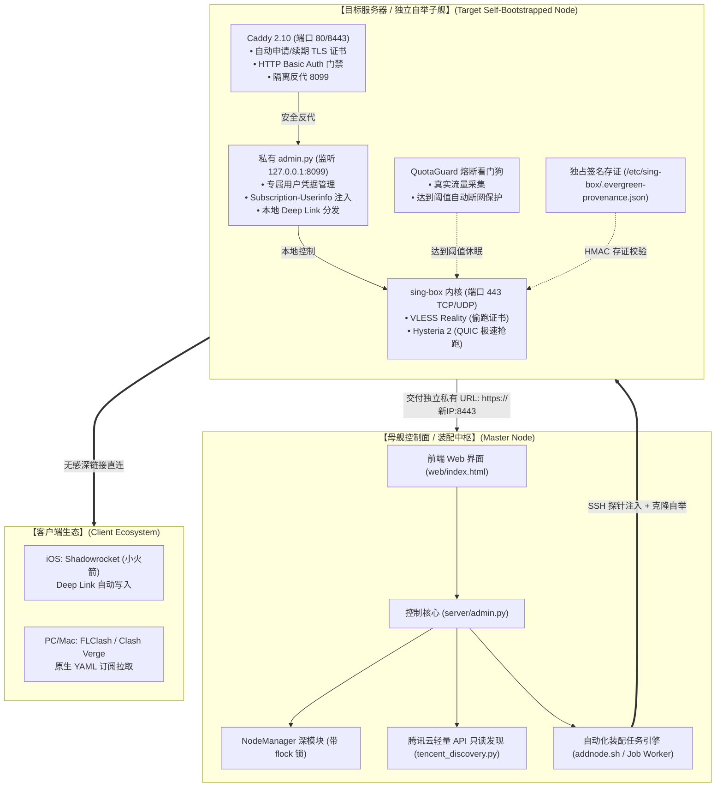
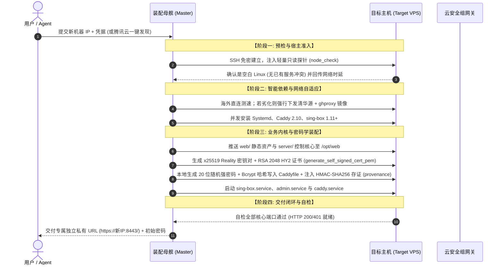

# 03 - 系统技术方案与去中心化自举架构 RFC (Architecture RFC)

> **版本**：v1.0.0 · 2026-11-09  
> **状态**：PROPOSED / 架构方案征求意见稿  
> **指导哲学**：家用电饭煲哲学（插电、放米、按煮饭；消灭工程师自嗨，开箱即用，按需唤醒）  
> **代码基准**：基于 CodeGraph 索引符号（`NodeManager`、`apply_config`、`provenance`、`Caddy 2.10`、`sing-box 1.11+`）

---

## 一、 系统全景拓扑架构 (System Topology)

系统彻底摒弃传统“中心化多租户共享代理”架构，采用 **“装配母舰控制面 + 去中心化私有子舰独立自举”** 拓扑：



---

## 二、 4 阶段全自动自举状态机 (The 4-Stage Bootstrapping Engine)

当用户或 Agent 在控制端触发一台新云服务器的装配时，后台异步作业（Job）严格执行 4 级状态流水线：



---

## 三、 L1 / L2 / L3 按需模块分级架构 (Modular Architecture)

为彻底消灭认知过载，系统底层将所有网络特性严格解耦为 3 层积木，**遵循“平时极度克制，需要时按需唤醒”原则**：

```
┌────────────────────────────────────────────────────────┐
│ L3 跨网落地层: 原生静态住宅 IP 挂载                    │
│   • 适用: 跨境电商 / 严风控 AI (Claude) / 海外银行     │
│   • 依赖: 第三方民用 ISP 住宅出口映射 (需外购 IP 资源)│
├────────────────────────────────────────────────────────┤
│ L2 专线拓扑层: 国内 BGP 入口跳板专线 (Relay)           │
│   • 适用: 晚高峰跨海骨干网丢包 / 跨国延迟拉直          │
│   • 依赖: 引入第 2 台国内机器作为中转节点              │
├────────────────────────────────────────────────────────┤
│ L1 基础自举层 (标配): 独立云主机单机自愈闭环           │
│   • 特性: Reality 伪装 + HY2 抢跑 + QuotaGuard 熔断    │
│   • 成本: 零额外费用 (单台轻量云内部纯内核切换)        │
└────────────────────────────────────────────────────────┘
```

1. **L1 级模块（单机基础态 · 标配）**：
   * **VLESS Reality**：作为默认主干入站，偷跑 Apple/Bing 证书，保证平时稳如磐石。
   * **Hysteria 2 极速引擎**：基于 UDP/QUIC 拥塞控制算法，晚高峰丢包场景下按需抢跑带宽。
   * **QuotaGuard**：内核看门狗。月流量达 90% 自动对 sing-box 执行原子级保护停机，杜绝云账单失控。
2. **L2 级模块（专线级联态 · 按需）**：
   * 基于 `RelayService`：将国内 BGP 跳板机与海外落地机进行配置级联，客户端入站连国内节点，内网直达海外出口。
3. **L3 级模块（纯净住宅态 · 按需）**：
   * 基于外部住宅 ISP 端口穿透协议，将落地出口流量无缝导向民用住宅 ASN，彻底消除 IDC 机房欺诈特征。

---

## 四、 核心安全与零信任边界设计 (Security & Zero-Trust)

1. **API 凭据内存即时消费（Ephemeral Secret Handling）**：
   * 无论是腾讯云 `SecretId / SecretKey`，还是主机 SSH 密码，**严禁持久化存储于 `nodes.json`、SQLite 数据库或打印到日志**。单次扫描/装机请求结束后，在 Python 内存中立即解除引用并触发垃圾回收。
2. **HMAC-SHA256 服务独占性存证（Provenance Signature）**：
   * 目标服务器包含 `/etc/sing-box/.evergreen-provenance.json`。
   * 主控中枢在下发任何重启、自愈重载或端口清理操作前，必须通过 `verify_provenance` 校验签名摘要；**非本系统专属签名的进程绝不擅自越权干涉**，杜绝误杀用户同机运行的其他业务。
3. **首登强制改密门禁（First-Login Gate）**：
   * 新服务器安装完成时，磁盘自动创建 `.initial-password-required` 标记。
   * Caddy 网关通过 `forward_auth` 将所有静态与 API 请求拦截重定向至 `/change-password`。用户完成 12 位以上强密码重构后，标记物理清除，完成安全交接。

---

## 五、 客户端一键唤醒与体验闭环 (Client UX Deep Link)

1. **移动端零参数输入（iOS Shadowrocket）**：
   * 采用深链接协议：`shadowrocket://add/sub://<Base64_Encoded_Sub_URL>`。
   * 用户在 Safari 点击后，直接跳起小火箭，静默写入全部节点。
2. **免开网页的配额透明感知**：
   * 订阅响应头强制注入：
     ```http
     Subscription-Userinfo: upload=0; download=17179869184; total=1073741824000; expire=1794700800
     ```
   * 用户无需登录管理后台，直接在小火箭或 Clash 订阅列表下拉刷新，即可秒级查阅当月已用流量与剩余天数。
