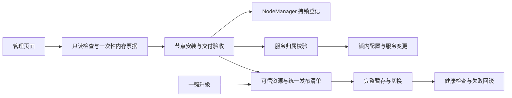

# 可信交付修复方案

[STATUS: IMPLEMENTED]

目标：用户检查的是实际安装的服务器；安装完成后得到真实可用的节点和独立后台；升级失败时保留完整可用的旧版；未确认归属的服务不被修改。

审查基线：`edfe98e56c4240bb426c103918ea01f5eefc7cce`，2026-11-17。覆盖审查报告的 10 项问题。

## 当前问题与具体路径

`网页检查 → 临时拼接安装参数 → admin._write_job 落盘秘密 → addnode.sh → admin 拼交付网址`。检查所得身份和私钥口令没有进入实际安装；完成判定和目标资产部署分离。

`HY2/WARP/ISP/中转 → remote_config.apply_config → 重启` 与 `用量采集 → quota_guard → 停启` 使用不同归属规则。

`首装复制清单 ≠ 升级复制清单`；升级逐项覆盖活动代码，只有到达健康检查才能回滚。

## 方案选择

| 选择 | 调用方责任 | 迁移成本 | 决定 |
| --- | --- | --- | --- |
| 分别补字段与条件 | 页面仍需懂认证、身份、交付地址 | 低，但容易再次分叉 | 不采用 |
| 通用 Intent/Prepared/Delivery 操作引擎 | 统一任意操作，类型和状态很多 | 高 | 当前规模不采用 |
| 面向常见调用的安装模块、服务归属模块、版本发布模块 | 提交目标和意图，读取可信结果 | 中，保留原路由适配 | 采用 |

## 不变量与兼容

- `/api/*` 与裸管理路径继续可用。旧参数入口保留适配，但必须重新取得可信检查结果，不能绕过归属或身份校验。
- 检查票据绑定地址、端口、用户、SSH host key、机器标识与内存凭据，短时一次性消费。进程重启后重新认证。
- SSH 密码、私钥和口令通过内存、匿名管道传递，不写持久文件、参数或日志。
- 缺失或无效 HMAC、目标或配置摘要不匹配时，禁止变更、停止和重启。旧节点不自动接管；保留连接能力并提示人工核实。
- 独立后台功能继续保留；只有真实部署、目标登录、TLS、订阅和代理验真全部通过才能交付网址与初始凭据。任何未验证资产不得宣称就绪。
- 新安装建立存证；订阅令牌轮换不改变服务控制密钥。配置与存证成对更新及回滚。
- NodeManager 是节点变更唯一入口，文件存储使用跨进程 flock；协议伴生关系不依赖可变显示名。
- 应用包仅使用可信官方 HTTPS 来源；缺少可信摘要时不启用第三方镜像。固定二进制使用内置校验值，镜像只传输字节。
- 首装与升级共享部署清单；完整暂存成功后切换，所有切换后错误统一回滚，数据目录独立保留。
- 订阅字符串使用一致编码；AI 域名规则由一个纯数据集合生成。

## Todo 与关闭证据

- [x] T1 服务归属：缺失、伪造、错主机、配置漂移均零变更；合法更新和成对回滚可用。
- [x] T2 凭据与身份：一次性票据、加密私钥端到端、安装前复核、进程中断无秘密文件。
- [x] T3 真实交付：独立后台部署与登录、TLS、订阅和代理验收；失败无交付。
- [x] T4 可信资源：篡改包拒绝，反向入网使用固定摘要。
- [x] T5 发布事务：真实首装布局可升级，复制失败不污染活动版，健康失败回滚。
- [x] T6 订阅：特殊字符和数字外观字符串可回读，AI 主域及子域路由一致。
- [x] T7 节点组：改名后删除、暂停和协议切换均覆盖伴生节点，跨进程无丢更新。
- [x] T8 文档：追加 ADR、更新接口契约和变更记录、README 状态同步。
- [x] T9 质量：构建、全量离线门禁、变更复核通过。
- [x] T10 交付：提交、推送、部署及健康验证；无法执行项记录明确原因，不标完成。

## 发布与剩余风险

先在离线适配器和临时文件系统证明失败路径，再执行全量门禁，最后检查部署目标与归属后发布。不能为了迁移而给未知旧服务自动补签。生产旧节点若无存证，需要独立的归属核实；此期间只阻止危险控制，不主动停止已有代理。Windows 在实际环境验收前不声称跨平台运行验证完成。

## 验证记录（2026-11-17）

- 全量离线门禁 757 项通过，前端构建产物同步、Shell 语法与 diff 检查通过。测试覆盖功能和失败路径，不代表实际新服务器安装或生产激活已通过。
- SSH 匿名内存方案在生产 Linux 中以新生成的无用途测试密钥验证 OpenSSH 加载能力：仅内存，无磁盘凭据，无实际登录认证；临时目录原子交换和交换还原验证通过；另在生产 Linux 的独立临时源码目录执行 19 项离线升级回归（含四处 SIGKILL 与恢复）全部通过，未操作现有服务。
- 独立后台自举、TLS/认证/订阅判断、加密私钥交接使用隔离适配器验证；没有可用空白主机，因此未执行真实新机端到端安装。实际 Windows 仍未运行验收。
- 生产只读检查确认 admin、Caddy、sing-box 均运行；归属存证和专用主控签名密钥缺失。不得自动补签或重启。T10 的生产激活需要先取得该现网服务独占归属的明确确认，并通过冻结摘要的迁移检查。
- `adopt_legacy.py --check-only` 可准备具体迁移证据；显式迁移只建立签名元数据，不重启或修改代理配置。确认后再原子激活候选版本和验证管理接口。
